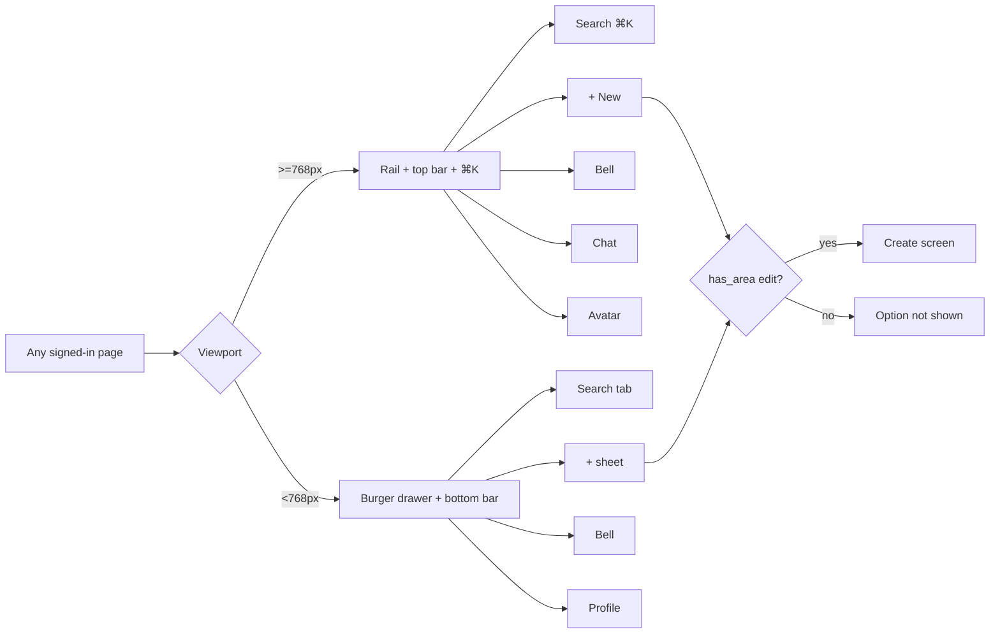
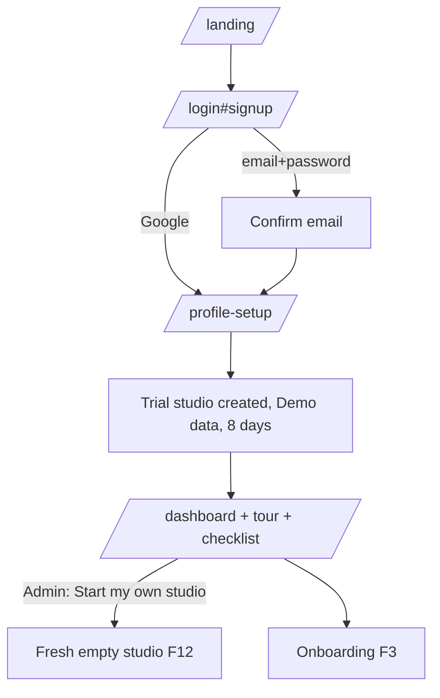
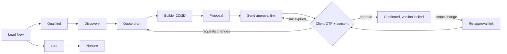
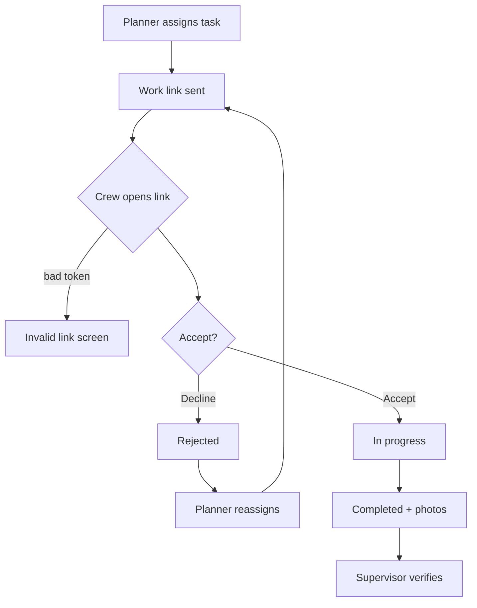
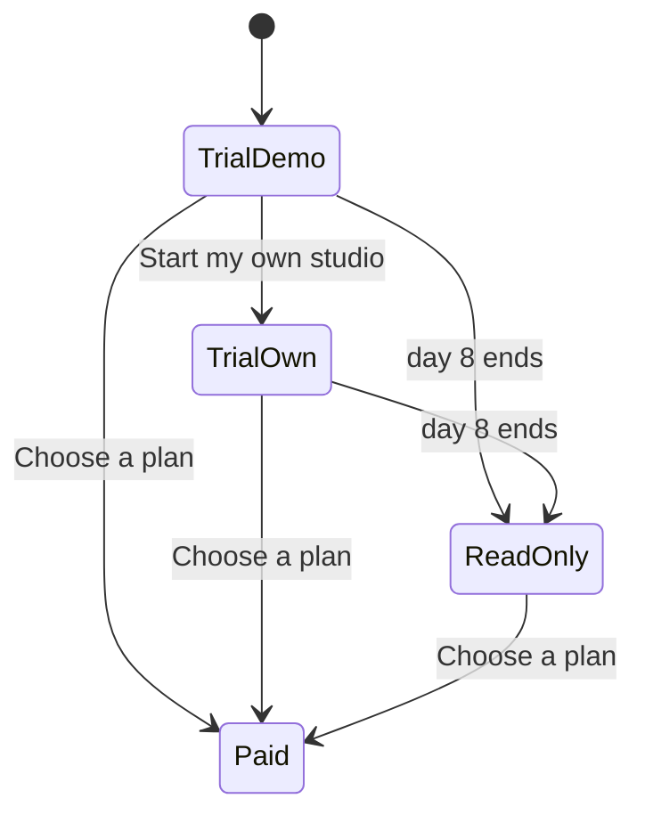

# Helm — Application Flow Document (APP-FLOW)

| | |
|---|---|
| Document | APP-FLOW.md (companion to PRD.md, TRD.md, USER-MANUAL.md) |
| Version | 1.0 — 16 Oct 2026 |
| Scope | Every route, entry point, navigation surface and user flow, for every role, on laptop and phone |
| Source of truth | `vercel.json` (rewrites/redirects), `server.js` (local mirror), `public/*.html`, `public/shell-b.js` (rail), `public/mobile-nav.js` (bottom bar), `public/store-api.js` (roles, areas, session), `public/trial*.js`, `supabase/migrations` 0001–0125 |
| Owner | [OWNER TO FILL] |

> Permissions shown here describe what the UI offers. **The server (RLS + `has_area()` + `can_create()`/`can_delete()` + SECURITY DEFINER RPCs) enforces everything**; a hidden button is a convenience, never the control.

---

## 1. Roles and how they map to this document

The request lists "owner/admin, manager, planner, finance, crew, viewer". Helm's actual role keys (`store-api.js ALL_ROLES`) are below. **There is no separate `finance` or `viewer` role**; those personas are produced with the access matrix (Control Center → Access matrix) on an existing role.

| Persona | Role key (label) | Default capabilities (`ROLE_CAPS`) | Notes |
|---|---|---|---|
| Owner / admin | `admin` (Admin) | view, create, edit, delete, manage | Only role for Control Center, billing/plan, photo renders by default, Start-fresh, lifecycle overrides |
| Manager | `manager` (Event manager) | view, create*, edit, manage | *`can_create()` server-side is {admin, planner, sales}: create buttons are hidden for manager (Wave 16). Product decision open |
| Planner | `planner` | view, create, edit, delete | Main quoting/builder user |
| Sales | `sales` | view, create, edit | Leads, CRM, Nurture, quotes |
| Coordinator / Supervisor / Quality / Operations | `coordinator`, `supervisor`, `quality`, `operations` | view, edit (per area) | Ops, inventory, vendors, command, issues |
| Designer | `designer` | view, create, edit | Builder/layouts (Design studio page hidden since 2026-10-11) |
| "Finance" persona | any role + matrix areas `finance`, `settlement`, `closure` = edit | — | Recommend: `manager` or `operations` with finance areas on, pipeline off |
| "Viewer" persona | `crew` or `worker` signed in, or any role with all areas = view | view | Read-only workspace |
| Crew (link) | none (no account) | token-scoped | `/<studio>/work/<token>` |
| Client (link) | none (`client` role exists but is excluded from the shell) | token/OTP-scoped | proposal, approve, portal, booklet, invite |
| Public visitor | none | public pages | landing, `/try`, `/demo`, legal |
| Helm HQ operator | platform (`hq.html`, MFA) | platform only | Never sees studio private data |

Access areas (26+, `store-api.js AREAS`): leads, crm, nurture, discovery, proposal, quotes, layouts, design, photo_render, staff, inventory, vendors, calendar, templates, venues, resources, runsheet, plan, logistics, ready, finance, settlement, closure, command, issues, media, controls, codes, users. Each is `none | view | edit` per role.

---

## 2. Route inventory

### 2.1 Public / marketing (no sign-in)
| Route | File | Purpose |
|---|---|---|
| `/` | index.html | Landing page, menus, Start free trial, Try the planner, Live demo |
| `/pricing`, `/about`, `/services`, `/resources` | pricing/about/services/resources.html | Marketing |
| `/try` | try.html | Browser-only builder sandbox (localStorage, nothing saved server-side) |
| `/demo` | demo.html | Read-only fictional studio ("Marigold Events"), no network writes |
| `/signup` | redirect → `/login#signup` | Sign-up tab |
| `/login`, `/reset-password` | login.html, reset-password.html | Sign in (email+password, Google), sign up, forgot/reset password |
| `/manual` (also `/docs/USER-MANUAL`) | manual.html | User manual |
| `/privacy`, `/terms`, `/cookie-policy`, `/refund-policy`, `/acceptable-use`, `/dpa`, `/data-deletion` | *.html | Legal |
| `/404` | 404.html | Not found (also target of blocked paths: `sim-pay` on prod, `config.staging.js`, `*.md/.map/.sql/.bak/.log/.env`, `.DS_Store`, `_headers`) |

### 2.2 Link-based pages (token / OTP, no account)
| Pretty URL | Rewrites to | Who |
|---|---|---|
| `/<studio>/proposal/<ref>` | proposal-view | Client: read proposal, plan, 3D images |
| `/<studio>/quote/<ref>` | approve | Client: OTP approval + consent |
| `/<studio>/portal/<ref>` | portal | Client portal: status, payments due |
| `/<studio>/booklet/<ref>` | booklet | Client booklet: scope, change lines, payments |
| `/<studio>/invite/<ref>`, `/i/<slug>` | invite | Guests: invitation site, RSVP |
| `/<studio>/work/<token>` (legacy `work?token=`) | work | Crew/vendor: own tasks, accept/decline, evidence photos |
| `/sim-pay` | sim-pay.html | Staging-only payment simulator (404 on prod) |

### 2.3 Signed-in studio workspace
Pretty URLs (vercel rewrites): `/<studio>/dashboard`, `/<studio>/quotes`, `/<studio>/leads`, `/<studio>/chat`, `/<studio>/settings` (→ control), `/<studio>/events/<id>` (→ event), `/<studio>/events/<id>/floor-plan` (→ builder), `/<studio>/events/<id>/tasks` (→ ops), `/<studio>/clients/<id>` (→ client), `/<studio>/booklet/<id>`. Every other page is served at its clean name (`/inventory`, `/vendors`, …); `*.html` forms 301 to clean names.

| Group | Route(s) | Area (matrix) |
|---|---|---|
| Setup | `/profile-setup`, `/onboarding` | — / controls |
| Home | `/dashboard` | always |
| Pipeline | `/leads`, `/crm`, `/nurture`, `/discovery` | leads, crm, nurture, discovery |
| Quote/event | `/quotes`, `/flow?quote=`, `/event?quote=`, `/builder`, `/proposal`, `/design` (hidden), `/plan`, `/budget` | quotes, layouts, proposal, plan, finance |
| Operations | `/ops`, `/staff`, `/inventory`, `/checkout`, `/vendors`, `/calendar`, `/templates`, `/logistics`, `/runsheet`, `/ready`, `/capture` | staff, inventory, vendors, calendar, templates, logistics, runsheet, ready |
| Event day | `/command`, `/issues`, `/media`, `/teardown` | command, issues, media |
| Money | `/settlement`, `/closure`, `/business`, `/reports`, `/insights` | settlement, closure, finance |
| Client | `/client?id=`, `/invite-studio` | crm/quotes |
| Admin | `/control` (Control Center), `/audit` | controls, users, codes |
| Collaboration | `/chat` | signed-in |
| Platform | `/hq` | Helm HQ only (MFA) |
| Other | `/ready`, `/issues` (studio-wide) | ready, issues |

---

## 3. Navigation model

### 3.1 Laptop (≥ 768 px)
- **Left rail** (`shell-b.js`, `#hbRail`): slim icons, hover-expand, pin to keep labels. Groups: Pinned favourites → Workspace (Home always; others only if `canView(area)`) → Manage → Admin (Control Center, Users & access, Business if finance). Footer: Recently viewed, guided tour, colour theme (light/dark + swatches), help.
- **Top bar**: global search **⌘K / Ctrl K** (`shell-b-search.js`: quotes, leads, clients, pages), **+ New** split button (New quote, lead, checklist template, inventory item, vendor, staff member — each filtered by `edit` on its area), chat icon with unread count, notification bell (deep links, mutes), privacy eye (masks money), avatar menu (profile, studio, sign out).
- **Breadcrumb trail** (`nav-trail.js`) and the **lifecycle bar** on event pages.
- Trial banner under the top bar (see §6.2).

### 3.2 Phone (< 768 px)
- Rail is replaced by a **burger** drawer (same groups) plus a top-bar search icon and chat icon.
- **Bottom bar** (`mobile-nav.js`): Home · Search · **Add (+)** sheet (New lead, New quote/event, Add staff, Add stock item, Add vendor — role-filtered) · Bell · Profile. Hidden on public/link pages, login, profile-setup, hq and for role `client`. **Auto-hides when the on-screen keyboard is open** (visual viewport shrinks >150 px).
- Quick tabs strip on some pages: Home, Quotes, Leads, Chat, More.
- Tables collapse to cards; builder uses touch gestures (pinch zoom, two-finger pan, long-press select); camera capture on Work, Capture and Issues (`capture="environment"`).

---

## 4. Entry points

| Entry | Lands on | Condition |
|---|---|---|
| Typed URL / marketing link | `/` | — |
| "Start free trial" | `/login#signup` | — |
| "Try the planner" | `/try` | — |
| "Live demo" | `/demo` | — |
| Confirmation email link | `/profile-setup` → `/dashboard` | new user |
| Team invite email | `/login` (set password) → `/dashboard` | invited member |
| Password reset email | `/reset-password` | — |
| Notification bell / email deep link | target page (e.g. `/event?quote=…`) | signed in; else `/login?next=…` |
| Protected URL while signed out | `/login?next=<page>` | — |
| Client WhatsApp/email link | proposal / quote / portal / booklet / invite | valid token |
| Crew SMS/WhatsApp link | `/<studio>/work/<token>` | valid token |
| PWA/home-screen shortcut | `/dashboard` | [OWNER TO FILL: confirm manifest] |

---

## 5. Flow catalogue

Each flow: numbered steps, permission per step, mobile difference, then a diagram.

### F1. Public visitor: explore without an account
1. Open `/`. 2. Choose **Try the planner** → `/try` (2D/3D/Measure on a sample banquet; nothing saved; refresh may reset). 3. Or **Live demo** → `/demo` (read-only fictional studio; writes disabled). 4. CTA **Start free trial** → F2.
- Mobile: same pages; builder in `/try` uses touch; 3D orbit by drag.

### F2. Sign-up and trial (demo data vs own data)
1. `/login#signup`: studio name (optional), name, email, password (≥12 chars, upper, lower, digit, symbol) — or **Continue with Google**. 2. Confirm email (link). 3. `/profile-setup`: name, phone, avatar. 4. Trial studio is created (`trial_mode = demo`) and pre-seeded with records labelled *Demo*; 8-day trial starts (`organizations.trial_ends_at`). 5. Dashboard opens with guided tour + getting-started checklist. 6. Admin can at any time choose **Start my own studio →** (F12) to get an empty studio.
- Permissions: the signer becomes `admin` of the new org.
- Errors: weak password inline; email already registered → "Sign in instead"; unconfirmed email → resend link; Google cancelled → stays on login.

### F3. Studio setup / onboarding (admin)
1. `/onboarding` or Control Center → Studio. 2. Country → sets currency, tax lines (India GST CGST/SGST/IGST, UAE VAT 5 %, UK VAT, US sales tax [OWNER TO FILL: confirm US default], others), date format, metric/imperial. 3. Logo, colours, studio slug (used in `/<studio>/…` URLs). 4. Price list: manual or smart Excel import. 5. Menu packages (6 standard). 6. Venues (dimensions feed the builder). 7. Templates (checklists, layouts). 8. Team: invite users by email, assign role. 9. Access matrix: adjust area view/edit per role. 10. Codes/coupons and link windows (OTP/link expiry).
- Permission: `controls` edit (admin). Users/roles: `users` edit.
- Mobile: wizard is single-column; matrix editor scrolls horizontally inside its card (page itself never scrolls sideways).

### F4. Lead → quote → approval → confirmed (core sales flow)
| # | Step | Screen | Permission |
|---|---|---|---|
| 1 | Create lead (+ New / bottom +) | `/leads` | leads edit |
| 2 | Qualify, set stage/follow-up/source | `/leads` | leads edit |
| 3 | **Convert to quote** (creates quote = event; date-based code) | `/flow?quote=` | quotes edit + `can_create` (admin/planner/sales) |
| 4 | Discovery notes, requirements | `/discovery`, event tab | discovery edit |
| 5 | Choose package / price-list items, discounts, coupons; tax computed after discount on server | `/flow` | quotes edit; codes for coupons |
| 6 | Floor plan (F5); placed items price live | `/builder` | layouts edit |
| 7 | Proposal: mood board, palette, scope | `/proposal` | proposal edit |
| 8 | **Send approval link** (WhatsApp/email/copy) | event | quotes edit |
| 9 | Client opens `/<studio>/quote/<ref>`, enters OTP, ticks consent, approves | approve | token + OTP |
| 10 | Quote **Confirmed**; version locked; advance milestone created | event | server |
| 11 | Scope changed after confirmation → **re-approval** link | event | quotes edit |
- Duplicate-email lead from a quote: currently may overwrite (parked "option A" fix) — see Gaps.

### F5. Builder 2D / 3D / Measure
1. Open from event (`/<studio>/events/<id>/floor-plan`) or quote. 2. Pick venue (dimensions) or enter W×L. 3. Optional layout wizard / studio template. 4. Search catalogue (stages, seating, tables, décor, arches, lighting, buffets, lounges, dance floors); drag to place; snap/align. 5. **Measure** mode: distances to walls/neighbours in m or ft. 6. **3D** toggle: orbit/walk. 7. Full screen. 8. Save layout version (autosave + explicit). 9. Prices flow into the quote (server recomputes). 10. **✦ Render** photo: owner-controlled, costs credits (`photo_render` edit).
- Permission: view-only roles see the plan without edit handles.
- Mobile: tool palette as bottom sheet; pinch zoom; long-press to select; 3D supported but heavy on low-end phones; full screen recommended.
- Errors: unsaved changes guard on leave; WebGL unavailable → 2D only message.

### F6. Operations (confirmed → planning → resources → ready)
1. Event workspace lifecycle bar: Lead → Discovery → Proposal → Quote → Confirmed → Planning → Resources → Ready → Event Day → Settlement → Closed (stage derived from records; admin override). 2. Venue & menu lock (`/plan`). 3. Resource plan: in-house first, gaps → vendor bookings (`/vendors`). 4. Inventory reservations (atomic) → checkout/return (`/checkout`), shortage warnings, calendar conflicts (`/calendar`). 5. Tasks on `/ops` (dependencies, alarms) assigned to staff/crew (F7). 6. Logistics: guests, checklists, permits, comms, payments (`/logistics`). 7. Run sheet (`/runsheet`). 8. Readiness gate (`/ready`) → Event Day.
- Permission: each step uses its area (plan, resources, inventory, vendors, logistics, runsheet, ready).
- Known gap: inventory availability ignores checkouts (audit P1, open).

### F7. Crew: accept / decline / reassign
1. Planner assigns tasks (`assign_tasks`) to a crew member (name + phone) or outsources to a vendor. 2. System produces `/<studio>/work/<token>` link (shared via WhatsApp/SMS). 3. Crew opens on phone: sees only their tasks + equipment. 4. **Accept** or **Decline** (with reason). 5. Mark in progress → completed with photo evidence (camera). 6. Supervisor verifies on `/ops`. 7. Declined/no response → planner **Reassign** (`reassign_task`) → new link to new person; old token loses those tasks.
- Status values: Assigned, Accepted, In progress, Completed, Rejected.
- Errors: invalid/expired token → "This link is not valid" screen; offline → photo upload retried (session cache 12 h, token hashed).

### F8. Event day
1. `/command`: arrivals, setup checks, guest reception counts, live stock requests. 2. Issues & incidents (`/issues`, photo). 3. Media & gallery (`/media`). 4. Teardown & returns (`/teardown`) → inventory returned/short.
- Mobile-first: these screens are designed for phone use on site.

### F9. Payments
1. Milestones created at confirmation (advance, balance, custom). 2. Record payment (cash/bank/UPI/card) against ledger; **overpayment guard** on server. 3. Client sees due amounts on portal/booklet. 4. Online payment links (Razorpay Payment Links): **built but dormant, fail-closed** until deploy + secrets + flag; staging uses `/sim-pay`. 5. Refunds & recoveries in settlement. 6. Dashboard "Due today" strip lists milestones due today.
- Permission: `finance` / `settlement` edit. Privacy eye masks figures.
- Known gaps: settlement "Received" reads milestones not ledger; paid-milestone undo (open).

### F10. Vendor bills and payouts (0124, staging)
1. Event → Settlement → Vendor bills: add bill (vendor, amount, tax, due date, attachment). 2. Record payouts (partial allowed). 3. Void with reason (never hard-delete). 4. Event P&L updates; Business page shows vendor payables across events.
- Permission: `settlement` edit; Business requires `finance`.

### F11. Settlement → closure
1. Record client balance. 2. Vendor bills/payouts (F10). 3. Staff expense claims. 4. Refunds/recoveries. 5. Event P&L. 6. Feedback/testimonial. 7. **Mark event closed & archived** (`/closure`). 8. Nurture reminder created for anniversary.
- Permission: `closure` edit. Known gap: `close_event` has no server balance gate (audit P1).

### F12. Trial reminders, expiry, read-only, start fresh
1. Banner: "Free trial · N days left" (+ "Choose a plan" for admins). 2. Day 5 / 7 / 8 reminder card (3 days left / ends tomorrow / ends today), once per day, studio time zone (0120). 3. Trial ends → banner "Trial ended — read-only. Your data is safe."; every write is refused by the server (errcode 25006, hint `trial_ended`) and the UI shows a toast. 4. Admin chooses a plan → write access restored [OWNER TO FILL: billing checkout flow — payments dormant]. 5. **Start my own studio** (admin, `trial_mode = demo`, 0123): confirms, creates a fresh studio for the user, demo records are left untouched (zero data loss), user lands on empty dashboard.

### F13. Client journey (no account)
1. Receives proposal link → `proposal-view` (plan, 3D images, scope, price). 2. Approve link → OTP sent → enter code → consent → approved (F4 step 9). 3. Portal/booklet: status, change lines, payments due, (future) pay online. 4. Invitation site `/i/<slug>` designed by studio in `/invite-studio` (5 templates) → guests RSVP.
- Errors: wrong OTP (rate-limited), link expired (link windows), already approved → read-only summary.
- Mobile: all client pages are phone-first.

### F14. Settings, users and roles
Control Center (`/<studio>/settings`): Studio profile, branding, tax/currency/units, venues, price list, packages, codes & coupons, link windows, comms templates, Users (invite, change role, deactivate), Access matrix (area × role view/edit), data export, audit log (`/audit`). Admin only by default.

### F15. Team chat and notifications
`/chat`: channels/DMs, attachments, mentions; unread badge on rail/top bar. Bell: deep links into events/tasks, mute per type.

### F16. Sign-out and session expiry
1. Avatar → **Sign out** → `/login`. 2. Session expires (401/PGRST301/JWT expired or unexpected SIGNED_OUT): if unsaved changes, sticky toast "Your session expired — sign in again. Copy any unsaved changes first." with **Sign in**; else redirect to `/login?next=<page>&expired=1`. 3. After sign-in, user returns to `next`. 4. Repeated wrong passwords → lockout; security alert email.

### F17. Errors, empty and offline states
| State | Behaviour |
|---|---|
| Empty lists | Illustrated empty state + primary create action (if permitted) |
| No permission for a page | Rail hides it; direct URL shows "You don't have access" and RLS returns nothing |
| 404 / bad pretty URL | `/404` with link home |
| Invalid/expired link (client/crew) | Dedicated "link not valid / expired" panel, contact studio |
| Network offline | Toast; writes fail closed (no silent local saves in Supabase mode); `/try` works fully offline |
| Server validation (overpayment, trial ended, not authorized) | Error toast with plain-English reason, form keeps input |
| Unsaved changes | Browser leave-guard on builder and forms |
| Feature dormant (payments, WhatsApp) | Button hidden or "not enabled" message |

---

## 6. Permission matrix per flow (default)

| Flow | admin | manager | planner | sales | coord/sup/qual/ops | designer | crew/worker | client link | public |
|---|---|---|---|---|---|---|---|---|---|
| Onboarding/Control Center | E | – | – | – | – | – | – | – | – |
| Leads/CRM/Nurture | E | E | E | E | V | V | – | – | – |
| Create/delete quote | C/D | – (open decision) | C/D | C | – | C | – | – | – |
| Builder | E | E | E | E | V | E | V | view in proposal | /try |
| Ops/inventory/vendors | E | E | E | V | E | V | V | – | – |
| Payments/settlement/closure | E | E | per matrix | – | per matrix | – | – | view dues | – |
| Photo render | E | – | – | – | – | – | – | – | – |
| Start fresh / plan choice | E | – | – | – | – | – | – | – | – |
E = edit, V = view, C = create, D = delete, – = hidden. Actual values come from `role_access`; this is the shipped default [OWNER TO FILL: verify against current Control Center matrix].

---

## 7. Mobile differences summary
1. Bottom bar + burger replace the rail; ⌘K becomes Search tab. 2. Bottom bar hides with the keyboard. 3. Tables → cards; long forms single-column. 4. Builder: bottom-sheet tools, pinch/pan, 3D optional. 5. Camera capture on Work, Capture, Issues, Command. 6. Link pages (client/crew) have no app chrome. 7. Hover-only affordances (rail expand, tooltips) have tap equivalents. 8. 16 px side gutter, no horizontal page scroll.

---

## 8. Gaps and open items
- No dedicated `finance` / `viewer` roles (use matrix). Decide whether to add.
- Manager cannot create/delete quotes server-side (product decision).
- Open P1s: settlement Received reads milestones not ledger; `close_event` no balance gate; inventory availability ignores checkouts.
- Payments online and WhatsApp sending dormant; plan purchase flow after trial undefined.
- Lead same-email overwrite (parked), paid-milestone undo, clear-package.
- Migrations 0116–0125 (trial, start fresh, vendor bills, lead audit) on staging only until owner runs on prod.
- Design studio page hidden; PWA/offline caching not confirmed.

## References
- Nielsen Norman Group, "User Journeys vs. User Flows" — https://www.nngroup.com/articles/user-journeys-vs-user-flows/
- Mermaid flowchart and state diagram syntax — https://mermaid.js.org/syntax/flowchart.html
- Material Design 3, Navigation bar (mobile bottom nav) — https://m3.material.io/components/navigation-bar
- Apple Human Interface Guidelines, Tab bars — https://developer.apple.com/design/human-interface-guidelines/tab-bars
- W3C WCAG 2.2 (target size, focus, reflow) — https://www.w3.org/TR/WCAG22/
- Supabase Row Level Security — https://supabase.com/docs/guides/database/postgres/row-level-security
- Internal: docs/product/PRD.md, TRD.md, USER-MANUAL.md; vercel.json; public/shell-b.js, mobile-nav.js, store-api.js, trial.js, trial-demo.js, work.html; supabase/migrations 0116–0125.
