# Helm — Backend Schema Reference

| Field | Value |
|---|---|
| Document | Backend Schema (data model, security model, server surface) |
| Product | Helm — multi-tenant event-management SaaS for event studios |
| Version | 1.0 (generated 2026-10-16 from the repository, not from a live database) |
| Source of truth | `supabase/HELM-STAGING-SCHEMA.sql` (prod-faithful base, 59 tables) + `supabase/migrations/0001…0125` applied in `supabase/migrations/MANIFEST` order |
| Stack | Supabase Postgres 17 (RLS), PostgREST RPC, Supabase Auth, Supabase Storage, Deno Edge Functions, `pg_cron` (optional); vanilla HTML/JS front end on Vercel |
| Owner | [OWNER TO FILL] |
| Related | `docs/product/PRD.md`, `docs/product/TRD.md`, `docs/product/UI-UX-BRIEF.md` |

> **How this document was built.** Every table, column, constraint, policy, trigger and function below was extracted statically from the SQL files in the repository (base schema + 124 forward migrations). It reflects the *intended* end state after all migrations through **0125** are applied. Per the SQL tracker, migrations **0116 and 0118–0124 are applied on STAGING only, 0125 is prepared but not yet run anywhere, and 0117 is held (do not run)** at the time of writing; production may lag. Where a fact can only be confirmed against a live database it is marked **[OWNER TO VERIFY]**. No SQL was executed to produce this document.

---

## 1. Summary

| Metric | Count |
|---|---|
| Tables (public schema) | **136** (59 in base, 77 added by migrations) |
| Views | 1 (`inventory_availability`) |
| Functions defined (latest definition wins) | 619 total; **442 SECURITY DEFINER RPC/helpers**, 94 trigger functions |
| Triggers | ~195 (incl. `on_auth_user_created` on `auth.users`) |
| Storage buckets | 8 (all private) |
| Edge Functions | 16 (+ `_shared` helpers) |
| `pg_cron` jobs | 4 |
| Migrations | 0001 → 0125 (0087 and 0103 unused) — 123 files |

### 1.1 Core modelling decisions

1. **Multi-tenancy by `org_id`.** Every studio-owned row carries `org_id uuid → organizations(id)`. A signed-in user belongs to exactly one studio via `profiles.org_id`. `current_org_id()` (SECURITY DEFINER, `select org_id from profiles where id = auth.uid()`) is the anchor of every policy. Child rows created from a quote inherit `org_id` from the quote via the `tg_org_from_quote` BEFORE INSERT trigger, so a client can never plant a row into another tenant (0004 tenant integrity).
2. **The quote row *is* the event.** There is no separate `events` table. `quotes` holds the client, the priced proposal (`pricing jsonb`), `status`, `approval_status`, `lifecycle_stage`, `confirmed_at`, `currency`, `tax_snapshot`, codes, and slug. Every event-phase table (`event_plan`, `event_tasks`, `run_sheet_items`, `event_closure`, …) hangs off `quote_id`.
3. **No separate clients table.** A client is the person on a lead (`leads.name/phone/email`) and on the quote (`quotes.client`); `client_timeline()` stitches them (0062).
4. **Role-based access matrix.** `profiles.role` is one of `admin, manager, planner, sales, coordinator, supervisor, quality, operations, designer, crew, worker, client`. `role_access(org_id, role, area, can_view, can_edit)` is the single authority (owner decision D2, 0044). `has_area(area, 'view'|'edit')` returns true for `admin`, otherwise reads the matrix for the caller's role in the caller's studio.
5. **Money is server-authoritative.** Totals are recomputed server-side (`enforce_pricing_total` trigger, 0001/0099 D8 pricing authority); payments go through advisory-locked RPCs with an overpayment cap that includes approved change orders (0003, 0110); approved money records are frozen (0046 D6). Ledger = `quote_payments` (paid rows); milestones are a schedule, not the ledger (0070, 0111).
6. **Forward-only, additive, idempotent migrations.** Every migration is `CREATE … IF NOT EXISTS` / `CREATE OR REPLACE` / guarded `DO` blocks; no destructive data changes. Records such as equipment check-outs and vendor bills are **cancelled, never hard-deleted** (0073, 0124).
7. **Outbox pattern for side effects.** E-mail / WhatsApp / SMS are queued in outbox tables (`comms_outbox`, `pkg_outbox`, `welcome_email_outbox`, `security_alert_outbox`, `billing_reminders`, `trial_reminders`) and delivered by Edge Functions; integrations are **dormant / fail-closed** until secrets and flags are set.

### 1.2 Tenancy and request path

```mermaid
flowchart LR
  B[Browser - vanilla JS<br/>store-api.js] -- JWT --> PR[PostgREST]
  B -- JWT / public token --> EF[Edge Functions]
  PR --> RLS{RLS policies<br/>org_id = current_org_id()<br/>AND has_area()}
  PR --> RPC[SECURITY DEFINER RPCs<br/>self-check is_admin / has_area / token]
  RLS --> T[(public tables)]
  RPC --> T
  EF -- service_role --> T
  EF --> X[Razorpay / Meta WhatsApp / MSG91 / Resend / OpenAI]
  CRON[pg_cron] --> RPC
  ANON[Signed-out client / crew link] -- anon + uuid token --> RPC
```

---

## 2. Security model

### 2.1 Roles at the database layer

| Postgres role | Who | What it can reach |
|---|---|---|
| `anon` | Signed-out visitors: client approval link, portal, booklet, invitation site, crew work link | **No table access through RLS** (all policies are `to authenticated`, except legacy `event_sites` baseline). EXECUTE only on the whitelisted token RPCs (`public_*`, `worker_*`, `request_otp`, `verify_and_consent`, `create_payment`, storage guard helpers) — 0005 and later re-grants. Each validates an unguessable uuid token, link window (0022/0039) and revocation. |
| `authenticated` | Signed-in studio members (and HQ operators) | Tables via RLS (`org_id = current_org_id()` + `has_area`), RPCs that self-check authority. A restrictive `helm_pwgate_*` policy blocks writes while a temporary password must be changed (0032). MFA enforced for privileged roles via `mfa_ok()` (0043; optional for HQ, 0047). |
| `service_role` | Edge Functions, cron, owner | Bypasses RLS. Used for outbox delivery, webhooks, upload verification, renders. Never exposed to the browser. |

### 2.2 Policy patterns

| Pattern | Predicate | Tables |
|---|---|---|
| **Area matrix (`ra view/ins/upd/del`)** | read: `has_area(area,'view') AND org_id = current_org_id()`; write: `has_area(area,'edit') AND …` | 41 base operational tables (see §6, each table states its area) |
| **Config (`cfg read/write`)** | read: same studio; write: `has_area('controls','edit')` | `app_config, chair_types, coupons, dish_catalog, layout_rules, menu_templates, plate_types` |
| **Self-row** | `user_id = auth.uid()` | `notification_seen, notification_mutes, user_dashboard_prefs, saved_views (own), user_recent_records, chat_prefs` |
| **Default deny (RLS on, no client policy)** | none — access only through SECURITY DEFINER RPCs or service role | outboxes, OTP/token tables, auth-limit tables, HQ billing tables, `member_profiles`, `studio_account`, `vendor_*` writes, etc. |
| **Restrictive password gate** | `NOT helm_pw_change_pending()` on INSERT/UPDATE/DELETE | every RLS table (0032) |
| **Storage restrictive guards** | `storage_object_name_ok(bucket, name)` (path must start with caller's org / event), quota and MIME checks | `storage.objects` (0013, 0048, 0051) |

### 2.3 Access areas (matrix keys)

`leads, crm, nurture, quotes, discovery, proposal, plan, runsheet, staff, vendors, inventory, command, issues, media, finance, settlement, closure, templates, controls, users` (plus newer keys used by RPCs, e.g. design, insights, reports) — see `role_access` and `docs/product/USER-MANUAL.md` for the default matrix per role. [OWNER TO VERIFY final key list against `role_access` on prod.]

---

## 3. Entity-relationship diagrams by domain

Notes: every tenant table also has `org_id → ORGANIZATIONS` (omitted outside the tenancy diagram to keep the diagrams readable); `created_by / updated_by → auth.users` edges are likewise omitted. Edges are foreign keys found in the SQL; some logical links (e.g. `leads.quote_id`) are enforced by RPCs or triggers rather than FKs. Isolated boxes are tables without declared FKs inside their domain.

### Tenancy, identity and access

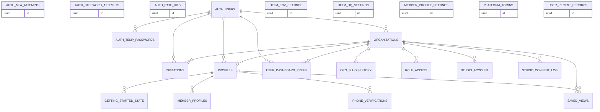

### Studio configuration and catalogs

```mermaid
erDiagram
  APP_CONFIG { uuid id }
  CHAIR_TYPES { uuid id }
  COMMS_SETTINGS { uuid id }
  COUPONS { uuid id }
  CUSTOM_FIELD_DEFS { uuid id }
  IMPORT_MAPPINGS { uuid id }
  ITEM_RATE_CARDS { uuid id }
  LAYOUT_RULES { uuid id }
  PKG_SETTINGS { uuid id }
  PLATE_TYPES { uuid id }
  TASK_TEMPLATES { uuid id }
  TAX_RULES { uuid id }
  VENUES { uuid id }
```

### CRM, leads and nurture

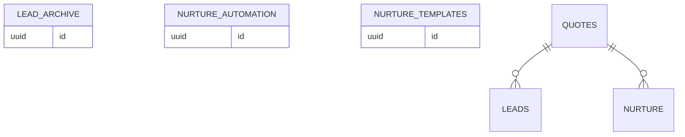

### Quotes and events (the quote row is the event)

```mermaid
erDiagram
  DISH_CATALOG ||--o{ EVENT_MENU_ITEMS : ""
  EVENT_CLOSE_OVERRIDES { uuid id }
  LIFECYCLE_STAGE_OVERRIDES { uuid id }
  QUOTES ||--o{ CHANGE_REQUESTS : ""
  QUOTES ||--o{ EVENT_ATTENDEES : ""
  QUOTES ||--o{ EVENT_CHECKLIST : ""
  QUOTES ||--o{ EVENT_CLOSURE : ""
  QUOTES ||--o{ EVENT_DAY : ""
  QUOTES ||--o{ EVENT_DISCOVERY : ""
  QUOTES ||--o{ EVENT_FILES : ""
  QUOTES ||--o{ EVENT_GUESTS : ""
  QUOTES ||--o{ EVENT_ISSUES : ""
  QUOTES ||--o{ EVENT_MEDIA : ""
  QUOTES ||--o{ EVENT_MENU_ITEMS : ""
  QUOTES ||--o{ EVENT_PLAN : ""
  QUOTES ||--o{ EVENT_PROPOSAL : ""
  QUOTES ||--o{ EVENT_RATINGS : ""
  QUOTES ||--o{ EVENT_REQUIREMENTS : ""
  QUOTES ||--o{ PROPOSAL_RISKS : ""
  QUOTES ||--o{ QUOTATION_VERSIONS : ""
  QUOTES ||--o{ QUOTE_VERSIONS : ""
  QUOTES ||--o{ RUN_SHEET_ITEMS : ""
```

### Builder, layouts and design

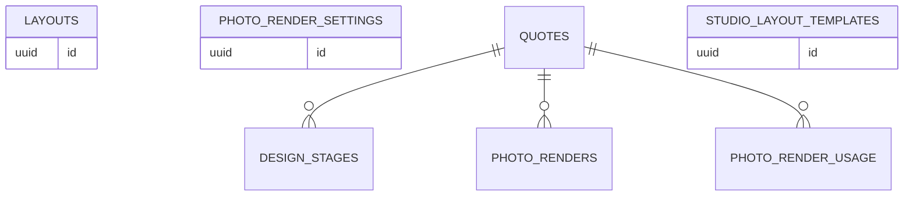

### Operations, crew and tasks

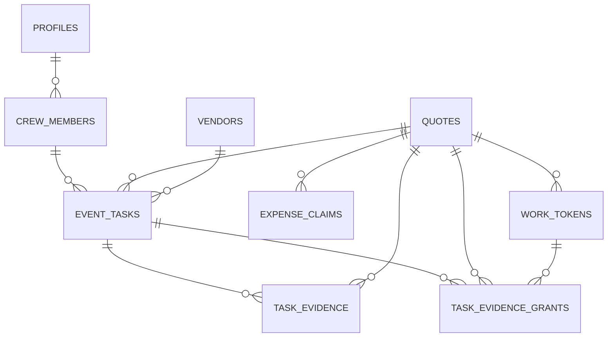

### Inventory and resources

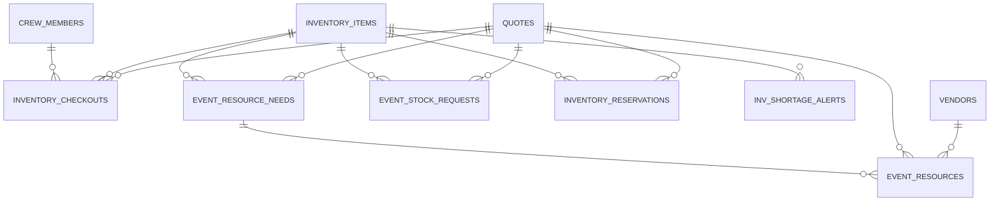

### Vendors and bills

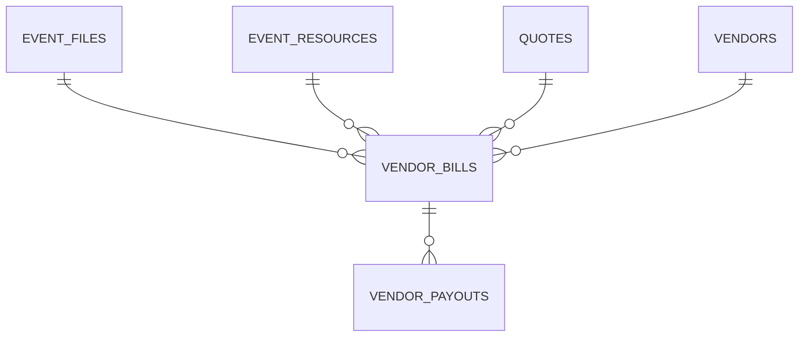

### Money, payments and settlement

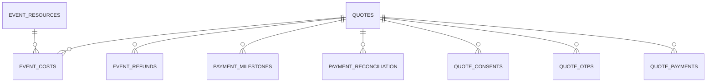

### Client portal, booklet and public links

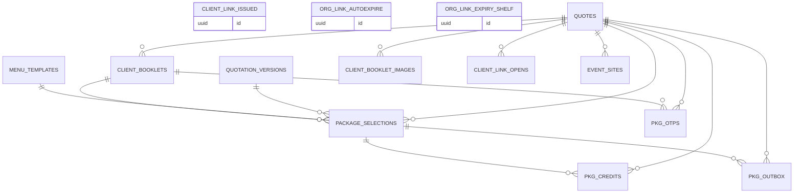

### Chat and notifications

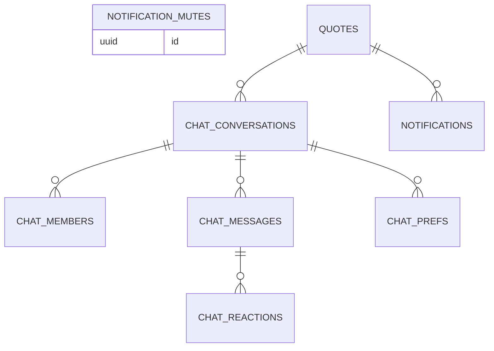

### Messaging, integrations and outboxes

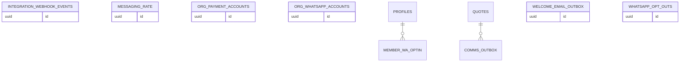

### Audit, security and uploads

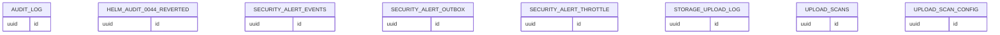

### Trial, subscription and billing (Helm HQ)

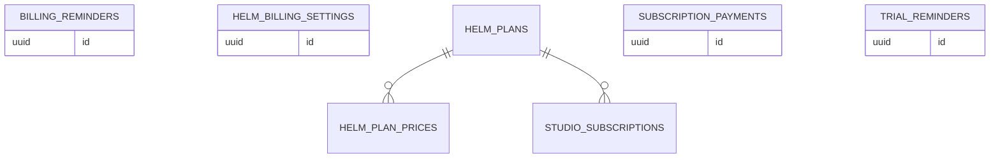

---

## 4. Key RPCs (SECURITY DEFINER) by domain

All listed functions are `SECURITY DEFINER` with a pinned `search_path`, and **re-check authority inside the body** (grants are defence-in-depth only). "Caller" is the intended caller; the full generated list with detected guards is in Appendix B.

| Domain | Function | Purpose | Caller / guard |
|---|---|---|---|
| Tenancy | `current_org_id()`, `user_role()`, `is_admin()`, `can_edit()`, `has_area(area, need)` | Identity helpers used by every policy | any authenticated |
| Tenancy | `create_studio(...)` | Create a studio, make caller its admin, seed defaults | authenticated user with no studio |
| Tenancy | `start_trial(p_timezone, p_currency)` | Unified 8-day trial: creates "Demo N" studio with sample data (advisory lock on N) | authenticated user with no studio (0116/0118/0119) |
| Tenancy | `my_start_trial`, `my_trial_status`, `my_demo_status`, `seed_demo_data` | Trial / demo-data lifecycle (counts preview before "start fresh", 0123) | studio admin |
| Tenancy | `create_invitation`, `invitation_preview(token)`, `accept_invitation(token)` | Team invitations (role must exist; existing members refused, 0072) | `users` edit / anon preview / invitee |
| Tenancy | `admin_get_role_access`, `admin_set_role_access` | Edit the role × area matrix (Control Center) | admin |
| Tenancy | `export_org_data`, `export_tenant_organization_package` | Studio data export (DPDP / GDPR portability) | admin |
| CRM | `sync_quote_to_lead` (trigger fn), `archive_lead` (trigger fn) | Keep lead in step with quote; snapshot every lead change into `lead_archive` | trigger |
| Quotes | `create_quote`, `start_blank_quote` | Create quote with advisory-locked event code; reuse your untouched blank quote | `quotes` edit |
| Quotes | `enforce_pricing_total` (trigger fn) | Server recomputes `pricing.total` (D8 pricing authority) | trigger |
| Lifecycle | `set_lifecycle_stage(quote, stage, reason)`, `reopen_event` | Enforce stage order; overrides logged to `lifecycle_stage_overrides` | area edit + reason for override |
| Lifecycle | `close_event(quote, closed, reason)`, `close_event_blockers` | Close with server balance / blocker gate; overrides logged | `closure` edit |
| Design | `design_get`, `design_queue`, `design_advance` | Design-studio stage workflow (optimistic concurrency) | designer / `quotes` area |
| Money | `record_payment(quote, amount, method, receipt)` | Record advance/instalment into `quote_payments`; confirms booking and stamps `confirmed_at` (0112); overpay cap incl. approved changes (0110) | finance / admin |
| Money | `record_settlement_payment`, `settle_milestone`, `mark_paid` | Settlement-page money path (same lock + cap) | `settlement`/`finance` edit; `mark_paid` admin/manager |
| Money | `razorpay_settle`, `razorpay_settle_for_org` | Settle a verified gateway payment | service role (webhook) |
| Money | `dashboard_money`, `dashboard_due_today`, `insights_range`, `insights_events` | Read-only money / pipeline / profit (ex-tax, per currency) | studio member with finance view |
| Inventory | `reserve_inventory`, `return_reservation`, `checkout_equipment`, `cancel_checkout` | Atomic reserve; no over-issue (0015); check-outs cancelled never deleted (0073) | `inventory` edit |
| Vendors | `record_vendor_payout`, `vendor_payables_summary` | Pay vendor bills (immutable payouts), payables roll-up (0124) | `vendors`/`finance` edit / view |
| Ops | `my_tasks`, `my_pending`, `assign_tasks_vendor` | Staff work queues, task assignment | authenticated |
| Crew link | `worker_get_tasks`, `worker_get_equipment`, `worker_respond`, `worker_respond_evidence`, `worker_checkin_equipment`, `worker_evidence_upload` | Signed-out crew work link actions | anon + valid work token within window |
| Client | `public_get_quote`, `public_get_portal`, `public_get_proposal`, `public_portal_extras`, `public_quote_paid_status` | Client approval page / portal reads | anon + quote token |
| Client | `request_otp`, `verify_and_consent`, `admin_store_otp` | OTP + recorded consent (country terms 0093) | anon + token; `admin_store_otp` service role |
| Client | `create_payment(token)` | Start client payment (dormant gateway) | anon + token |
| Booklet | `public_get_booklet`, `public_booklet_packages`, `public_booklet_choose`, `public_booklet_otp_request`, `public_booklet_pay_terms`, `public_get_booklet_image` | Client booklet + package choice (maker-checker staff review) | anon + booklet token |
| Public site | `public_event_site(slug)`, `public_link_studio`, `public_booklet_studio`, `public_link_opened` | Published invitation site, branded studio links, open tracking | anon |
| Search | `studio_search(q, limit)`, `client_timeline(ref)` | Universal search, one page per client | authenticated, area-filtered |
| Notifications | `notify_*` helpers, `_notify` | Write bell notifications respecting prefs and mutes | internal |
| Comms | `comms_tick()`, `comms_outbox_claim(limit)` | Queue automatic reminders; claim queued messages for sending | cron / service role [OWNER TO VERIFY grant] |
| Links | `apply_link_expiry_archive_all()` | Expire and shelve stale client links | cron |
| Trial / billing | `trial_reminders_tick()`, `_billing_refresh()`, `hq_billing`, `hq_set_billing_state`, `hq_settle_provider_payment` | Trial reminders; subscription status; HQ billing console | cron / platform admin |
| Storage | `storage_object_name_ok`, `storage_quota_ok`, `task_proof_upload_ok`, `upload_scan_*` | Storage path, quota, MIME and quarantine checks | storage policies (anon/auth) |

---

## 5. Triggers (patterns)

| Pattern | Function | Applied to | Effect |
|---|---|---|---|
| Audit | `tg_audit()` | quotes, payment_milestones, quote_payments, expense_claims, event_costs, inventory_*, vendors, crew_members, profiles, role_access, config tables, change_requests, **leads (0125)** | Writes before/after JSONB to `audit_log` (feeds Audit log page and dashboard "Recent activity") |
| Tenant stamp | `tg_org_from_quote()` | ~30 event child tables + `audit_log` | Sets `org_id` from the parent quote on insert |
| Timestamps | `set_updated_at()` | leads, quotes, layouts, event_day, event_resources, inventory_reservations … | `updated_at = now()` |
| Pricing authority | `enforce_pricing_total()` | quotes (pricing) | Server recomputation of totals |
| Lead sync / archive | `sync_quote_to_lead()`, `archive_lead()` | quotes → leads; leads | Keep CRM in step; archive every lead change |
| Task verification | `tg_task_verify()` | event_tasks | Quality maker-checker; requeue after rework (0115); blocks direct verify_* PATCH (0007) |
| Money freeze | `_a42_tg_refund_freeze`, `tg_refund_maker_checker`, D6 triggers | event_refunds, payments | Approved money is immutable; refunds need a second person |
| Vendor bills | `tg_vendor_bill_guard`, `tg_vendor_payout_immutable` | vendor_bills, vendor_payouts | Cancel-not-delete; payouts immutable |
| Guards | `event_attendees_guard`, `event_sites_guard`, `invitations_api_guard` | respective tables | Validate shape / allowed transitions |
| Repricing notify | `_r3_tg_pricing_changed`, `_r3_tg_menu_price_changed` | quotes, menu_templates | Notify on price change after approval |
| Auth hook | `handle_new_user()` | `auth.users` AFTER INSERT | Seeds `profiles` row |

Full trigger list: Appendix C.

---

## 6. Storage buckets

All buckets are **private** (re-pinned by 0048); objects are served through signed URLs or Edge Functions. Object names must start with the caller's org/event path (`storage_object_name_ok`).

| Bucket | Size cap | Allowed MIME | Used for | Since |
|---|---|---|---|---|
| `invite-media` | 8 MB | png, jpeg, webp, gif | Invitation-site images (guest read only when the site is published, 0019) | phase88 / 0013 |
| `event-docs` | 10 MB | pdf, png, jpeg, webp | Event files, vendor bill attachments | 0009 |
| `chat-media` | 16 MB | images + audio (webm, ogg, mpeg, mp4, aac, wav, m4a) | Team chat attachments / voice notes | 0017 |
| `task-proof` | 8 MB | jpeg, png, webp, audio | Crew task evidence | 0038 |
| `member-avatars` | 2 MB | png, jpeg, webp | Profile photos | 0041/0060 |
| `helm-manual` | 20 MB | (unrestricted) | Private user manual assets | 0031 |
| `upload-quarantine` | 20 MB | (unrestricted) | Uploads pending server verification (dormant until `verify-upload` + flag) | 0051 |
| `booklet-snapshots` | 3 MB | png, jpeg, webp | Booklet 2D/3D snapshot images (served by `booklet-snapshot`) | 0069 |

---

## 7. Edge Functions (`supabase/functions/`)

| Function | Trigger / caller | Purpose | Default state |
|---|---|---|---|
| `send-otp` | Approval page (LIVE) | 6-digit OTP, bcrypt hash via `admin_store_otp`, SMS through MSG91 | Live when secrets set |
| `create-payment-link` | Approval page (LIVE) | Razorpay Payment Link for an approved quote → `quote_payments` | Dormant until keys |
| `razorpay-webhook` | Razorpay | Verify signature, settle quote, e-mail confirmations (Resend) | Dormant until keys |
| `create-subscription-checkout` | `/checkout` | Studio → Helm subscription via Razorpay Standard Checkout | Dormant |
| `razorpay-subscription-webhook` | Razorpay | Settle Helm's own subscription charges | Dormant |
| `billing-reminder` | Cron / HQ | Subscription due / past-due e-mails | `HELM_BILLING_REMINDERS_ENABLED` |
| `send-whatsapp` | App (LIVE) | Meta WhatsApp Cloud API send | Dormant until token |
| `wa-webhook` | Meta | Inbound WhatsApp webhook (opt-outs, statuses), `--no-verify-jwt` | 404 until both secrets set |
| `send-phone-code` | Profile | Member phone verification code via WhatsApp (0055) | Dormant |
| `comms-dispatch` | Cron | Deliver `comms_outbox` (payment reminders, follow-ups, greetings) | Flagged |
| `pkg-client-notify` | Cron | Deliver `pkg_outbox` (package accepted/declined) | Flagged |
| `welcome-mailer` | Cron | Deliver `welcome_email_outbox` | Flagged |
| `security-alert-mailer` | Cron | Deliver `security_alert_outbox` to admins / HQ | Flagged |
| `verify-upload` | Storage | Server-side upload verification + quarantine (0051) | `HELM_UPLOAD_SCAN_ENABLED` |
| `booklet-snapshot` | Booklet page | Stream private booklet snapshot images | Live |
| `render-photo` | Builder "Render" | Photo-realistic render via OpenAI Images API; usage metered in `photo_render_usage` | **Owner-triggered only** |
| `_shared` | — | CORS + response helpers | — |

---

## 8. Scheduled jobs (`pg_cron`, optional)

Each migration schedules the job only if `pg_cron` is installed; otherwise it raises a notice and the work runs on demand.

| Job | Schedule | Command | Since |
|---|---|---|---|
| `helm_link_expiry_shelf` | `*/30 * * * *` (every 30 min) | `select public.apply_link_expiry_archive_all()` | 0040 |
| `helm_billing_refresh` | `15 0 * * *` (00:15 daily, UTC) | `select public._billing_refresh()` | 0045 |
| `helm_comms_tick` | `*/15 * * * *` | `select public.comms_tick()` | 0078 |
| `helm_trial_reminders` | `7 * * * *` (hourly) | `select public.trial_reminders_tick()` | 0120 |

Outbox delivery Edge Functions must be scheduled separately (Supabase scheduled functions or external cron) — [OWNER TO VERIFY schedule on prod].

---

## 9. Data-protection notes (India DPDP 2023, UAE PDPL, UK/EU GDPR, US state laws)

| Concern | Where in schema |
|---|---|
| Consent records | `quote_consents` (terms version, phone, OTP evidence), `studio_consent_log`, `whatsapp_opt_outs`, `member_wa_optin` |
| Audit trail | `audit_log` (trigger-fed), override tables (`event_close_overrides`, `lifecycle_stage_overrides`) |
| Portability / export | `export_org_data`, `export_tenant_organization_package` |
| Retention / expiry | link windows and auto-expiry (0022, 0039, 0040); OTP tables short-lived |
| Security events | `security_alert_*`, `auth_*_attempts`, `auth_rate_hits` |
| Residency | Single Supabase project region — [OWNER TO FILL region and cross-border transfer basis] |
| Erasure | No hard-delete paths by design; an erasure / anonymisation RPC per data principal is **not present** — gap, see §11 |

---

## 10. Migration index (0001 → 0125)

Apply order is `supabase/migrations/MANIFEST` (`base` on a fresh DB only, then every `forward` file). The ledger table `public.helm_schema_migrations` makes re-runs idempotent (`scripts/db-migrate.sh --plan | --apply | --verify`).

| # | Migration | Summary |
|---|---|---|
| 0001 | `0001_pricing_authority` | migration (W15-001 fix). Reuses the STAGING-verified wave15b logic (W15B-01 + W15B-06), now wired into the deterministic canonical path so a clean deploy is hardened by default. Idempotent (CREATE OR REPLACE).… |
| 0002 | `0002_create_helm_user_lockdown` | (SEC-01, CRITICAL). Reuses supabase/security-fix/SEC-01, now wired into the deterministic path so a clean deploy is NOT exposed. Idempotent. Forward-only. CLOSES: public.create_helm_user(text,text,text) is SECURITY… |
| 0003 | `0003_money_integrity` | (reuses H04 + H01 + B2). Closes two money defects and the overpayment TOCTOU: * helm_total_paid double-count → LEDGER-ONLY (sum paid quote_payments only). * overpayment with NO lock (check-then-insert race) → a… |
| 0004 | `0004_tenant_integrity` | (SEC-05 F2 + SEC-07 G4). Closes cross-tenant proposal/portal leakage (F2) and forged-org row planting (G4). Behaviorally FAIL-before confirmed on PG17: org-B staff set org_id=B on a proposal pointing at org-A's quote… |
| 0005 | `0005_least_privilege` | (SEC-05 F4/F5 + SEC-07 G5). Reuses the SEC grant logic, wired into the canonical path. F5: revoke EXECUTE from PUBLIC + anon on EVERY public function, grant it to authenticated + service_role, then RE-grant anon only to… |
| 0006 | `0006_rls_access_gates` | (SEC-02 + SEC-03 + SEC-04). Logic re-authored (not copied) from the SEC files, wired into the canonical path. SEC-02 layouts: add the has_area('quotes') gate (base was org-only → any in-org role could read/write… |
| 0007 | `0007_rpc_authz_guards` | (SEC-05 F10/F11/F12). Re-authored from SEC-05 logic. F11 mark_paid: restrict to admin/manager (was any can_edit role). F12 verify-columns: a BEFORE trigger blocks direct PATCH of event_tasks verify_* columns by the API… |
| 0008 | `0008_feature_designer` | CANONICAL feature-completeness (Design Studio). The canonical base (2026-09-25) predates the Design Studio; the current app depends on design_get/design_queue/design_advance, design_stages, the 'designer' role and the… |
| 0009 | `0009_feature_tasks_files` | CANONICAL feature-completeness. Adds current-app objects missing from base-v1: my_tasks, my_pending (worker/staff queues), event_files + list_event_files (file storage), and the event-docs storage policies. Extracted… |
| 0010 | `0010_feature_settlement_teardown` | CANONICAL feature-completeness. Adds record_settlement_payment (settlement money path; writes quote_payments + payment_milestones, so it inherits the 0003 overpayment advisory-lock boundary), return_reservation (atomic… |
| 0011 | `0011_authz_complete` | Completes matrix-aware authorization (SEC-05 F10) on remaining org-mutating RPCs and closes two previously UNGUARDED mutating RPCs. DB/RPC authorization is authoritative; the client ROLE_CAPS is not. Idempotent (CREATE… |
| 0012 | `0012_token_otp_hardening` | (SEC-07 G1/G2/G3). Extracted from security-fix/SEC-07 (not blind-replayed; preconditions removed, and the base column SEC-07 assumed from prod-rollout is created here). G1 approval-token expiry: auto-stamp + never… |
| 0013 | `0013_storage_hardening` | (SEC-05 F6 + bucket config). Storage security for the invite-media and event-docs buckets, enforced in SQL so it does not depend on dashboard-only settings: * buckets are private (public=false) with a MIME allowlist +… |
| 0014 | `0014_advisor_hardening` | clears the two legitimate Supabase Security Advisor items on the canonical path. NO business-semantics change. Idempotent. Forward-only. 1) helm_schema_migrations (the migration LEDGER created by the runner) sits in the… |
| 0015 | `0015_checkout_overissue_guard` | stop checking out more stock than you own. Forward-only, idempotent (CREATE OR REPLACE). NO data change, NO signature change. BUG: checkout_equipment inserted a loan with no availability check, so you could check out 20… |
| 0016 | `0016_feature_chat` | 0016_feature_chat.sql Team chat (WhatsApp-style): per-organization DMs, groups and an org-wide "Everyone" broadcast, with text / image / voice messages, replies, reactions and read state. Real-time via the… |
| 0017 | `0017_chat_attachments` | 0017_chat_attachments.sql Rich attachments in team chat: a message can carry a "card" (a quote, a floor layout, or — in future — any other object) alongside optional text. The card payload is a free-form JSONB snapshot,… |
| 0018 | `0018_chat_read_tracking` | 0018_chat_read_tracking.sql Make read-state work for the org-wide "Everyone" broadcast (and any conversation the caller can SEE but has no explicit chat_members row for yet). Before this, chat_mark_read only UPDATEd an… |
| 0019 | `0019_invite_media_published_read` | (security audit Phase 2, finding P2-01). Problem: 0013 made the invite-media bucket private with own-org-only read, but the PUBLIC invitation page (/i/<slug>, anonymous guests) renders those photos — so on any DB where… |
| 0020 | `0020_studio_links` | Branded, secure client links: https://www.helm.events/<studio>/invite/<event-slug> https://www.helm.events/<studio>/quote/<token> (client approval) https://www.helm.events/<studio>/proposal/<token>… |
| 0021 | `0021_profiles_privilege_lockdown` | (security audit Phase 5, finding P5-01 — CRITICAL on any DB built from canonical, e.g. staging). Problem: 0006 created profiles_self_update (USING/WITH CHECK id = auth.uid()) and the authenticated role kept column… |
| 0022 | `0022_client_link_windows` | Public links stop working a set time after the EVENT (end of that day, in the studio's timezone): invitation website (guests) ........ event + 7 days (NEW — never expired before) proposal link ......................… |
| 0023 | `0023_work_token_no_date_fix` | Fixes a bug in 0022 (found by live verification on production, 2026-10-06). Bug: work_token_expiry_for() used greatest(deadline, now()+2 days) and fell back to 60 days only when that was NULL — but Postgres greatest()… |
| 0024 | `0024_injection_guards` | Security audit Phase 6 (injection / XSS). The pages now escape these values (that is the real fix); these checks stop bad data from being stored at all, so no other screen can trip on it later: chat reaction emoji… |
| 0025 | `0025_write_path_lockdown` | Security audit Phase 6 (mass assignment). Several tables could be written straight through the API by anyone holding the table's area right, skipping the server function that owns that change (and its checks). Every one… |
| 0026 | `0026_business_logic_crypto` | Security audit Phase 7 (business logic + cryptography). Every attack below was reproduced on the disposable test DB (tests/db/business-logic.sql) before this fix: 1 money: 'NaN' / 'Infinity' / negative numbers were… |
| 0027 | `0027_uploads_payments` | Security audit Phase 8 (risky functionality: file uploads, card payments, outbound messaging). Every ATTACK below was reproduced on the disposable test DB before this fix (tests/db/uploads-payments.sql): uploads —… |
| 0028 | `0028_auth_hardening` | Security audit Phase 3-4 follow-up (Authentication + Session Management). What this changes, in plain words: 1. Studio admins creating a user (Control Center) must now give a password of at least 12 characters with a… |
| 0029 | `0029_platform_admin` | Helm HQ: private platform-owner dashboard (read-only). Who: ONLY Helm's own operators, listed by e-mail in public.platform_admins (seeded: admin@helm.events, security@helm.events). Studio users — studio admins included… |
| 0030 | `0030_password_rule_symbols` | What this changes, in plain words: The owner set Supabase Auth -> Password requirements to "Lowercase, uppercase letters, digits and symbols", minimum 12. Supabase enforces that on sign-up, reset and change-password,… |
| 0031 | `0031_manual_private_bucket` | What this changes, in plain words: The Helm user manual used to be a public file (/docs/USER-MANUAL + screenshots): anyone with the URL could read it. It now lives in a PRIVATE storage bucket, "helm-manual", and the… |
| 0032 | `0032_rescore2_fixes` | Security re-score #2 fixes. Every ATTACK below was reproduced on the disposable test DB (tests/db/rescore2-fixes.sql FAILS on 0001-0031 and passes after this file). What this changes, in plain words: 1 REFUNDS: a new… |
| 0033 | `0033_rescore3_fixes` | Security re-score #3 fixes. Every ATTACK below was reproduced on the disposable test DB (tests/db/rescore3-fixes.sql FAILS on 0001-0032 and passes after this file). What this changes, in plain words: 1 CHANNEL FLAGS… |
| 0034 | `0034_display_names` | Display names in chat. Problem: chat showed teammates as "Member" (or just their role). Two causes: a) nobody could set a name: 0021 revoked UPDATE on profiles from every API role (correctly — that closed the… |
| 0035 | `0035_event_groups_mentions` | Event groups + @mentions. What this adds, in plain words: 1 An "event group": a team chat group tied to ONE confirmed quote/event. create_event_group(quote, members) makes it (or returns the one that already exists —… |
| 0036 | `0036_notification_prefs` | Admin-managed notifications per role (and per person). Before this file every member of a studio saw EVERY entry of the studio's notification log in the bell (crew saw payment receipts, OTP sends, …) and nothing could… |
| 0037 | `0037_platform_operator_check` | is_platform_admin() is false for an HQ operator who still owes a two-step code (require_mfa / enrolled factor at aal1). The app then mistook them for a new user with no studio and offered studio setup. This adds:… |
| 0038 | `0038_worker_evidence` | Crew evidence from the signed-out work link (/work, /<studio>/work/<ref>): • REJECT a task → optional reason (≤ 1000 chars) + optional voice note (≤ 2 min) • MARK DONE → optional proof photos (≤ 10 per completion) Staff… |
| 0039 | `0039_link_autoexpire` | OPTIONAL per-studio rule: "client links stop working N days after they were sent" (calendar days, weekends included). Default OFF; N defaults to 10; allowed 1–365. Set by a studio ADMIN in Control Center… |
| 0040 | `0040_link_expiry_archive` | "When a quote's client link expires (and the client never approved or paid): Keep it (default) / Move to Archive / Move to Deleted quotes" — an OPTIONAL per-studio choice under 0039's "auto-expire client links" switch… |
| 0041 | `0041_member_profile` | "Complete your profile": every studio member gets a profile (mobile, WhatsApp, job title, department, skills, city, emergency contact, photo) that also keeps their Staff-directory row up to date, so they can be assigned… |
| 0042 | `0042_audit_run2_fixes` | Security audit run 2, Phase H "safe now" fixes (REMEDIATION-PLAN.md): RC-1 OTP: a NULL / non-6-digit code is a wrong code (counts an attempt, never approves); dev-echo codes only where the service-role-only setting… |
| 0043 | `0043_mfa_enforce` | Owner decision D3 (audit run 2, RC-6 / C-05): the second factor is enforced by the DATABASE for every member who has enrolled one. A signed-in user with a VERIFIED factor whose session is still aal1 (password only) gets… |
| 0044 | `0044_revert_matrix_seed` | Owner decision D2: the role_access matrix is the SINGLE authority and nobody GAINS access. 0042's _a42_seed_matrix_defaults() inserted can_view = can_edit = true rows for (planner/sales/operations ×… |
| 0045 | `0045_hq_subscriptions` | Owner decision: Helm HQ (platform operators) sees NO studio business data. HQ sees only (a) the studio list, (b) the people in each studio (name, e-mail, role, active, last sign-in, two-step on/off — never a phone), (c)… |
| 0046 | `0046_d6_money_freeze` | owner decision D6: approved money records are frozen. Same shape as 0042 RC-5 (event_refunds): a BEFORE UPDATE OR DELETE row trigger that only acts for API callers (current_user anon / authenticated); the service role… |
| 0047 | `0047_hq_mfa_optional` | Owner decision (temporary): two-step verification is OPTIONAL for Helm HQ operators, behind ONE platform switch so it can be turned back on later. helm_hq_settings.hq_require_mfa (one row, default FALSE) false → an… |
| 0048 | `0048_upload_hardening` | Upload + storage hardening (all six app buckets) and NV-04 (run-2). 1) NV-04 — guests could LIST invite-media across studios. The 0019 anon SELECT policy matched any photo on ANY published, live site, with no slug… |
| 0049 | `0049_db_gates` | Owner-approved DB gates: 1. CLOSE GATE. close_event(quote, true) refuses to close while the client still owes money on the LEDGER (quote total − paid quote_payments, i.e. helm_total_paid — NOT milestones) or while… |
| 0050 | `0050_auth_limits` | (Numbered 0050: 0049 is being written in parallel. On merge, the MANIFEST line for this file must sit AFTER 0049's. Nothing here depends on 0049.) 1) Durable rate limits — public.rate_hit(bucket, key, window_s, max) →… |
| 0051 | `0051_upload_quarantine` | Server-side upload verification + quarantine (DORMANT until the owner deploys the verify-upload Edge Function and flips the enforce flag). Gap closed: the browser magic-byte checks (store-api uploads.*) can be skipped… |
| 0052 | `0052_lifecycle_reapproval` | 1. LIFECYCLE TRANSITIONS. set_lifecycle_stage enforces the stage order lead > discovery > proposal > quote > confirmed > planning > resources > ready > event_day > settlement > closed * moving BACK to an earlier stage… |
| 0053 | `0053_password_lockout` | Per-account password lockout, enforced by Supabase Auth itself through the "Password Verification Attempt" Auth Hook (Postgres function hook, Pro plan). public.hook_password_verification_attempt(event jsonb) → jsonb… |
| 0054 | `0054_security_alerts` | Security alerts. Works with or without 0053 (password lockouts). What this adds, in plain words: 1 security_alert_events — one row per security-relevant thing that happened (admin override, MFA / password lockout,… |
| 0055 | `0055_phone_verify` | Phone verification + international mobiles on member profiles. What this adds, in plain words: 1 member_profiles.phone_verified_at — when the member proved they own the mobile on their profile. Cleared automatically… |
| 0056 | `0056_onboarding_checkout` | Onboarding checkout. terms_version_accepted, _resolve_tax). Independent of 0055. after "Complete your profile", the OWNER (admin) of a NEW studio picks a Helm plan on /checkout, sees a server-computed tax preview, fills… |
| 0057 | `0057_welcome_email` | Welcome e-mails. Independent of 0055/0056. Uses only base tables (organizations, profiles, auth.users). * When someone creates a NEW studio (create_studio → organizations insert, and the owner's profile joins it) we… |
| 0058 | `0058_trial_reminders` | Trial-ending reminders. Independent of 0057 (welcome); MANIFEST keeps 0057 before 0058. (historical: written for the original 14-day trial; superseded by 0119 — trial is now 8 days, `helm_billing_settings.trial_days`) a studio on the free trial is reminded 7, 3 and 1 day(s) before the trial ends, and once when it has ended. Each reminder is… |
| 0059 | `0059_getting_started` | Dashboard "Getting started" checklist for new studios. Independent of 0057 (welcome) and 0058 (trial); keep the order 0057, 0058, 0059. * my_getting_started() — signed-in studio member. Works out, ON THE SERVER, which… |
| 0060 | `0060_studio_avatars` | Profile photos for the new top-bar profile menu and for team chips. * Photos are already stored by 0041: member_profiles.avatar_path (RLS on, no direct client access, own-row writes only through set_my_avatar) and the… |
| 0061 | `0061_studio_search` | Universal studio search (top-bar search + Cmd/Ctrl+K palette in public/studio-search.js). Independent of 0060 (profile menu); 0060 lands above it in the MANIFEST. * studio_search(p_q, p_limit) - signed-in studio member… |
| 0062 | `0062_client_timeline` | "One page per client" (public/client.html?id=<lead id or event id>). * Helm has no separate clients table: a client is the person on a lead (leads.name / phone / email) and on an event (quotes.client name / phone /… |
| 0063 | `0063_notification_mutes` | Per-person muted notification types (bell "..." menu -> "Mute this type"; Muted types list). * notification_mutes - one row per (person, studio, catalog type) the person muted for THEMSELVES. RLS on; a person can only… |
| 0064 | `0064_saved_views` | Saved filters / views for the list pages (public/saved-filters.js): leads, quotes (events), staff, vendors, inventory. * saved_views - one row per saved view: who saved it, which studio, which page, a name and the… |
| 0065 | `0065_client_booklet` | The client "event booklet": a read-only website the studio shares with its client (public/booklet.html?t=<token>). deleted_at), 0045 (tg_studio_read_only) and 0050 (rate_hit) - the preflight stops if missing. *… |
| 0066 | `0066_notification_task_ref` | Notification deep links: task notifications carry the id of the task they are about. * Task notifications (task_assigned, task_reminder, task_due, task_accept, task_reject, task_start, task_complete) are written by… |
| 0067 | `0067_pretty_urls` | Human-readable, studio-scoped app URLs: https://www.helm.events/<studio>/events/<event-number>/floor-plan * The studio part of the URL is the studio's EXISTING link name (organizations.public_slug, 0020): unique,… |
| 0068 | `0068_client_timeline_totals` | Fixes the totals on the "one page per client" page (client_timeline, 0062). * Quoted: was pricing.total only, so events whose total lives in an older top-level total field showed 0. Now pricing.total, then that older… |
| 0069 | `0069_package_flow` | Client package selection from the private booklet, staff review (maker-checker), re-pricing through the server pricing authority, payment credit / overpay handling, notifications and a dormant outbox for client + staff… |
| 0070 | `0070_booklet_payments` | Client booklet Payments section reads the same money source of truth as the settlement page "Received" rule and the 0068 client timeline. * Bug: a cash advance recorded via flow.html "Record payment" lands in the… |
| 0071 | `0071_reserve_inventory_atomic` | 0071_reserve_inventory_atomic.sql (was the orphaned 0070_reserve_inventory_atomic.sql; an older body of this function was hand-pasted on prod + staging. This migration supersedes it: search_path = '' and created_by =… |
| 0072 | `0072_pending_fixes` | Sections 2-8 + 10 of the old supabase/PENDING-SQL-ALL.sql (section 1 = 0071; section 9, duplicate-name unique indexes, is EXCLUDED pending an owner decision). Additive + idempotent: CREATE OR REPLACE, ADD COLUMN IF NOT… |
| 0073 | `0073_inventory_cancel_and_unique_names` | Additive + idempotent. No row is updated or deleted by this migration. 1 Owner decision #4: equipment check-out records are NEVER hard-deleted. A check-out recorded by mistake (nothing returned yet) is CANCELLED with… |
| 0074 | `0074_chat_admin_fixes` | Additive + idempotent: CREATE OR REPLACE, new table guarded by IF NOT EXISTS, DROP/CREATE of policies and triggers by name. No row is updated or deleted. 1 Invitations: the 0025 guard (a direct UPDATE may only set… |
| 0075 | `0075_ui_fixes` | UI fix pass (L8 blank-quote reuse, #16 booklet studio contact). mode, payments helper). 1) start_blank_quote(code, title): the dashboard "Generate a quote" button used to make a brand-new empty quote on every click. Now… |
| 0076 | `0076_insights` | Date-ranged studio insights (read-only). insights_range(from, to) returns one JSON summary for the caller's own studio, for the events whose event date (or, when no date is set yet, the day they were created in the… |
| 0077 | `0077_r3_sync_reprice_profit` | Round 3 (A). 1 Recent records (the clock button next to search) were kept ONLY in this browser's localStorage, so a record opened on the laptop never showed on the phone. A small per-person list now lives on the server:… |
| 0078 | `0078_comms_automation` | Automatic client messages, low-stock bell warnings and WhatsApp forwarding of bell notifications. 1 comms_settings (one row per studio, admin-managed in Control Center): * payment reminders: on/off, channels (email /… |
| 0079 | `0079_country_tax` | Country-based tax: tax-inclusive prices. A studio now picks its country (India, UAE, UK, US, Singapore, Australia, Canada or other). The country only changes LABELS (GST / VAT / Sales tax, GSTIN / TRN / ABN ...), the… |
| 0080 | `0080_notif_catalog_speed` | 0080_notif_catalog_speed.sql Speed fix for the notification catalog (Control Center > Notifications timed out on prod). Each catalog layer (0054/0058/0069/0078) reads the previous layer through a subquery "from (select… |
| 0081 | `0081_booklet_tax_labels` | Client booklet shows the exact tax label. 0079 lets a studio pick its country, so a quote's saved pricing may carry taxCountry, taxName and taxInclusive (UAE "VAT", a custom name for other countries, "prices include… |
| 0082 | `0082_r4_sql_fixes` | Round 4 review fixes for 0076-0080. R4-01 comms_outbox_claim re-checks each queued message right before it is handed to the sender. It now ALSO checks that: * the address / number queued is still the client's (or… |
| 0083 | `0083_booklet_images` | Client booklet pictures stored in the database. The client booklet shows the 2D floor plan and the 3D view as real pictures from the builder. Until now those pictures needed a storage bucket plus an edge function that… |
| 0084 | `0084_r7_polish` | Plain-ASCII error texts, phone checks, re-open event. 1. Some server messages had a long dash that showed up as garbage (odd symbols) after a copy/paste. The three functions that raise those messages are re-created with… |
| 0085 | `0085_venues` | Studio venue list (Control Center -> Venues). Each studio keeps a list of the venues it works with: name, type, AC / non-AC, indoor / outdoor, seated + floating capacity, hall size (stored in METERS), event types… |
| 0086 | `0086_item_specs` | Item specifications + per-studio item rate cards. 1. item_rate_cards: ONE row per studio per item type (dj, generator, stage, lighting, led, chandelier, photobooth, chocolatefountain, chariot, smoke, dancers). The row… |
| 0087 | — | **Number not used** (gap in sequence; no file, not in MANIFEST). |
| 0088 | `0088_smart_import` | Smart import (any spreadsheet layout) + custom fields. 1. Staff (crew_members), inventory (inventory_items), menu dishes (dish_catalog) and vendors get a new "attributes" column (jsonb object, default {}). Anything a… |
| 0089 | `0089_country_tax` | Country tax for India / UAE / USA. * Every studio can be in India (GST 18%, CGST+SGST or IGST), the UAE (VAT 5%, TRN) or the USA (sales tax at the state's rate, optional EIN). The browser table lives in… |
| 0090 | `0090_portal_quote_currency` | Client portal shows the quote's OWN money. The signed-out client portal (public_get_portal) formatted amounts as Indian rupees because it could not read the studio's settings. It now also returns the quote's own… |
| 0091 | `0091_quote_currency_backfill` | Old quotes keep their rupees. 0089 started stamping each quote's own currency + tax facts (quotes.currency / tax_snapshot) whenever its pricing is saved, but did not fill the quotes created BEFORE 0089. Those rows have… |
| 0092 | `0092_country_templates` | Client reminders/follow-ups speak the studio's country. Automatic payment reminders and follow-ups (0078) always wrote amounts as "Rs. 1,234" and turned a 10-digit phone number into an Indian (+91) WhatsApp number. A… |
| 0093 | `0093_country_terms` | Client approval OTP works for UAE / USA numbers. The client approval page now shows country terms (India v1-2026-09 unchanged; new v1-2026-09-AE / v1-2026-09-US). The server stores whatever terms id the page sent… |
| 0094 | `0094_per_currency_totals` | Money totals per currency. A studio can hold quotes in more than one currency (INR / AED / USD - each quote keeps its own currency, quotes.currency, stamped by 0089 and backfilled by 0091). The reports that add money… |
| 0095 | `0095_photo_render` | Photo-realistic renders of a planned event. The builder's "Render" button can turn the floor plan + 3D view into a realistic photograph of the event (made by an image model on the SERVER - edge function render-photo;… |
| 0096 | `0096_studio_layout_templates` | Each studio's OWN floor-layout templates. Besides the built-in "Classic templates", a studio can save any floor layout as its own template (name, event type, short description, small preview picture) and reuse it on new… |
| 0097 | `0097_trial_demo` | Free-trial "Try with demo data". when a studio starts its trial (14 days when written; 8 days since 0119) the owner picks "Try with demo data" -> seed_demo_data() fills the studio with a clearly-marked sample studio (every name starts with "Demo -"), or… |
| 0098 | `0098_public_paid_status` | Client approval link: paid vs total. The client's approval page said "Payment received - your event is confirmed" as soon as ANY payment was recorded (approval_status = 'paid'), even when only a Rs50,000 advance was in… |
| 0099 | `0099_pkg_payment_balance` | Staff "payment received" WhatsApp carries the balance. When a client pays on a package-flow event, the staff WhatsApp said only "a payment of Rs50,000 was received". The sender (pkg-client-notify templates.ts) already… |
| 0100 | `0100_demo_seed_fix` | Fixes "Try with demo data" on prod. production refused the demo seed with 23514 quote_payments violates check constraint "quote_payments_amount_pos". The demo events' pricing carried guests + gstPct but no plate price /… |
| 0101 | `0101_e2e_usability` | Client pages + ex-tax revenue. 1. Insights showed "Revenue" INCLUDING the GST / VAT the studio collected for the government, so profit and margin looked bigger than they are. insights_range now ALSO returns tax,… |
| 0102 | `0102_uae_demo_seed` | "Try with demo data" for a UAE studio. country, D8 server pricing authority with VAT 5% for taxCountry AE). a studio whose country is the UAE got the India demo (Hyderabad venues, rupee prices, GST 18%, Indian phone… |
| 0103 | — | **Number not used** (gap in sequence; no file, not in MANIFEST). |
| 0104 | `0104_venue_samples_4` | 4th sample venue (200 x 200 ft). "Load sample venues" (Control Center -> Venues, admin only) now offers 4 sample venues. The new one is 'SAMPLE - Square Garden Pavilion, Gachibowli': an exactly 200 x 200 ft open-air… |
| 0105 | `0105_checkout_shortage_nurture` | 0105_checkout_shortage_nurture.sql Additive + idempotent. CREATE OR REPLACE FUNCTION, ADD COLUMN IF NOT EXISTS, fill-only seed (ON CONFLICT DO NOTHING). No row is updated or deleted. Needs 0073 (checkout_equipment /… |
| 0106 | `0106_staff_roles_departments` | Staff roles + studio department list. The Staff page "Role" and "Department" are now drop-downs. Roles come from the studio's access-matrix roles (Admin, Event manager, Planner ...). Departments come from a studio… |
| 0107 | `0107_nurture_fill_blank` | 0107: fill BLANK birthday / anniversary greeting templates. Some studios already had empty birthday / anniversary rows before 0105, and 0105 is fill-only (it skips rows that exist), so those stayed blank and the… |
| 0108 | `0108_dashboard_money` | Exact money + pipeline numbers for the dashboard. The dashboard used to add up money from the first 500 quotes it downloaded, and it could not show what was actually collected. This adds ONE read-only function that the… |
| 0109 | `0109_user_dashboard_prefs` | Per-user dashboard layout + desk notes. Each person can now arrange their own home dashboard (block order + which blocks are hidden) and their "Desk notes" are kept on the server instead of only in one browser. One row… |
| 0110 | `0110_overpay_cap_includes_changes` | The "no overpayment" guard on payments capped what the client may pay at the quote total ONLY. Settlement's invoice is "quote + approved change orders", so once a change order was approved the client could never be… |
| 0111 | `0111_booklet_invoice_total` | The client booklet Payments section said "Paid in full" while an APPROVED change order (e.g. +5,000) was still unpaid: _bk_payments (0070) used the quote total only, while Settlement / the overpay guard / the close gate… |
| 0112 | `0112_confirmed_at_stamp` | Recording the advance (record_payment) is how a quote becomes a confirmed booking, but record_payment flips status to 'confirmed' WITHOUT setting quotes.confirmed_at (only the older confirm_quote RPC stamps it).… |
| 0113 | `0113_insights_events_ex_tax` | Insights "Profit per event" used insights_events (0077/0094), whose revenue includes the GST collected, so the GST was counted as profit: QA-E2E Full Run 2 showed revenue 4,38,600, profit 4,01,800 (92%) while Settlement… |
| 0114 | `0114_booklet_change_lines` | The client booklet Quotation section did not list APPROVED change orders, although the Payments total (0111) already includes them. Fix: _bk_payments additionally returns 'changes' = [{title, amount, date}] for that… |
| 0115 | `0115_task_requeue_after_rework` | When quality REJECTS a task it goes back to the worker (status in_progress, verify_status 'rejected'). When the worker marks it done again, tg_task_verify only queued tasks that were 'unverified', so the redone task… |
| 0116 | `0116_trial_orgs` | "Start free trial" -> a ready-to-explore "Demo N" studio with sample data, 8 days, then read-only until the owner picks a plan. * start_trial() (signed-in user with NO studio yet) creates a studio named "Demo N" (next… |
| 0117 | `0117_integration_accounts` | Per-studio Razorpay + WhatsApp accounts (DORMANT plumbing: nothing goes live by applying this). current_org_id(), public.is_admin(). OPTIONAL: Supabase Vault (schema "vault"). Without Vault the save_* RPCs refuse with… |
| 0118 | `0118_trial_locale` | a free-trial "Demo N" studio now starts in the VISITOR's own time zone and currency (sent by the sign-up page from the browser), instead of always India/INR. * NEW start_trial(p_timezone, p_currency): same body as… |
| 0119 | `0119_unified_trial` | ONE free trial for every self-serve studio. trial_mode), 0116 (start_trial, trial_ends_at, read-only after the trial), 0118 (start_trial(text,text): visitor time zone + currency). * There were two trials: the old… |
| 0120 | `0120_trial_reminders` | Reminders for the 8-day free trial. org_id / bell), 0045 (studio_subscriptions), 0058 (trial bell kind 'trial_reminder' + _trial_paid + _trial_refresh), 0116 (organizations.trial_ends_at), 0119 (unified 8-day trial,… |
| 0121 | `0121_dashboard_due_today` | the dashboard "Today" strip can now also show payment milestones due TODAY (in the studio's time zone), not only overdue ones. * NEW read-only dashboard_due_today(): up to 20 milestones due today on confirmed events… |
| 0122 | `0122_trial_text_fix` | when 0116/0119 were pasted into the SQL editor, special characters (the "·" in "Demo ·" and the dash "—") were turned into two- and three-letter garbage (a "not" sign plus a sum sign, and similar). This re-creates the… |
| 0123 | `0123_trial_start_fresh` | "Start my own studio" shows the trial admin exactly what will be removed (how many sample events, leads, staff ... marked "Demo") before they confirm. This only ADDS a "counts" breakdown to my_demo_status() - it reads,… |
| 0124 | `0124_vendor_bills` | In plain words (Phase C, client meeting): * vendor_bills - a bill a vendor sent for an event (number, date, amount, due date, optional photo/PDF in the existing event-docs files). Never deleted: a wrong bill is VOIDED… |
| 0125 | `0125_lead_audit_and_milestone_fix` | 1) Lead edits now show in the Audit log page and the dashboard "Recent activity" card. public.leads had no audit trigger. We attach the SAME shared function every other audited table uses (public.tg_audit(), trigger… |

---

## 11. Known gaps and verification items

| # | Item | Status |
|---|---|---|
| 1 | 0116–0125 applied to staging; production apply pending owner "go" | [OWNER TO VERIFY] |
| 2 | `worker_respond()` body flagged as not fully captured in `HELM-STAGING-SCHEMA.sql`; canonical body comes from 0012 | Verify on staging |
| 3 | `event_sites` baseline policies are `to public`; WAVE-09 re-scopes to `authenticated` | Pending (staging) |
| 4 | Function EXECUTE grants are partly applied by dynamic SQL; Appendix B grant column is static analysis — confirm with `\df+` / `information_schema.routine_privileges` | [OWNER TO VERIFY] |
| 5 | Per-person erasure / anonymisation workflow (DPDP §12, GDPR Art. 17) not modelled as an RPC | Product decision |
| 6 | Static analysis finds RLS enabled on **all 136 tables** (13 of them via `DO`-loop blocks in 0045/0054/0095). Confirm on each live DB with `select relname from pg_class where relnamespace = 'public'::regnamespace and relkind = 'r' and not relrowsecurity;` (expect zero rows) | [OWNER TO VERIFY] |
| 7 | Production hostname/region, backup/PITR policy | [OWNER TO FILL] |

## References

- Supabase — Row Level Security: https://supabase.com/docs/guides/database/postgres/row-level-security
- Supabase — Database functions and `SECURITY DEFINER`: https://supabase.com/docs/guides/database/functions
- Supabase — Storage access control: https://supabase.com/docs/guides/storage/security/access-control
- Supabase — Edge Functions: https://supabase.com/docs/guides/functions
- Supabase — `pg_cron`: https://supabase.com/docs/guides/database/extensions/pg_cron
- PostgreSQL 17 — Row Security Policies: https://www.postgresql.org/docs/17/ddl-rowsecurity.html
- PostgreSQL 17 — CREATE FUNCTION (security definer, search_path): https://www.postgresql.org/docs/17/sql-createfunction.html
- Mermaid — Entity Relationship Diagrams: https://mermaid.js.org/syntax/entityRelationshipDiagram.html
- OWASP — Multi-Tenant Security Cheat Sheet: https://cheatsheetseries.owasp.org/cheatsheets/Multi_Tenant_Security_Cheat_Sheet.html
- Microservices.io — Transactional Outbox pattern: https://microservices.io/patterns/data/transactional-outbox.html
- India Digital Personal Data Protection Act 2023 (MeitY): https://www.meity.gov.in/data-protection-framework
- Repository sources: `supabase/HELM-STAGING-SCHEMA.sql`, `supabase/migrations/*.sql`, `supabase/migrations/MANIFEST`, `supabase/functions/*/index.ts`

---

## Appendix A — Table catalogue (columns, keys, RLS)

Columns are listed as declared; `[NNNN]` marks a column or constraint added later by migration NNNN. CONSTRAINT rows show primary keys, uniques, foreign keys and checks.

### Tenancy, identity and access


#### `organizations`

Introduced: `base`. RLS on. Policies: `org self read` (SELECT, to authenticated); `org self write` (UPDATE, to authenticated).

| Column / constraint | Definition |
|---|---|
| `id` | uuid not null default gen_random_uuid() |
| `name` | text not null |
| `slug` | text |
| `business_email` | text |
| `currency` | text not null default 'INR'::text |
| `timezone` | text not null default 'Asia/Kolkata'::text |
| `gst_number` | text |
| `brand` | jsonb not null default '{}'::jsonb |
| `plan` | text not null default 'free'::text |
| `created_by` | uuid |
| `created_at` | timestamptz not null default now() |
| `location` | text |
| `CONSTRAINT` | organizations_pkey primary key (id) |
| `CONSTRAINT` | organizations_slug_key unique (slug) |
| `CONSTRAINT` | organizations_created_by_fkey foreign key (created_by) references auth.users(id) |
| `public_slug` | text  [0020] |
| `business_email_confirmed` | boolean not null default false  [0075] |
| `country` | text  [0089] |
| `tax_region` | text  [0089] |
| `tax_rate_override` | numeric  [0089] |
| `CONSTRAINT` | organizations_country_0089_chk check (country is null or country ~ '^[A-Z]{2}$') not valid  [0089] |
| `CONSTRAINT` | organizations_tax_rate_0089_chk check (tax_rate_override is null or (tax_rate_override >= 0 and tax_rate_override <= 100)) not valid  [0089] |
| `CONSTRAINT` | organizations_tax_region_0089_chk check (tax_region is null or length(tax_region) <= 60) not valid  [0089] |
| `trial_mode` | text  [0097] |
| `CONSTRAINT` | organizations_trial_mode_chk97 check (trial_mode is null or trial_mode in ('demo','own'))  [0097] |
| `staff_departments` | text[] not null default '{}'::text[]  [0106] |
| `CONSTRAINT` | org_staff_departments_ck check (coalesce(array_length(staff_departments, 1), 0) <= 100) not valid  [0106] |
| `trial_ends_at` | timestamptz default null  [0116] |

#### `profiles`

Introduced: `base`. RLS on. Policies: `profiles read` (SELECT, to authenticated); `profiles_select` (SELECT, to public); `profiles_self_update` (UPDATE, to public).

| Column / constraint | Definition |
|---|---|
| `id` | uuid not null |
| `email` | text |
| `full_name` | text |
| `role` | text not null default 'client'::text |
| `created_at` | timestamptz not null default now() |
| `org_id` | uuid |
| `must_change_password` | boolean not null default false |
| `CONSTRAINT` | profiles_pkey primary key (id) |
| `CONSTRAINT` | profiles_id_fkey foreign key (id) references auth.users(id) on delete cascade |
| `CONSTRAINT` | profiles_org_id_fkey foreign key (org_id) references organizations(id) |
| `CONSTRAINT` | profiles_role_check check (role = any (array['admin'::text, 'manager'::text, 'planner'::text, 'sales'::text, 'coordinator'::text, 'supervisor'::text, 'quality'::text, 'operations': |
| `CONSTRAINT` | profiles_role_check check (role = any (array['admin','manager','planner','sales','coordinator', 'supervisor','quality','operations','crew','worker','client','designer']))  [0008] |

#### `role_access`

Introduced: `base`. RLS on. Policies: `ra read` (SELECT, to authenticated).

| Column / constraint | Definition |
|---|---|
| `role` | text not null |
| `area` | text not null |
| `can_view` | boolean not null default false |
| `can_edit` | boolean not null default false |
| `updated_at` | timestamptz not null default now() |
| `org_id` | uuid not null default current_org_id() |
| `CONSTRAINT` | role_access_pkey primary key (org_id, role, area) |
| `CONSTRAINT` | role_access_org_fk foreign key (org_id) references organizations(id) |

#### `invitations`

Introduced: `base`. RLS on. Policies: `a42 inv read needs users edit` (SELECT, to authenticated); `a74 inv upd pending only` (UPDATE, to authenticated); `inv del` (DELETE, to authenticated); `inv ins` (INSERT, to authenticated); `inv read` (SELECT, to authenticated); `inv upd` (UPDATE, to authenticated).

| Column / constraint | Definition |
|---|---|
| `id` | uuid not null default gen_random_uuid() |
| `org_id` | uuid not null default current_org_id() |
| `email` | text not null |
| `role` | text not null |
| `token` | text not null default encode(gen_random_bytes(24), 'hex'::text) |
| `status` | text not null default 'pending'::text |
| `invited_by` | uuid |
| `expires_at` | timestamptz not null default (now() + '7 days'::interval) |
| `accepted_at` | timestamptz |
| `accepted_by` | uuid |
| `created_at` | timestamptz not null default now() |
| `CONSTRAINT` | invitations_pkey primary key (id) |
| `CONSTRAINT` | invitations_token_key unique (token) |
| `CONSTRAINT` | invitations_org_id_fkey foreign key (org_id) references organizations(id) on delete cascade |
| `CONSTRAINT` | invitations_invited_by_fkey foreign key (invited_by) references auth.users(id) |
| `CONSTRAINT` | invitations_accepted_by_fkey foreign key (accepted_by) references auth.users(id) |
| `CONSTRAINT` | invitations_role_chk check (role = any (array['admin'::text, 'manager'::text, 'planner'::text, 'sales'::text, 'coordinator'::text, 'supervisor'::text, 'operations'::text, 'crew'::t |
| `CONSTRAINT` | invitations_role_chk check (role = any (array['admin','manager','planner','sales','coordinator','supervisor', 'quality','operations','designer','crew','worker','client']))  [0072] |

#### `org_slug_history`

Introduced: `0020`. RLS on with **no client policy** (default deny): reachable only through SECURITY DEFINER RPCs or the service role.

| Column / constraint | Definition |
|---|---|
| `slug` | text primary key |
| `org_id` | uuid not null references public.organizations(id) on delete cascade |
| `retired_at` | timestamptz not null default now() |

#### `auth_temp_passwords`

Introduced: `0028`. RLS on with **no client policy** (default deny): reachable only through SECURITY DEFINER RPCs or the service role.

| Column / constraint | Definition |
|---|---|
| `user_id` | uuid primary key references auth.users(id) on delete cascade |
| `pw_hash` | text not null |
| `created_at` | timestamptz not null default now() |

#### `platform_admins`

Introduced: `0029`. RLS on with **no client policy** (default deny): reachable only through SECURITY DEFINER RPCs or the service role.

| Column / constraint | Definition |
|---|---|
| `email` | text primary key check (email = lower(email) and position('@' in email) > 1) |
| `added_at` | timestamptz not null default now() |
| `added_by` | text |
| `require_mfa` | boolean not null default false |
| `require_mfa` | boolean not null default false  [0029] |
| `user_id` | uuid  [0042] |

#### `member_profile_settings`

Introduced: `0041`. RLS on with **no client policy** (default deny): reachable only through SECURITY DEFINER RPCs or the service role.

| Column / constraint | Definition |
|---|---|
| `id` | boolean primary key default true |
| `gate_cutoff` | timestamptz not null default now() |
| `created_at` | timestamptz not null default now() |
| `constraint` | member_profile_settings_one check (id) |

#### `member_profiles`

Introduced: `0041`. RLS on with **no client policy** (default deny): reachable only through SECURITY DEFINER RPCs or the service role.

| Column / constraint | Definition |
|---|---|
| `user_id` | uuid primary key references public.profiles(id) on delete cascade |
| `phone` | text |
| `whatsapp` | text |
| `whatsapp_same` | boolean not null default true |
| `job_title` | text |
| `department` | text |
| `skills` | text[] not null default '{}'::text[] |
| `city` | text |
| `emergency_contact_name` | text |
| `emergency_contact_phone` | text |
| `avatar_path` | text |
| `profile_completed_at` | timestamptz |
| `created_at` | timestamptz not null default now() |
| `updated_at` | timestamptz not null default now() |
| `updated_by` | uuid |
| `constraint` | member_profiles_phone_chk check (phone is null or phone ~ '^\+91[6-9][0-9]{9}$') |
| `constraint` | member_profiles_whatsapp_chk check (whatsapp is null or whatsapp ~ '^\+91[6-9][0-9]{9}$') |
| `constraint` | member_profiles_emerg_ph_chk check (emergency_contact_phone is null or emergency_contact_phone ~ '^\+[0-9]{8,15}$') |
| `constraint` | member_profiles_text_chk check ( coalesce(char_length(job_title), 0) <= 80 and coalesce(char_length(department), 0) <= 80 and coalesce(char_length(city), 0) <= 80 and coalesce(char |
| `constraint` | member_profiles_skills_chk check (cardinality(skills) <= 20 and array_to_string(skills, '\|') !~ '[<>]') |
| `constraint` | member_profiles_avatar_chk check (avatar_path is null or avatar_path ~ '^[0-9a-f]{8}-[0-9a-f]{4}-[0-9a-f]{4}-[0-9a-f]{4}-[0-9a-f]{12}/[0-9a-f]{8}-[0-9a-f]{4}-[0-9a-f]{4}-[0-9a-f]{4 |
| `phone_verified_at` | timestamptz  [0055] |
| `CONSTRAINT` | member_profiles_phone_chk check (phone is null or (phone ~ '^\+[1-9][0-9]{6,14}$' and (phone !~ '^\+91' or phone ~ '^\+91[6-9][0-9]{9}$')))  [0055] |
| `CONSTRAINT` | member_profiles_whatsapp_chk check (whatsapp is null or (whatsapp ~ '^\+[1-9][0-9]{6,14}$' and (whatsapp !~ '^\+91' or whatsapp ~ '^\+91[6-9][0-9]{9}$')))  [0055] |
| `CONSTRAINT` | member_profiles_emerg_ph_chk check (emergency_contact_phone is null or emergency_contact_phone ~ '^\+[0-9]{7,15}$')  [0055] |

#### `helm_env_settings`

Introduced: `0042`. RLS on with **no client policy** (default deny): reachable only through SECURITY DEFINER RPCs or the service role.

| Column / constraint | Definition |
|---|---|
| `key` | text primary key |
| `value` | jsonb not null default 'null'::jsonb |
| `updated_at` | timestamptz not null default now() |

#### `studio_account`

Introduced: `0045`. RLS on with **no client policy** (default deny): reachable only through SECURITY DEFINER RPCs or the service role.

| Column / constraint | Definition |
|---|---|
| `org_id` | uuid primary key references public.organizations(id) on delete restrict |
| `country` | text check (country is null or country ~ '^[A-Z]{2}$') |
| `state` | text check (state is null or length(state) <= 80) |
| `city` | text check (city is null or length(city) <= 80) |
| `billing_address` | text check (billing_address is null or length(billing_address) <= 500) |
| `legal_business_name` | text check (legal_business_name is null or length(legal_business_name) <= 160) |
| `gstin` | text check (gstin is null or gstin ~ '^[0-9]{2}[A-Z]{5}[0-9]{4}[A-Z][1-9A-Z]Z[0-9A-Z]$') |
| `website` | text check (website is null or (length(website) <= 200 and website ~* '^https?://[^\s]+$')) |
| `timezone` | text check (timezone is null or length(timezone) <= 64) |
| `primary_contact_name` | text check (primary_contact_name is null or length(primary_contact_name) <= 120) |
| `primary_contact_email` | text check (primary_contact_email is null or primary_contact_email ~ '^[^@\s]+@[^@\s]+\.[^@\s]+$') |
| `primary_contact_phone` | text check (primary_contact_phone is null or primary_contact_phone ~ '^\+[1-9][0-9]{7,14}$') |
| `secondary_contact_name` | text check (secondary_contact_name is null or length(secondary_contact_name) <= 120) |
| `secondary_contact_email` | text check (secondary_contact_email is null or secondary_contact_email ~ '^[^@\s]+@[^@\s]+\.[^@\s]+$') |
| `secondary_contact_phone` | text check (secondary_contact_phone is null or secondary_contact_phone ~ '^\+[1-9][0-9]{7,14}$') |
| `billing_contact_email` | text check (billing_contact_email is null or billing_contact_email ~ '^[^@\s]+@[^@\s]+\.[^@\s]+$') |
| `team_size_band` | text check (team_size_band is null or team_size_band in ('1','2-5','6-15','16-50','51+')) |
| `signup_source` | text check (signup_source is null or length(signup_source) <= 80) |
| `updated_at` | timestamptz not null default now() |
| `updated_by` | uuid |
| `business_type` | text check (business_type is null or business_type in ('wedding'  [0045] |
| `events_per_month_band` | text check (events_per_month_band is null or events_per_month_band in ('0-2'  [0045] |
| `preferred_contact_method` | text check (preferred_contact_method is null or preferred_contact_method in ('whatsapp'  [0045] |
| `preferred_language` | text check (preferred_language is null or preferred_language ~ '^[a-z]{2}(-[A-Z]{2})?$')  [0045] |
| `referral_code` | text check (referral_code is null or referral_code ~ '^[A-Z0-9-]{3  [0045] |
| `referred_by` | text check (referred_by is null or length(referred_by) <= 80)  [0045] |
| `terms_version_accepted` | text check (terms_version_accepted is null or terms_version_accepted ~ '^[A-Za-z0-9._-]{1  [0045] |
| `terms_accepted_at` | timestamptz  [0045] |
| `consent_version` | text check (consent_version is null or consent_version ~ '^[A-Za-z0-9._-]{1  [0045] |
| `data_processing_consent_at` | timestamptz  [0045] |
| `marketing_opt_in` | boolean not null default false  [0045] |
| `is_business` | boolean not null default true  [0045] |
| `tax_id_type` | text check (tax_id_type is null or tax_id_type in ('IN_GSTIN'  [0045] |
| `tax_id` | text check (tax_id is null or length(tax_id) <= 40)  [0045] |
| `pan` | text check (pan is null or pan ~ '^[A-Z]{5}[0-9]{4}[A-Z]$')  [0045] |
| `billing_currency` | text check (billing_currency is null or billing_currency ~ '^[A-Z]{3}$')  [0045] |
| `payment_mandate_ref` | text check (payment_mandate_ref is null or payment_mandate_ref ~ '^[A-Za-z0-9_-]{3  [0045] |

#### `studio_consent_log`

Introduced: `0045`. RLS on with **no client policy** (default deny): reachable only through SECURITY DEFINER RPCs or the service role.

| Column / constraint | Definition |
|---|---|
| `id` | uuid primary key default gen_random_uuid() |
| `org_id` | uuid not null references public.organizations(id) on delete restrict |
| `kind` | text not null check (kind in ('terms','data_processing','marketing')) |
| `version` | text |
| `value` | boolean |
| `at` | timestamptz not null default now() |
| `actor` | uuid |

#### `helm_hq_settings`

Introduced: `0047`. RLS on with **no client policy** (default deny): reachable only through SECURITY DEFINER RPCs or the service role.

| Column / constraint | Definition |
|---|---|
| `id` | boolean primary key default true check (id) |
| `hq_require_mfa` | boolean not null default false |
| `updated_at` | timestamptz not null default now() |
| `updated_by` | uuid |

#### `auth_rate_hits`

Introduced: `0050`. RLS on with **no client policy** (default deny): reachable only through SECURITY DEFINER RPCs or the service role.

| Column / constraint | Definition |
|---|---|
| `bucket` | text not null |
| `key` | text not null |
| `window_start` | timestamptz not null default now() |
| `n` | integer not null default 0 |
| `primary` | key (bucket, key) |

#### `auth_mfa_attempts`

Introduced: `0050`. RLS on with **no client policy** (default deny): reachable only through SECURITY DEFINER RPCs or the service role.

| Column / constraint | Definition |
|---|---|
| `user_id` | uuid primary key |
| `fails` | integer not null default 0 |
| `window_start` | timestamptz not null default now() |
| `locked_until` | timestamptz |
| `updated_at` | timestamptz not null default now() |

#### `auth_password_attempts`

Introduced: `0053`. RLS on. Policies: `auth_admin_all` (ALL, to supabase_auth_admin).

| Column / constraint | Definition |
|---|---|
| `user_id` | uuid primary key |
| `fails` | integer not null default 0 |
| `window_start` | timestamptz not null default now() |
| `locked_until` | timestamptz |
| `last_lock_at` | timestamptz |
| `updated_at` | timestamptz not null default now() |

#### `phone_verifications`

Introduced: `0055`. RLS on with **no client policy** (default deny): reachable only through SECURITY DEFINER RPCs or the service role.

| Column / constraint | Definition |
|---|---|
| `id` | uuid primary key default gen_random_uuid() |
| `user_id` | uuid not null references public.profiles(id) on delete cascade |
| `phone` | text not null |
| `code_hash` | text not null |
| `attempts` | integer not null default 0 |
| `expires_at` | timestamptz not null |
| `created_at` | timestamptz not null default now() |
| `verified_at` | timestamptz |
| `constraint` | phone_verifications_phone_chk check (phone ~ '^\+[1-9][0-9]{6,14}$') |
| `constraint` | phone_verifications_attempts_chk check (attempts between 0 and 5) |

#### `getting_started_state`

Introduced: `0059`. RLS on with **no client policy** (default deny): reachable only through SECURITY DEFINER RPCs or the service role.

| Column / constraint | Definition |
|---|---|
| `user_id` | uuid primary key references public.profiles(id) on delete cascade |
| `dismissed_at` | timestamptz |
| `updated_at` | timestamptz not null default now() |

#### `saved_views`

Introduced: `0064`. RLS on. Policies: `a64 saved views delete` (DELETE, to authenticated); `a64 saved views insert` (INSERT, to authenticated); `a64 saved views read` (SELECT, to authenticated); `a64 saved views update` (UPDATE, to authenticated).

| Column / constraint | Definition |
|---|---|
| `id` | uuid primary key default gen_random_uuid() |
| `org_id` | uuid not null references public.organizations(id) on delete cascade |
| `user_id` | uuid not null references public.profiles(id) on delete cascade |
| `page` | text not null |
| `name` | text not null |
| `state` | jsonb not null default '{}'::jsonb |
| `shared` | boolean not null default false |
| `is_default` | boolean not null default false |
| `created_at` | timestamptz not null default now() |
| `updated_at` | timestamptz not null default now() |
| `CONSTRAINT` | saved_views_page_chk check (page in ('leads', 'quotes', 'staff', 'vendors', 'inventory'))  [0064] |
| `CONSTRAINT` | saved_views_name_chk check (char_length(btrim(name)) between 1 and 60)  [0064] |
| `CONSTRAINT` | saved_views_state_chk check (jsonb_typeof(state) = 'object' and octet_length(state::text) <= 4096)  [0064] |

#### `user_recent_records`

Introduced: `0077`. RLS on. Policies: `urr own read` (SELECT, to authenticated).

| Column / constraint | Definition |
|---|---|
| `user_id` | uuid not null |
| `org_id` | uuid not null |
| `href` | text not null |
| `title` | text not null |
| `kind` | text not null default 'record' |
| `opened_at` | timestamptz not null default now() |
| `primary` | key (user_id, org_id, href) |

#### `user_dashboard_prefs`

Introduced: `0109`. RLS on. Policies: `a109 prefs own insert` (INSERT, to authenticated); `a109 prefs own read` (SELECT, to authenticated); `a109 prefs own update` (UPDATE, to authenticated).

| Column / constraint | Definition |
|---|---|
| `user_id` | uuid not null references auth.users(id) on delete cascade |
| `org_id` | uuid not null references public.organizations(id) on delete cascade |
| `layout` | jsonb not null default '{}'::jsonb |
| `hidden` | jsonb not null default '[]'::jsonb |
| `desk_notes` | text not null default '' |
| `updated_at` | timestamptz not null default now() |
| `primary` | key (user_id, org_id) |
| `CONSTRAINT` | udp_layout_shape check (jsonb_typeof(layout) = 'object' and pg_column_size(layout) < 8192)  [0109] |
| `CONSTRAINT` | udp_hidden_shape check (jsonb_typeof(hidden) = 'array' and jsonb_array_length(hidden) <= 40)  [0109] |
| `CONSTRAINT` | udp_notes_len check (char_length(desk_notes) <= 2000)  [0109] |

### Studio configuration and catalogs


#### `app_config`

Introduced: `base`. RLS on. Policies: `cfg read` (SELECT, to authenticated); `cfg write` (ALL, to authenticated).

| Column / constraint | Definition |
|---|---|
| `key` | text not null |
| `value` | jsonb not null default '{}'::jsonb |
| `updated_at` | timestamptz not null default now() |
| `org_id` | uuid not null default current_org_id() |
| `CONSTRAINT` | app_config_pkey primary key (org_id, key) |
| `CONSTRAINT` | app_config_org_fk foreign key (org_id) references organizations(id) |

#### `chair_types`

Introduced: `base`. RLS on. Policies: `cfg read` (SELECT, to authenticated); `cfg write` (ALL, to authenticated).

| Column / constraint | Definition |
|---|---|
| `id` | uuid not null default gen_random_uuid() |
| `name` | text not null |
| `price` | numeric not null default 0 |
| `active` | boolean not null default true |
| `created_at` | timestamptz not null default now() |
| `org_id` | uuid not null default current_org_id() |
| `CONSTRAINT` | chair_types_pkey primary key (id) |
| `CONSTRAINT` | chair_types_org_name_key unique (org_id, name) |
| `CONSTRAINT` | chair_types_org_fk foreign key (org_id) references organizations(id) |

#### `coupons`

Introduced: `base`. RLS on. Policies: `cfg read` (SELECT, to authenticated); `cfg write` (ALL, to authenticated); `coupons_del` (DELETE, to public); `coupons_ins` (INSERT, to public); `coupons_select` (SELECT, to public); `coupons_upd` (UPDATE, to public).

| Column / constraint | Definition |
|---|---|
| `id` | uuid not null default gen_random_uuid() |
| `code` | text not null |
| `kind` | text not null default 'percent'::text |
| `value` | numeric not null default 0 |
| `note` | text |
| `active` | boolean not null default true |
| `created_at` | timestamptz not null default now() |
| `org_id` | uuid not null default current_org_id() |
| `CONSTRAINT` | coupons_pkey primary key (id) |
| `CONSTRAINT` | coupons_org_code_key unique (org_id, code) |
| `CONSTRAINT` | coupons_org_fk foreign key (org_id) references organizations(id) |
| `CONSTRAINT` | coupons_kind_check check (kind = any (array['percent'::text, 'flat'::text])) |

#### `plate_types`

Introduced: `base`. RLS on. Policies: `cfg read` (SELECT, to authenticated); `cfg write` (ALL, to authenticated).

| Column / constraint | Definition |
|---|---|
| `id` | uuid not null default gen_random_uuid() |
| `name` | text not null |
| `price` | numeric not null default 0 |
| `active` | boolean not null default true |
| `created_at` | timestamptz not null default now() |
| `org_id` | uuid not null default current_org_id() |
| `CONSTRAINT` | plate_types_pkey primary key (id) |
| `CONSTRAINT` | plate_types_org_name_key unique (org_id, name) |
| `CONSTRAINT` | plate_types_org_fk foreign key (org_id) references organizations(id) |

#### `dish_catalog`

Introduced: `base`. RLS on. Policies: `cfg read` (SELECT, to authenticated); `cfg write` (ALL, to authenticated).

| Column / constraint | Definition |
|---|---|
| `id` | uuid not null default gen_random_uuid() |
| `category` | text not null |
| `name` | text not null |
| `kind` | text not null default 'veg'::text |
| `active` | boolean not null default true |
| `created_at` | timestamptz not null default now() |
| `org_id` | uuid not null default current_org_id() |
| `CONSTRAINT` | dish_catalog_pkey primary key (id) |
| `CONSTRAINT` | dish_catalog_org_name_key unique (org_id, name) |
| `CONSTRAINT` | dish_catalog_org_fk foreign key (org_id) references organizations(id) |
| `CONSTRAINT` | dish_catalog_kind_check check (kind = any (array['veg'::text, 'nonveg'::text, 'special'::text])) |
| `attributes` | jsonb not null default '{}'::jsonb  [0088] |

#### `menu_templates`

Introduced: `base`. RLS on. Policies: `cfg read` (SELECT, to authenticated); `cfg write` (ALL, to authenticated).

| Column / constraint | Definition |
|---|---|
| `id` | uuid not null default gen_random_uuid() |
| `org_id` | uuid not null default current_org_id() |
| `tier` | text not null |
| `diet` | text not null |
| `name` | text not null |
| `price_per_plate` | numeric not null default 0 |
| `dishes` | jsonb not null default '[]'::jsonb |
| `active` | boolean not null default true |
| `seq` | integer not null default 0 |
| `created_at` | timestamptz not null default now() |
| `CONSTRAINT` | menu_templates_pkey primary key (id) |
| `CONSTRAINT` | menu_templates_org_id_tier_diet_key unique (org_id, tier, diet) |
| `CONSTRAINT` | menu_templates_org_id_fkey foreign key (org_id) references organizations(id) |
| `CONSTRAINT` | menu_templates_diet_check check (diet = any (array['veg'::text, 'nonveg'::text])) |
| `CONSTRAINT` | menu_templates_tier_check check (tier = any (array['standard'::text, 'gold'::text, 'premium'::text])) |
| `CONSTRAINT` | menu_templates_dishes_array_chk check (jsonb_typeof(dishes) = 'array') not valid  [0024] |
| `description` | text  [0069] |
| `min_guests` | integer  [0069] |
| `max_guests` | integer  [0069] |
| `CONSTRAINT` | menu_templates_pkg_guests_chk check ( (min_guests is null or min_guests between 1 and 100000) and (max_guests is null or max_guests between 1 and 100000) and (min_guests is null or |

#### `layout_rules`

Introduced: `base`. RLS on. Policies: `cfg read` (SELECT, to authenticated); `cfg write` (ALL, to authenticated).

| Column / constraint | Definition |
|---|---|
| `id` | uuid not null default gen_random_uuid() |
| `org_id` | uuid not null default current_org_id() |
| `event_type` | text not null |
| `rules` | jsonb not null default '{}'::jsonb |
| `active` | boolean not null default true |
| `seq` | integer not null default 0 |
| `created_at` | timestamptz not null default now() |
| `CONSTRAINT` | layout_rules_pkey primary key (id) |
| `CONSTRAINT` | layout_rules_org_id_event_type_key unique (org_id, event_type) |
| `CONSTRAINT` | layout_rules_org_id_fkey foreign key (org_id) references organizations(id) |

#### `checklist_templates`

Introduced: `base`. RLS on. Standard area policies `ra view/ins/upd/del`: read needs `has_area('templates','view')`, write needs `has_area('templates','edit')`, all AND `org_id = current_org_id()`.

| Column / constraint | Definition |
|---|---|
| `id` | uuid not null default gen_random_uuid() |
| `name` | text not null |
| `section` | text not null default 'logistics'::text |
| `items` | jsonb not null default '[]'::jsonb |
| `notes` | text |
| `created_at` | timestamptz not null default now() |
| `created_by` | uuid |
| `org_id` | uuid not null default current_org_id() |
| `CONSTRAINT` | checklist_templates_pkey primary key (id) |
| `CONSTRAINT` | checklist_templates_org_fk foreign key (org_id) references organizations(id) |
| `CONSTRAINT` | checklist_templates_created_by_fkey foreign key (created_by) references auth.users(id) |
| `CONSTRAINT` | checklist_templates_section_check check (section = any (array['logistics'::text, 'compliance'::text, 'comms'::text, 'guests'::text])) |

#### `task_templates`

Introduced: `base`. RLS on. Standard area policies `ra view/ins/upd/del`: read needs `has_area('templates','view')`, write needs `has_area('templates','edit')`, all AND `org_id = current_org_id()`.

| Column / constraint | Definition |
|---|---|
| `id` | uuid not null default gen_random_uuid() |
| `category` | text not null |
| `title` | text not null |
| `seq` | integer not null default 0 |
| `default_duration_min` | integer not null default 60 |
| `org_id` | uuid not null default current_org_id() |
| `CONSTRAINT` | task_templates_pkey primary key (id) |
| `CONSTRAINT` | task_templates_org_cat_title_key unique (org_id, category, title) |
| `CONSTRAINT` | task_templates_org_fk foreign key (org_id) references organizations(id) |

#### `tax_rules`

Introduced: `0045`. RLS on with **no client policy** (default deny): reachable only through SECURITY DEFINER RPCs or the service role.

| Column / constraint | Definition |
|---|---|
| `id` | uuid primary key default gen_random_uuid() |
| `country` | text not null check (country ~ '^[A-Z]{2}$') |
| `region` | text check (region is null or length(region) <= 80) |
| `regime` | text not null check (regime in ('IN_GST_INTRA','IN_GST_INTER','EXPORT_LUT_ZERO','EXPORT_IGST_PAID','REVERSE_CHARGE','LOCAL_REGISTERED','NO_TAX')) |
| `rate` | numeric(5,2) not null default 0 check (rate >= 0 and rate <= 50) |
| `invoice_note` | text check (invoice_note is null or length(invoice_note) <= 300) |
| `effective_from` | date not null default date '2017-07-01' |
| `effective_to` | date |
| `active` | boolean not null default true |
| `updated_at` | timestamptz not null default now() |
| `updated_by` | uuid |
| `check` | (effective_to is null or effective_to >= effective_from) |

#### `pkg_settings`

Introduced: `0069`. RLS on. Policies: `pkg_settings_read` (SELECT, to authenticated).

| Column / constraint | Definition |
|---|---|
| `org_id` | uuid primary key references public.organizations(id) on delete cascade |
| `pkg_require_otp` | boolean not null default false |
| `pkg_client_channel` | text not null default 'email' check (pkg_client_channel in ('whatsapp', 'email', 'both')) |
| `overpay_mode` | text not null default 'credit' check (overpay_mode in ('credit', 'manual_refund')) |
| `pkg_lock_days` | integer not null default 0 check (pkg_lock_days between 0 and 365) |
| `updated_at` | timestamptz not null default now() |
| `updated_by` | uuid |

#### `comms_settings`

Introduced: `0078`. RLS on. Policies: `comms_settings_read` (SELECT, to authenticated).

| Column / constraint | Definition |
|---|---|
| `org_id` | uuid primary key references public.organizations(id) on delete cascade |
| `pay_enabled` | boolean not null default false |
| `pay_channels` | text[] not null default array['email']::text[] |
| `pay_before_days` | integer not null default 3 check (pay_before_days between 0 and 30) |
| `pay_on_due` | boolean not null default true |
| `pay_every_days` | integer not null default 3 check (pay_every_days between 1 and 30) |
| `pay_max_overdue` | integer not null default 3 check (pay_max_overdue between 0 and 10) |
| `pay_template` | text check (pay_template is null or (char_length(pay_template) <= 1000 and pay_template !~ '[<>]')) |
| `fu_enabled` | boolean not null default false |
| `fu_channels` | text[] not null default array['email']::text[] |
| `fu_delay_days` | integer not null default 3 check (fu_delay_days between 1 and 30) |
| `fu_max` | integer not null default 2 check (fu_max between 1 and 5) |
| `fu_template` | text check (fu_template is null or (char_length(fu_template) <= 1000 and fu_template !~ '[<>]')) |
| `low_stock_enabled` | boolean not null default true |
| `wa_forward_enabled` | boolean not null default false |
| `wa_forward_roles` | jsonb not null default '{}'::jsonb check (jsonb_typeof(wa_forward_roles) = 'object') |
| `studio_whatsapp` | text check (studio_whatsapp is null or studio_whatsapp ~ '^[0-9]{8,15}$') |
| `updated_at` | timestamptz not null default now() |
| `updated_by` | uuid |
| `constraint` | comms_settings_channels_chk check ( pay_channels <@ array['email', 'whatsapp']::text[] and fu_channels <@ array['email', 'whatsapp']::text[]) |

#### `venues`

Introduced: `0085`. RLS on. Policies: `a85 venues read` (SELECT, to authenticated).

| Column / constraint | Definition |
|---|---|
| `id` | uuid primary key default gen_random_uuid() |
| `org_id` | uuid not null |
| `name` | text not null |
| `venue_type` | text not null default 'other' |
| `ac_type` | text not null default 'ac' |
| `setting` | text not null default 'indoor' |
| `seated_capacity` | integer null |
| `floating_capacity` | integer null |
| `length_m` | numeric(9,2) null |
| `width_m` | numeric(9,2) null |
| `dim_unit` | text not null default 'm' |
| `event_types` | text[] not null default '{}' |
| `restrictions` | text[] not null default '{}' |
| `restrictions_note` | text null |
| `sound_curfew` | time null |
| `setup_window` | text null |
| `cost_min` | numeric(14,2) null |
| `cost_max` | numeric(14,2) null |
| `cost_basis` | text not null default 'per_day' |
| `parking_spaces` | integer null |
| `rooms` | integer null |
| `power_backup_kw` | numeric(9,2) null |
| `green_rooms` | integer null |
| `washrooms` | integer null |
| `address` | text null |
| `city` | text null |
| `map_url` | text null |
| `contact_name` | text null |
| `contact_phone` | text null |
| `contact_email` | text null |
| `notes` | text null |
| `active` | boolean not null default true |
| `is_sample` | boolean not null default false |
| `created_by` | uuid null |
| `created_at` | timestamptz not null default now() |
| `updated_at` | timestamptz not null default now() |
| `CONSTRAINT` | venues_name_ck check (length(btrim(name)) between 1 and 200)  [0085] |
| `CONSTRAINT` | venues_type_ck check (venue_type in ('convention_centre', 'banquet_hall', 'lawn', 'hotel_ballroom', 'resort', 'community_hall', 'rooftop', 'other'))  [0085] |
| `CONSTRAINT` | venues_ac_ck check (ac_type in ('ac', 'non_ac', 'partial'))  [0085] |
| `CONSTRAINT` | venues_setting_ck check (setting in ('indoor', 'outdoor', 'both'))  [0085] |
| `CONSTRAINT` | venues_capacity_ck check ( (seated_capacity is null or seated_capacity between 1 and 1000000) and (floating_capacity is null or floating_capacity between 1 and 1000000) and coalesc |
| `CONSTRAINT` | venues_dims_ck check ( (length_m is null or (length_m > 0 and length_m <= 10000)) and (width_m is null or (width_m > 0 and width_m <= 10000)))  [0085] |
| `CONSTRAINT` | venues_unit_ck check (dim_unit in ('m', 'ft'))  [0085] |
| `CONSTRAINT` | venues_event_types_ck check (event_types <@ array['wedding', 'reception', 'engagement', 'birthday', 'corporate', 'product_launch', 'conference', 'political', 'concert', 'festival', |
| `CONSTRAINT` | venues_restrictions_ck check (restrictions <@ array['sound_curfew', 'no_open_flame', 'no_fireworks', 'no_outside_catering', 'decor_vendor_tieup', 'no_alcohol', 'parking_limited', ' |
| `CONSTRAINT` | venues_cost_ck check ( (cost_min is null or cost_min >= 0) and (cost_max is null or cost_max >= 0) and (cost_min is null or cost_max is null or cost_min <= cost_max))  [0085] |
| `CONSTRAINT` | venues_basis_ck check (cost_basis in ('per_day', 'per_slot', 'per_plate'))  [0085] |
| `CONSTRAINT` | venues_amenities_ck check ( coalesce(parking_spaces, 0) between 0 and 100000 and coalesce(rooms, 0) between 0 and 100000 and coalesce(power_backup_kw, 0) between 0 and 100000 and c |
| `CONSTRAINT` | venues_text_len_ck check ( coalesce(length(restrictions_note), 0) <= 2000 and coalesce(length(setup_window), 0) <= 200 and coalesce(length(address), 0) <= 1000 and coalesce(length( |
| `CONSTRAINT` | venues_map_url_ck check (map_url is null or map_url ~* '^https://[^[:space:]<>"]+$')  [0085] |

#### `item_rate_cards`

Introduced: `0086`. RLS on. Policies: `item_rate_cards_read_own_org` (SELECT, to authenticated).

| Column / constraint | Definition |
|---|---|
| `org_id` | uuid not null |
| `item_type` | text not null |
| `rates` | jsonb not null |
| `updated_at` | timestamptz not null default now() |
| `updated_by` | uuid null |
| `primary` | key (org_id, item_type) |
| `CONSTRAINT` | item_rate_cards_type_ck check (item_type in ('dj','generator','stage','lighting','led','chandelier','photobooth','chocolatefountain','chariot','smoke','dancers'))  [0086] |
| `CONSTRAINT` | item_rate_cards_rates_ck check (jsonb_typeof(rates) = 'object' and pg_column_size(rates) <= 8192)  [0086] |

#### `custom_field_defs`

Introduced: `0088`. RLS on. Policies: `a88 cfd ins` (INSERT, to authenticated); `a88 cfd read` (SELECT, to authenticated); `a88 cfd upd` (UPDATE, to authenticated).

| Column / constraint | Definition |
|---|---|
| `org_id` | uuid not null default public.current_org_id() |
| `entity` | text not null |
| `key` | text not null |
| `label` | text not null |
| `type` | text not null default 'text' |
| `position` | integer not null default 0 |
| `active` | boolean not null default true |
| `created_at` | timestamptz not null default now() |
| `updated_at` | timestamptz not null default now() |
| `primary` | key (org_id, entity, key) |
| `CONSTRAINT` | custom_field_defs_entity_ck check (entity in ('staff', 'inventory', 'menu', 'vendors'))  [0088] |
| `CONSTRAINT` | custom_field_defs_key_ck check (key ~ '^[a-z0-9_]{1,48}$')  [0088] |
| `CONSTRAINT` | custom_field_defs_label_ck check (length(btrim(label)) between 1 and 80)  [0088] |
| `CONSTRAINT` | custom_field_defs_type_ck check (type in ('text', 'number', 'date', 'bool'))  [0088] |
| `CONSTRAINT` | custom_field_defs_pos_ck check (position between 0 and 10000)  [0088] |
| `CONSTRAINT` | custom_field_defs_org_fk foreign key (org_id) references public.organizations(id)  [0088] |

#### `import_mappings`

Introduced: `0088`. RLS on. Policies: `a88 map ins` (INSERT, to authenticated); `a88 map read` (SELECT, to authenticated); `a88 map upd` (UPDATE, to authenticated).

| Column / constraint | Definition |
|---|---|
| `org_id` | uuid not null default public.current_org_id() |
| `entity` | text not null |
| `mapping` | jsonb not null default '{}'::jsonb |
| `updated_at` | timestamptz not null default now() |
| `updated_by` | uuid null default auth.uid() |
| `primary` | key (org_id, entity) |
| `CONSTRAINT` | import_mappings_entity_ck check (entity in ('staff', 'inventory', 'menu', 'vendors'))  [0088] |
| `CONSTRAINT` | import_mappings_shape_ck check (jsonb_typeof(mapping) = 'object' and pg_column_size(mapping) <= 65536)  [0088] |
| `CONSTRAINT` | import_mappings_org_fk foreign key (org_id) references public.organizations(id)  [0088] |

### CRM, leads and nurture


#### `nurture_templates`

Introduced: `base`. RLS on. Standard area policies `ra view/ins/upd/del`: read needs `has_area('nurture','view')`, write needs `has_area('nurture','edit')`, all AND `org_id = current_org_id()`.

| Column / constraint | Definition |
|---|---|
| `occasion_type` | text not null |
| `subject` | text not null |
| `body` | text not null |
| `enabled` | boolean not null default true |
| `updated_at` | timestamptz not null default now() |
| `org_id` | uuid not null default current_org_id() |
| `CONSTRAINT` | nurture_templates_org_pkey primary key (org_id, occasion_type) |
| `CONSTRAINT` | nurture_templates_org_fk foreign key (org_id) references organizations(id) |

#### `nurture_automation`

Introduced: `base`. RLS on. Standard area policies `ra view/ins/upd/del`: read needs `has_area('nurture','view')`, write needs `has_area('nurture','edit')`, all AND `org_id = current_org_id()`.

| Column / constraint | Definition |
|---|---|
| `id` | integer not null default 1 |
| `enabled` | boolean not null default false |
| `within_days` | integer not null default 0 |
| `updated_at` | timestamptz not null default now() |
| `org_id` | uuid not null default current_org_id() |
| `CONSTRAINT` | nurture_automation_org_pkey primary key (org_id, id) |
| `CONSTRAINT` | nurture_automation_org_fk foreign key (org_id) references organizations(id) |
| `CONSTRAINT` | nurture_automation_id_check check (id = 1) |

#### `leads`

Introduced: `base`. RLS on. Standard area policies `ra view/ins/upd/del`: read needs `has_area('leads','view')`, write needs `has_area('leads','edit')`, all AND `org_id = current_org_id()`.

| Column / constraint | Definition |
|---|---|
| `id` | uuid not null default gen_random_uuid() |
| `name` | text not null |
| `phone` | text |
| `email` | text |
| `source` | text |
| `event_type` | text |
| `event_date` | date |
| `budget` | numeric |
| `guest_count` | integer |
| `notes` | text |
| `status` | text not null default 'new'::text |
| `quote_id` | uuid |
| `owner` | uuid default auth.uid() |
| `created_at` | timestamptz not null default now() |
| `updated_at` | timestamptz not null default now() |
| `org_id` | uuid not null default current_org_id() |
| `CONSTRAINT` | leads_pkey primary key (id) |
| `CONSTRAINT` | leads_org_fk foreign key (org_id) references organizations(id) |
| `CONSTRAINT` | leads_owner_fkey foreign key (owner) references auth.users(id) |
| `CONSTRAINT` | leads_quote_id_fkey foreign key (quote_id) references quotes(id) on delete set null |
| `CONSTRAINT` | leads_status_check check (status = any (array['new'::text, 'qualified'::text, 'discovery'::text, 'quoted'::text, 'won'::text, 'lost'::text])) |
| `birthday` | date  [0105] |
| `anniversary` | date  [0105] |

#### `lead_archive`

Introduced: `base`. RLS on. Standard area policies `ra view/ins/upd/del`: read needs `has_area('crm','view')`, write needs `has_area('crm','edit')`, all AND `org_id = current_org_id()`.

| Column / constraint | Definition |
|---|---|
| `id` | uuid not null default gen_random_uuid() |
| `lead_id` | uuid |
| `action` | text not null |
| `name` | text |
| `phone` | text |
| `email` | text |
| `source` | text |
| `event_type` | text |
| `event_date` | date |
| `budget` | numeric |
| `guest_count` | integer |
| `notes` | text |
| `status` | text |
| `quote_id` | uuid |
| `snapshot` | jsonb not null |
| `archived_at` | timestamptz not null default now() |
| `archived_by` | uuid default auth.uid() |
| `org_id` | uuid not null default current_org_id() |
| `CONSTRAINT` | lead_archive_pkey primary key (id) |
| `CONSTRAINT` | lead_archive_org_fk foreign key (org_id) references organizations(id) |

#### `nurture`

Introduced: `base`. RLS on. Standard area policies `ra view/ins/upd/del`: read needs `has_area('nurture','view')`, write needs `has_area('nurture','edit')`, all AND `org_id = current_org_id()`.

| Column / constraint | Definition |
|---|---|
| `id` | uuid not null default gen_random_uuid() |
| `name` | text not null |
| `phone` | text |
| `email` | text |
| `occasion` | text |
| `occasion_date` | date |
| `next_followup` | date |
| `note` | text |
| `status` | text not null default 'active'::text |
| `quote_id` | uuid |
| `created_at` | timestamptz not null default now() |
| `created_by` | uuid |
| `occasion_type` | text not null default 'custom'::text |
| `recurrence` | text not null default 'yearly'::text |
| `auto_on` | boolean not null default false |
| `last_greeted` | date |
| `org_id` | uuid not null default current_org_id() |
| `CONSTRAINT` | nurture_pkey primary key (id) |
| `CONSTRAINT` | nurture_org_fk foreign key (org_id) references organizations(id) |
| `CONSTRAINT` | nurture_created_by_fkey foreign key (created_by) references auth.users(id) |
| `CONSTRAINT` | nurture_quote_id_fkey foreign key (quote_id) references quotes(id) on delete set null |
| `CONSTRAINT` | nurture_status_check check (status = any (array['active'::text, 'won'::text, 'dormant'::text])) |
| `phone` | text  [0084] |

### Quotes and events (the quote row is the event)


#### `quotes`

Introduced: `base`. RLS on. Standard area policies `ra view/ins/upd/del`: read needs `has_area('quotes','view')`, write needs `has_area('quotes','edit')`, all AND `org_id = current_org_id()`.

| Column / constraint | Definition |
|---|---|
| `id` | uuid not null default gen_random_uuid() |
| `code` | text not null |
| `title` | text not null default 'Untitled event'::text |
| `event_type` | text |
| `status` | text not null default 'quote'::text |
| `client` | jsonb not null default '{}'::jsonb |
| `pricing` | jsonb not null default '{}'::jsonb |
| `current_version` | integer not null default 1 |
| `created_at` | timestamptz not null default now() |
| `updated_at` | timestamptz not null default now() |
| `confirmed_at` | timestamptz |
| `confirmed_by` | uuid |
| `approval_token` | uuid |
| `approval_status` | text not null default 'none'::text |
| `manager_id` | uuid |
| `lifecycle_stage` | text default 'quote'::text |
| `event_date` | date |
| `event_time` | text |
| `org_id` | uuid not null default current_org_id() |
| `approval_token_expires_at` | timestamptz |
| `approval_token_revoked_at` | timestamptz |
| `CONSTRAINT` | quotes_pkey primary key (id) |
| `CONSTRAINT` | quotes_org_code_key unique (org_id, code) |
| `CONSTRAINT` | quotes_org_fk foreign key (org_id) references organizations(id) |
| `CONSTRAINT` | quotes_confirmed_by_fkey foreign key (confirmed_by) references auth.users(id) |
| `CONSTRAINT` | quotes_manager_id_fkey foreign key (manager_id) references auth.users(id) |
| `CONSTRAINT` | quotes_status_check check (status = any (array['quote'::text, 'confirmed'::text, 'cancelled'::text])) |
| `CONSTRAINT` | quotes_approval_status_chk check (approval_status = any (array['none'::text, 'sent'::text, 'approved'::text, 'paid'::text, 'cancelled'::text])) |
| `CONSTRAINT` | quotes_lifecycle_chk check (lifecycle_stage = any (array['lead'::text, 'discovery'::text, 'proposal'::text, 'quote'::text, 'confirmed'::text, 'planning'::text, 'resources'::text, ' |
| `CONSTRAINT` | quotes_client_size_chk check (client is null or octet_length(client::text) <= 20000) not valid  [0026] |
| `archived_at` | timestamptz  [0040] |
| `archived_by` | uuid  [0040] |
| `archived_reason` | text  [0040] |
| `deleted_at` | timestamptz  [0040] |
| `deleted_by` | uuid  [0040] |
| `deleted_reason` | text  [0040] |
| `link_expired_at` | timestamptz  [0040] |
| `shelf_restored_at` | timestamptz  [0040] |
| `CONSTRAINT` | quotes_archived_reason_chk check (archived_reason is null or archived_reason in ('manual', 'link_expired'))  [0040] |
| `CONSTRAINT` | quotes_deleted_reason_chk check (deleted_reason is null or deleted_reason in ('manual', 'link_expired'))  [0040] |
| `CONSTRAINT` | quotes_shelf_one_chk check (archived_at is null or deleted_at is null)  [0040] |
| `consent_stale` | boolean not null default false  [0052] |
| `consent_stale_at` | timestamptz  [0052] |
| `consent_stale_prev_total` | numeric  [0052] |
| `consent_stale_new_total` | numeric  [0052] |
| `currency` | text  [0089] |
| `tax_snapshot` | jsonb  [0089] |

#### `quote_versions`

Introduced: `base`. RLS on. Standard area policies `ra view/ins/upd/del`: read needs `has_area('quotes','view')`, write needs `has_area('quotes','edit')`, all AND `org_id = current_org_id()`.

| Column / constraint | Definition |
|---|---|
| `id` | uuid not null default gen_random_uuid() |
| `quote_id` | uuid not null |
| `version_no` | integer not null |
| `label` | text |
| `data` | jsonb not null default '{"items": []}'::jsonb |
| `object_count` | integer not null default 0 |
| `created_at` | timestamptz not null default now() |
| `created_by` | uuid |
| `org_id` | uuid not null default current_org_id() |
| `CONSTRAINT` | quote_versions_pkey primary key (id) |
| `CONSTRAINT` | quote_versions_quote_id_version_no_key unique (quote_id, version_no) |
| `CONSTRAINT` | quote_versions_org_fk foreign key (org_id) references organizations(id) |
| `CONSTRAINT` | quote_versions_created_by_fkey foreign key (created_by) references auth.users(id) |
| `CONSTRAINT` | quote_versions_quote_id_fkey foreign key (quote_id) references quotes(id) on delete cascade |

#### `quotation_versions`

Introduced: `base`. RLS on. Policies: `qv read` (SELECT, to authenticated); `qv write` (ALL, to authenticated).

| Column / constraint | Definition |
|---|---|
| `id` | uuid not null default gen_random_uuid() |
| `org_id` | uuid not null default current_org_id() |
| `quote_id` | uuid not null |
| `label` | text not null |
| `pricing` | jsonb not null default '{}'::jsonb |
| `total` | numeric not null default 0 |
| `created_at` | timestamptz not null default now() |
| `created_by` | uuid |
| `CONSTRAINT` | quotation_versions_pkey primary key (id) |
| `CONSTRAINT` | quotation_versions_org_id_fkey foreign key (org_id) references organizations(id) |
| `CONSTRAINT` | quotation_versions_created_by_fkey foreign key (created_by) references auth.users(id) |
| `CONSTRAINT` | quotation_versions_quote_id_fkey foreign key (quote_id) references quotes(id) on delete cascade |

#### `change_requests`

Introduced: `base`. RLS on. Standard area policies `ra view/ins/upd/del`: read needs `has_area('finance','view')`, write needs `has_area('finance','edit')`, all AND `org_id = current_org_id()`.

| Column / constraint | Definition |
|---|---|
| `id` | uuid not null default gen_random_uuid() |
| `quote_id` | uuid not null |
| `title` | text not null |
| `detail` | text |
| `price_delta` | numeric not null default 0 |
| `cost_delta` | numeric not null default 0 |
| `status` | text not null default 'requested'::text |
| `created_at` | timestamptz not null default now() |
| `created_by` | uuid |
| `decided_at` | timestamptz |
| `org_id` | uuid not null default current_org_id() |
| `CONSTRAINT` | change_requests_pkey primary key (id) |
| `CONSTRAINT` | change_requests_org_fk foreign key (org_id) references organizations(id) |
| `CONSTRAINT` | change_requests_created_by_fkey foreign key (created_by) references auth.users(id) |
| `CONSTRAINT` | change_requests_quote_id_fkey foreign key (quote_id) references quotes(id) on delete cascade |
| `CONSTRAINT` | change_requests_status_check check (status = any (array['requested'::text, 'approved'::text, 'rejected'::text])) |

#### `event_discovery`

Introduced: `base`. RLS on. Standard area policies `ra view/ins/upd/del`: read needs `has_area('discovery','view')`, write needs `has_area('discovery','edit')`, all AND `org_id = current_org_id()`.

| Column / constraint | Definition |
|---|---|
| `quote_id` | uuid not null |
| `meet_date` | date |
| `mode` | text |
| `location` | text |
| `attendees` | text |
| `notes` | text |
| `budget_min` | numeric |
| `budget_max` | numeric |
| `updated_at` | timestamptz not null default now() |
| `updated_by` | uuid |
| `org_id` | uuid not null default current_org_id() |
| `CONSTRAINT` | event_discovery_pkey primary key (quote_id) |
| `CONSTRAINT` | event_discovery_org_fk foreign key (org_id) references organizations(id) |
| `CONSTRAINT` | event_discovery_quote_id_fkey foreign key (quote_id) references quotes(id) on delete cascade |
| `CONSTRAINT` | event_discovery_updated_by_fkey foreign key (updated_by) references auth.users(id) |

#### `event_requirements`

Introduced: `base`. RLS on. Standard area policies `ra view/ins/upd/del`: read needs `has_area('discovery','view')`, write needs `has_area('discovery','edit')`, all AND `org_id = current_org_id()`.

| Column / constraint | Definition |
|---|---|
| `id` | uuid not null default gen_random_uuid() |
| `quote_id` | uuid not null |
| `service` | text not null |
| `priority` | text not null default 'mandatory'::text |
| `qty` | integer |
| `note` | text |
| `created_at` | timestamptz not null default now() |
| `created_by` | uuid |
| `org_id` | uuid not null default current_org_id() |
| `CONSTRAINT` | event_requirements_pkey primary key (id) |
| `CONSTRAINT` | event_requirements_org_fk foreign key (org_id) references organizations(id) |
| `CONSTRAINT` | event_requirements_created_by_fkey foreign key (created_by) references auth.users(id) |
| `CONSTRAINT` | event_requirements_quote_id_fkey foreign key (quote_id) references quotes(id) on delete cascade |
| `CONSTRAINT` | event_requirements_priority_check check (priority = any (array['mandatory'::text, 'optional'::text, 'nice'::text])) |

#### `event_proposal`

Introduced: `base`. RLS on. Standard area policies `ra view/ins/upd/del`: read needs `has_area('proposal','view')`, write needs `has_area('proposal','edit')`, all AND `org_id = current_org_id()`.

| Column / constraint | Definition |
|---|---|
| `quote_id` | uuid not null |
| `concept` | text |
| `theme` | text |
| `palette` | jsonb not null default '[]'::jsonb |
| `images` | jsonb not null default '[]'::jsonb |
| `scope` | jsonb not null default '[]'::jsonb |
| `share_token` | uuid |
| `published` | boolean not null default false |
| `updated_at` | timestamptz not null default now() |
| `updated_by` | uuid |
| `org_id` | uuid not null default current_org_id() |
| `CONSTRAINT` | event_proposal_pkey primary key (quote_id) |
| `CONSTRAINT` | event_proposal_org_fk foreign key (org_id) references organizations(id) |
| `CONSTRAINT` | event_proposal_quote_id_fkey foreign key (quote_id) references quotes(id) on delete cascade |
| `CONSTRAINT` | event_proposal_updated_by_fkey foreign key (updated_by) references auth.users(id) |

#### `proposal_risks`

Introduced: `base`. RLS on. Standard area policies `ra view/ins/upd/del`: read needs `has_area('proposal','view')`, write needs `has_area('proposal','edit')`, all AND `org_id = current_org_id()`.

| Column / constraint | Definition |
|---|---|
| `id` | uuid not null default gen_random_uuid() |
| `quote_id` | uuid not null |
| `title` | text not null |
| `severity` | text not null default 'medium'::text |
| `mitigation` | text |
| `status` | text not null default 'open'::text |
| `created_at` | timestamptz not null default now() |
| `created_by` | uuid |
| `org_id` | uuid not null default current_org_id() |
| `CONSTRAINT` | proposal_risks_pkey primary key (id) |
| `CONSTRAINT` | proposal_risks_org_fk foreign key (org_id) references organizations(id) |
| `CONSTRAINT` | proposal_risks_created_by_fkey foreign key (created_by) references auth.users(id) |
| `CONSTRAINT` | proposal_risks_quote_id_fkey foreign key (quote_id) references quotes(id) on delete cascade |
| `CONSTRAINT` | proposal_risks_severity_check check (severity = any (array['low'::text, 'medium'::text, 'high'::text])) |
| `CONSTRAINT` | proposal_risks_status_check check (status = any (array['open'::text, 'mitigated'::text, 'accepted'::text])) |

#### `event_plan`

Introduced: `base`. RLS on. Standard area policies `ra view/ins/upd/del`: read needs `has_area('plan','view')`, write needs `has_area('plan','edit')`, all AND `org_id = current_org_id()`.

| Column / constraint | Definition |
|---|---|
| `quote_id` | uuid not null |
| `venue_name` | text |
| `venue_address` | text |
| `venue_contact` | text |
| `access_notes` | text |
| `package` | text |
| `menu` | text |
| `menu_locked` | boolean not null default false |
| `locked_at` | timestamptz |
| `locked_by` | uuid |
| `updated_at` | timestamptz not null default now() |
| `updated_by` | uuid |
| `dry_run_at` | timestamptz |
| `briefing_at` | timestamptz |
| `org_id` | uuid not null default current_org_id() |
| `menu_template` | text |
| `menu_plate_price` | numeric |
| `CONSTRAINT` | event_plan_pkey primary key (quote_id) |
| `CONSTRAINT` | event_plan_org_fk foreign key (org_id) references organizations(id) |
| `CONSTRAINT` | event_plan_quote_id_fkey foreign key (quote_id) references quotes(id) on delete cascade |
| `CONSTRAINT` | event_plan_locked_by_fkey foreign key (locked_by) references auth.users(id) |
| `CONSTRAINT` | event_plan_updated_by_fkey foreign key (updated_by) references auth.users(id) |

#### `event_menu_items`

Introduced: `base`. RLS on. Standard area policies `ra view/ins/upd/del`: read needs `has_area('plan','view')`, write needs `has_area('plan','edit')`, all AND `org_id = current_org_id()`.

| Column / constraint | Definition |
|---|---|
| `id` | uuid not null default gen_random_uuid() |
| `quote_id` | uuid not null |
| `dish_id` | uuid |
| `dish_name` | text not null |
| `category` | text |
| `kind` | text |
| `qty` | numeric |
| `seq` | integer not null default 0 |
| `created_at` | timestamptz not null default now() |
| `org_id` | uuid not null default current_org_id() |
| `CONSTRAINT` | event_menu_items_pkey primary key (id) |
| `CONSTRAINT` | event_menu_items_org_fk foreign key (org_id) references organizations(id) |
| `CONSTRAINT` | event_menu_items_dish_id_fkey foreign key (dish_id) references dish_catalog(id) on delete set null |
| `CONSTRAINT` | event_menu_items_quote_id_fkey foreign key (quote_id) references quotes(id) on delete cascade |

#### `event_checklist`

Introduced: `base`. RLS on. Standard area policies `ra view/ins/upd/del`: read needs `has_area('plan','view')`, write needs `has_area('plan','edit')`, all AND `org_id = current_org_id()`.

| Column / constraint | Definition |
|---|---|
| `id` | uuid not null default gen_random_uuid() |
| `quote_id` | uuid not null |
| `section` | text not null |
| `title` | text not null |
| `detail` | text |
| `owner` | text |
| `due_date` | date |
| `qty` | integer |
| `status` | text not null default 'open'::text |
| `seq` | integer not null default 0 |
| `created_at` | timestamptz not null default now() |
| `created_by` | uuid |
| `org_id` | uuid not null default current_org_id() |
| `CONSTRAINT` | event_checklist_pkey primary key (id) |
| `CONSTRAINT` | event_checklist_org_fk foreign key (org_id) references organizations(id) |
| `CONSTRAINT` | event_checklist_created_by_fkey foreign key (created_by) references auth.users(id) |
| `CONSTRAINT` | event_checklist_quote_id_fkey foreign key (quote_id) references quotes(id) on delete cascade |
| `CONSTRAINT` | event_checklist_section_check check (section = any (array['logistics'::text, 'compliance'::text, 'comms'::text, 'guests'::text, 'teardown'::text])) |
| `CONSTRAINT` | event_checklist_status_check check (status = any (array['open'::text, 'done'::text, 'na'::text])) |

#### `run_sheet_items`

Introduced: `base`. RLS on. Standard area policies `ra view/ins/upd/del`: read needs `has_area('runsheet','view')`, write needs `has_area('runsheet','edit')`, all AND `org_id = current_org_id()`.

| Column / constraint | Definition |
|---|---|
| `id` | uuid not null default gen_random_uuid() |
| `quote_id` | uuid not null |
| `start_time` | time without time zone |
| `duration_min` | integer |
| `title` | text not null |
| `owner` | text |
| `location` | text |
| `note` | text |
| `seq` | integer not null default 0 |
| `created_at` | timestamptz not null default now() |
| `created_by` | uuid |
| `org_id` | uuid not null default current_org_id() |
| `CONSTRAINT` | run_sheet_items_pkey primary key (id) |
| `CONSTRAINT` | run_sheet_items_org_fk foreign key (org_id) references organizations(id) |
| `CONSTRAINT` | run_sheet_items_created_by_fkey foreign key (created_by) references auth.users(id) |
| `CONSTRAINT` | run_sheet_items_quote_id_fkey foreign key (quote_id) references quotes(id) on delete cascade |

#### `event_guests`

Introduced: `base`. RLS on. Standard area policies `ra view/ins/upd/del`: read needs `has_area('command','view')`, write needs `has_area('command','edit')`, all AND `org_id = current_org_id()`.

| Column / constraint | Definition |
|---|---|
| `id` | uuid not null default gen_random_uuid() |
| `quote_id` | uuid not null |
| `label` | text not null |
| `expected` | integer not null default 0 |
| `arrived` | integer not null default 0 |
| `note` | text |
| `seq` | integer not null default 0 |
| `created_at` | timestamptz not null default now() |
| `created_by` | uuid |
| `org_id` | uuid not null default current_org_id() |
| `CONSTRAINT` | event_guests_pkey primary key (id) |
| `CONSTRAINT` | event_guests_org_fk foreign key (org_id) references organizations(id) |
| `CONSTRAINT` | event_guests_created_by_fkey foreign key (created_by) references auth.users(id) |
| `CONSTRAINT` | event_guests_quote_id_fkey foreign key (quote_id) references quotes(id) on delete cascade |

#### `event_attendees`

Introduced: `base`. RLS on. Policies: `ea del` (DELETE, to authenticated); `ea ins` (INSERT, to authenticated); `ea upd` (UPDATE, to authenticated); `ea view` (SELECT, to authenticated).

| Column / constraint | Definition |
|---|---|
| `id` | uuid not null default gen_random_uuid() |
| `org_id` | uuid not null default current_org_id() |
| `quote_id` | uuid not null |
| `name` | text |
| `email` | text |
| `ticket_status` | text not null default 'invited'::text |
| `seq` | integer not null default 0 |
| `created_at` | timestamptz not null default now() |
| `created_by` | uuid default auth.uid() |
| `CONSTRAINT` | event_attendees_pkey primary key (id) |
| `CONSTRAINT` | event_attendees_org_id_fkey foreign key (org_id) references organizations(id) on delete cascade |
| `CONSTRAINT` | event_attendees_created_by_fkey foreign key (created_by) references auth.users(id) |
| `CONSTRAINT` | event_attendees_quote_id_fkey foreign key (quote_id) references quotes(id) on delete cascade |

#### `event_day`

Introduced: `base`. RLS on. Standard area policies `ra view/ins/upd/del`: read needs `has_area('command','view')`, write needs `has_area('command','edit')`, all AND `org_id = current_org_id()`.

| Column / constraint | Definition |
|---|---|
| `id` | uuid not null default gen_random_uuid() |
| `quote_id` | uuid not null |
| `kind` | text not null |
| `who` | text not null |
| `role` | text |
| `ref_id` | uuid |
| `status` | text not null default 'expected'::text |
| `note` | text |
| `seq` | integer not null default 0 |
| `updated_at` | timestamptz not null default now() |
| `created_at` | timestamptz not null default now() |
| `created_by` | uuid |
| `org_id` | uuid not null default current_org_id() |
| `CONSTRAINT` | event_day_pkey primary key (id) |
| `CONSTRAINT` | event_day_org_fk foreign key (org_id) references organizations(id) |
| `CONSTRAINT` | event_day_created_by_fkey foreign key (created_by) references auth.users(id) |
| `CONSTRAINT` | event_day_quote_id_fkey foreign key (quote_id) references quotes(id) on delete cascade |
| `CONSTRAINT` | event_day_kind_check check (kind = any (array['arrival'::text, 'check'::text])) |

#### `event_issues`

Introduced: `base`. RLS on. Standard area policies `ra view/ins/upd/del`: read needs `has_area('issues','view')`, write needs `has_area('issues','edit')`, all AND `org_id = current_org_id()`.

| Column / constraint | Definition |
|---|---|
| `id` | uuid not null default gen_random_uuid() |
| `quote_id` | uuid not null |
| `kind` | text not null default 'issue'::text |
| `title` | text not null |
| `detail` | text |
| `severity` | text not null default 'medium'::text |
| `owner` | text |
| `status` | text not null default 'open'::text |
| `created_at` | timestamptz not null default now() |
| `resolved_at` | timestamptz |
| `created_by` | uuid |
| `org_id` | uuid not null default current_org_id() |
| `CONSTRAINT` | event_issues_pkey primary key (id) |
| `CONSTRAINT` | event_issues_org_fk foreign key (org_id) references organizations(id) |
| `CONSTRAINT` | event_issues_created_by_fkey foreign key (created_by) references auth.users(id) |
| `CONSTRAINT` | event_issues_quote_id_fkey foreign key (quote_id) references quotes(id) on delete cascade |
| `CONSTRAINT` | event_issues_kind_check check (kind = any (array['issue'::text, 'incident'::text])) |
| `CONSTRAINT` | event_issues_severity_check check (severity = any (array['low'::text, 'medium'::text, 'high'::text])) |
| `CONSTRAINT` | event_issues_status_check check (status = any (array['open'::text, 'in_progress'::text, 'resolved'::text])) |

#### `event_media`

Introduced: `base`. RLS on. Standard area policies `ra view/ins/upd/del`: read needs `has_area('media','view')`, write needs `has_area('media','edit')`, all AND `org_id = current_org_id()`.

| Column / constraint | Definition |
|---|---|
| `id` | uuid not null default gen_random_uuid() |
| `quote_id` | uuid not null |
| `kind` | text not null default 'photo'::text |
| `url` | text not null |
| `caption` | text |
| `in_gallery` | boolean not null default true |
| `seq` | integer not null default 0 |
| `created_at` | timestamptz not null default now() |
| `created_by` | uuid |
| `org_id` | uuid not null default current_org_id() |
| `CONSTRAINT` | event_media_pkey primary key (id) |
| `CONSTRAINT` | event_media_org_fk foreign key (org_id) references organizations(id) |
| `CONSTRAINT` | event_media_created_by_fkey foreign key (created_by) references auth.users(id) |
| `CONSTRAINT` | event_media_quote_id_fkey foreign key (quote_id) references quotes(id) on delete cascade |
| `CONSTRAINT` | event_media_kind_check check (kind = any (array['photo'::text, 'video'::text])) |

#### `event_ratings`

Introduced: `base`. RLS on. Standard area policies `ra view/ins/upd/del`: read needs `has_area('closure','view')`, write needs `has_area('closure','edit')`, all AND `org_id = current_org_id()`.

| Column / constraint | Definition |
|---|---|
| `id` | uuid not null default gen_random_uuid() |
| `quote_id` | uuid not null |
| `kind` | text not null |
| `name` | text not null |
| `stars` | integer not null |
| `note` | text |
| `created_at` | timestamptz not null default now() |
| `created_by` | uuid |
| `org_id` | uuid not null default current_org_id() |
| `CONSTRAINT` | event_ratings_pkey primary key (id) |
| `CONSTRAINT` | event_ratings_org_fk foreign key (org_id) references organizations(id) |
| `CONSTRAINT` | event_ratings_created_by_fkey foreign key (created_by) references auth.users(id) |
| `CONSTRAINT` | event_ratings_quote_id_fkey foreign key (quote_id) references quotes(id) on delete cascade |
| `CONSTRAINT` | event_ratings_kind_check check (kind = any (array['vendor'::text, 'staff'::text])) |
| `CONSTRAINT` | event_ratings_stars_check check (stars >= 1 and stars <= 5) |

#### `event_closure`

Introduced: `base`. RLS on. Standard area policies `ra view/ins/upd/del`: read needs `has_area('closure','view')`, write needs `has_area('closure','edit')`, all AND `org_id = current_org_id()`.

| Column / constraint | Definition |
|---|---|
| `quote_id` | uuid not null |
| `client_rating` | integer |
| `feedback` | text |
| `testimonial` | text |
| `media_consent` | boolean not null default false |
| `lessons` | text |
| `closed_at` | timestamptz |
| `updated_at` | timestamptz not null default now() |
| `updated_by` | uuid |
| `org_id` | uuid not null default current_org_id() |
| `CONSTRAINT` | event_closure_pkey primary key (quote_id) |
| `CONSTRAINT` | event_closure_org_fk foreign key (org_id) references organizations(id) |
| `CONSTRAINT` | event_closure_quote_id_fkey foreign key (quote_id) references quotes(id) on delete cascade |
| `CONSTRAINT` | event_closure_updated_by_fkey foreign key (updated_by) references auth.users(id) |
| `CONSTRAINT` | event_closure_client_rating_check check (client_rating >= 1 and client_rating <= 5) |

#### `event_files`

Introduced: `0009`. RLS on. Policies: `event_files_select` (SELECT, to authenticated); `event_files_write` (ALL, to authenticated).

| Column / constraint | Definition |
|---|---|
| `id` | uuid not null default gen_random_uuid() |
| `quote_id` | uuid not null |
| `storage_path` | text not null |
| `filename` | text not null |
| `mime` | text |
| `size_bytes` | bigint |
| `uploaded_by` | uuid |
| `created_at` | timestamptz not null default now() |
| `org_id` | uuid not null default public.current_org_id() |
| `constraint` | event_files_pkey primary key (id) |
| `constraint` | event_files_path_uk unique (storage_path) |
| `constraint` | event_files_quote_fk foreign key (quote_id) references public.quotes(id) on delete cascade |
| `CONSTRAINT` | event_files_filename_safe check (char_length(filename) between 1 and 255 and filename !~ '[[:cntrl:]]') not valid  [0027] |
| `CONSTRAINT` | event_files_path_in_event check (storage_path like org_id::text \|\| '/' \|\| quote_id::text \|\| '/%') not valid  [0027] |

#### `event_close_overrides`

Introduced: `0049`. RLS on. Policies: `a49 close overrides read` (SELECT, to authenticated).

| Column / constraint | Definition |
|---|---|
| `id` | uuid primary key default gen_random_uuid() |
| `org_id` | uuid not null references public.organizations(id) on delete restrict |
| `quote_id` | uuid not null |
| `actor` | uuid |
| `actor_email` | text |
| `reason` | text not null check (length(btrim(reason)) between 5 and 1000) |
| `balance_owed` | numeric not null default 0 |
| `open_checkouts` | integer not null default 0 |
| `blockers` | jsonb not null default '{}'::jsonb |
| `created_at` | timestamptz not null default now() |

#### `lifecycle_stage_overrides`

Introduced: `0052`. RLS on. Policies: `a52 stage overrides read` (SELECT, to authenticated).

| Column / constraint | Definition |
|---|---|
| `id` | uuid primary key default gen_random_uuid() |
| `org_id` | uuid not null references public.organizations(id) on delete restrict |
| `quote_id` | uuid not null |
| `actor` | uuid |
| `actor_email` | text |
| `from_stage` | text |
| `to_stage` | text not null |
| `reason` | text not null check (length(btrim(reason)) between 5 and 1000) |
| `blockers` | jsonb not null default '[]'::jsonb |
| `created_at` | timestamptz not null default now() |

### Builder, layouts and design


#### `layouts`

Introduced: `base`. RLS on. Policies: `layouts delete` (DELETE, to authenticated); `layouts insert` (INSERT, to authenticated); `layouts read` (SELECT, to authenticated); `layouts update` (UPDATE, to authenticated); `layouts_del` (DELETE, to public); `layouts_ins` (INSERT, to public); `layouts_select` (SELECT, to public); `layouts_upd` (UPDATE, to public).

| Column / constraint | Definition |
|---|---|
| `id` | uuid not null default gen_random_uuid() |
| `name` | text not null default 'Untitled layout'::text |
| `data` | jsonb not null default '{"items": []}'::jsonb |
| `created_at` | timestamptz not null default now() |
| `updated_at` | timestamptz not null default now() |
| `org_id` | uuid not null default current_org_id() |
| `CONSTRAINT` | layouts_pkey primary key (id) |
| `CONSTRAINT` | layouts_org_fk foreign key (org_id) references organizations(id) |

#### `design_stages`

Introduced: `0008`. RLS on. Policies: `design_stages_select` (SELECT, to authenticated); `design_stages_write` (ALL, to authenticated).

| Column / constraint | Definition |
|---|---|
| `id` | uuid not null default gen_random_uuid() |
| `quote_id` | uuid not null |
| `state` | text not null default 'draft_2d' |
| `revision` | integer not null default 1 |
| `assigned_designer` | uuid |
| `note` | text |
| `created_at` | timestamptz not null default now() |
| `updated_at` | timestamptz not null default now() |
| `updated_by` | uuid |
| `org_id` | uuid not null default public.current_org_id() |
| `constraint` | design_stages_pkey primary key (id) |
| `constraint` | design_stages_quote_uk unique (quote_id) |
| `constraint` | design_stages_quote_fk foreign key (quote_id) references public.quotes(id) on delete cascade |
| `constraint` | design_stages_state_chk check (state = any (array[ 'draft_2d','internal_review','approved_2d','build_3d','client_review','approved_3d','locked','revise'])) |
| `CONSTRAINT` | design_stages_state_chk check (state = any (array[ 'draft_2d','internal_review','approved_2d','build_3d','client_review','approved_3d','locked','revise']))  [0008] |

#### `photo_render_settings`

Introduced: `0095`. RLS on with **no client policy** (default deny): reachable only through SECURITY DEFINER RPCs or the service role.

| Column / constraint | Definition |
|---|---|
| `org_id` | uuid primary key |
| `enabled` | boolean not null default true |
| `monthly_quota` | integer not null default 60 |
| `hourly_limit` | integer not null default 20 |
| `updated_by` | uuid null |
| `updated_at` | timestamptz not null default now() |
| `CONSTRAINT` | photo_render_settings_quota_ck check (monthly_quota between 0 and 10000 and hourly_limit between 1 and 500)  [0095] |

#### `photo_render_usage`

Introduced: `0095`. RLS on with **no client policy** (default deny): reachable only through SECURITY DEFINER RPCs or the service role.

| Column / constraint | Definition |
|---|---|
| `id` | uuid primary key default gen_random_uuid() |
| `org_id` | uuid not null |
| `user_id` | uuid null |
| `quote_id` | uuid not null references public.quotes(id) on delete cascade |
| `model` | text not null |
| `size` | text not null |
| `quality` | text not null |
| `n` | integer not null |
| `status` | text not null default 'pending' |
| `error` | text null |
| `cost_usd` | numeric(10,4) not null default 0 |
| `created_at` | timestamptz not null default now() |
| `finished_at` | timestamptz null |
| `CONSTRAINT` | photo_render_usage_status_ck check (status in ('pending', 'ok', 'error'))  [0095] |
| `CONSTRAINT` | photo_render_usage_n_ck check (n between 1 and 4)  [0095] |

#### `photo_renders`

Introduced: `0095`. RLS on with **no client policy** (default deny): reachable only through SECURITY DEFINER RPCs or the service role.

| Column / constraint | Definition |
|---|---|
| `id` | uuid primary key default gen_random_uuid() |
| `org_id` | uuid not null |
| `quote_id` | uuid not null references public.quotes(id) on delete cascade |
| `usage_id` | uuid null |
| `created_by` | uuid null |
| `style` | text not null default '' |
| `camera` | text not null default '' |
| `theme` | text not null default '' |
| `quality` | text not null default '' |
| `model` | text not null default '' |
| `size` | text not null default '' |
| `prompt` | text not null default '' |
| `mime` | text not null |
| `bytes` | integer not null |
| `data` | bytea not null |
| `created_at` | timestamptz not null default now() |
| `CONSTRAINT` | photo_renders_mime_ck check (mime in ('image/jpeg', 'image/png', 'image/webp'))  [0095] |
| `CONSTRAINT` | photo_renders_bytes_ck check (bytes > 0 and bytes <= 6291456 and bytes = octet_length(data))  [0095] |
| `CONSTRAINT` | photo_renders_text_ck check (length(style) <= 40 and length(camera) <= 40 and length(theme) <= 200 and length(prompt) <= 32000)  [0095] |

#### `studio_layout_templates`

Introduced: `0096`. RLS on. Policies: `a96 templates read` (SELECT, to authenticated).

| Column / constraint | Definition |
|---|---|
| `id` | uuid primary key default gen_random_uuid() |
| `org_id` | uuid not null |
| `name` | text not null |
| `event_type` | text null |
| `description` | text null |
| `data` | jsonb not null default '{}'::jsonb |
| `thumbnail` | text null |
| `is_default` | boolean not null default false |
| `archived` | boolean not null default false |
| `created_by` | uuid null |
| `created_at` | timestamptz not null default now() |
| `updated_at` | timestamptz not null default now() |
| `CONSTRAINT` | slt_name_ck check (length(btrim(name)) between 1 and 120)  [0096] |
| `CONSTRAINT` | slt_event_type_ck check ( event_type is null or event_type ~ '^[a-z][a-z0-9_]{0,39}$')  [0096] |
| `CONSTRAINT` | slt_desc_ck check (coalesce(length(description), 0) <= 1000)  [0096] |
| `CONSTRAINT` | slt_data_ck check ( jsonb_typeof(data) = 'object' and pg_column_size(data) <= 614400 and (data -> 'items' is null or (jsonb_typeof(data -> 'items') = 'array' and jsonb_array_length |
| `CONSTRAINT` | slt_thumb_ck check ( thumbnail is null or (length(thumbnail) <= 409600 and thumbnail ~ '^data:image/(png\|jpeg\|webp)  [0096] |
| `CONSTRAINT` | slt_default_live_ck check (not (is_default and archived))  [0096] |

### Operations, crew and tasks


#### `crew_members`

Introduced: `base`. RLS on. Standard area policies `ra view/ins/upd/del`: read needs `has_area('staff','view')`, write needs `has_area('staff','edit')`, all AND `org_id = current_org_id()`.

| Column / constraint | Definition |
|---|---|
| `id` | uuid not null default gen_random_uuid() |
| `name` | text not null |
| `phone` | text not null |
| `department` | text |
| `active` | boolean not null default true |
| `created_at` | timestamptz not null default now() |
| `role` | text |
| `skills` | jsonb not null default '[]'::jsonb |
| `email` | text |
| `emp_type` | text |
| `day_rate` | numeric |
| `notes` | text |
| `org_id` | uuid not null default current_org_id() |
| `CONSTRAINT` | crew_members_pkey primary key (id) |
| `CONSTRAINT` | crew_members_org_fk foreign key (org_id) references organizations(id) |
| `CONSTRAINT` | crew_emp_type_chk check (emp_type is null or (emp_type = any (array['full_time'::text, 'part_time'::text, 'on_call'::text]))) |
| `profile_id` | uuid  [0041] |
| `CONSTRAINT` | crew_members_profile_fk foreign key (profile_id) references public.profiles(id) on delete set null  [0041] |
| `attributes` | jsonb not null default '{}'::jsonb  [0088] |

#### `event_tasks`

Introduced: `base`. RLS on. Standard area policies `ra view/ins/upd/del`: read needs `has_area('staff','view')`, write needs `has_area('staff','edit')`, all AND `org_id = current_org_id()`.

| Column / constraint | Definition |
|---|---|
| `id` | uuid not null default gen_random_uuid() |
| `quote_id` | uuid not null |
| `category` | text not null |
| `title` | text not null |
| `seq` | integer not null default 0 |
| `crew_id` | uuid |
| `assignee_name` | text |
| `assignee_phone` | text |
| `status` | text not null default 'assigned'::text |
| `note` | text |
| `planned_end` | timestamptz |
| `buffer_min` | integer |
| `depends_on` | uuid |
| `created_by` | uuid |
| `created_at` | timestamptz not null default now() |
| `responded_at` | timestamptz |
| `started_at` | timestamptz |
| `completed_at` | timestamptz |
| `verify_status` | text not null default 'unverified'::text |
| `verified_by` | uuid |
| `verified_at` | timestamptz |
| `verify_note` | text |
| `planned_start` | timestamptz |
| `triggered_at` | timestamptz |
| `is_special` | boolean not null default false |
| `remind_every_min` | integer not null default 5 |
| `last_reminded_at` | timestamptz |
| `assignee_kind` | text not null default 'in_house'::text |
| `vendor_id` | uuid |
| `org_id` | uuid not null default current_org_id() |
| `CONSTRAINT` | event_tasks_pkey primary key (id) |
| `CONSTRAINT` | event_tasks_org_fk foreign key (org_id) references organizations(id) |
| `CONSTRAINT` | event_tasks_created_by_fkey foreign key (created_by) references auth.users(id) |
| `CONSTRAINT` | event_tasks_crew_id_fkey foreign key (crew_id) references crew_members(id) on delete set null |
| `CONSTRAINT` | event_tasks_vendor_id_fkey foreign key (vendor_id) references vendors(id) on delete set null |
| `CONSTRAINT` | event_tasks_verified_by_fkey foreign key (verified_by) references auth.users(id) |
| `CONSTRAINT` | event_tasks_quote_id_fkey foreign key (quote_id) references quotes(id) on delete cascade |
| `CONSTRAINT` | event_tasks_assignee_kind_chk check (assignee_kind = any (array['in_house'::text, 'outsourced'::text])) |
| `CONSTRAINT` | event_tasks_status_check check (status = any (array['unassigned'::text, 'assigned'::text, 'accepted'::text, 'rejected'::text, 'in_progress'::text, 'completed'::text, 'cancelled'::t |
| `CONSTRAINT` | event_tasks_verify_status_check check (verify_status = any (array['unverified'::text, 'pending'::text, 'passed'::text, 'rejected'::text])) |

#### `expense_claims`

Introduced: `base`. RLS on. Standard area policies `ra view/ins/upd/del`: read needs `has_area('finance','view')`, write needs `has_area('finance','edit')`, all AND `org_id = current_org_id()`.

| Column / constraint | Definition |
|---|---|
| `id` | uuid not null default gen_random_uuid() |
| `quote_id` | uuid not null |
| `who` | text not null |
| `description` | text |
| `amount` | numeric not null default 0 |
| `status` | text not null default 'pending'::text |
| `created_at` | timestamptz not null default now() |
| `created_by` | uuid |
| `org_id` | uuid not null default current_org_id() |
| `CONSTRAINT` | expense_claims_pkey primary key (id) |
| `CONSTRAINT` | expense_claims_org_fk foreign key (org_id) references organizations(id) |
| `CONSTRAINT` | expense_claims_created_by_fkey foreign key (created_by) references auth.users(id) |
| `CONSTRAINT` | expense_claims_quote_id_fkey foreign key (quote_id) references quotes(id) on delete cascade |
| `CONSTRAINT` | expense_claims_status_check check (status = any (array['pending'::text, 'approved'::text, 'paid'::text, 'rejected'::text])) |

#### `work_tokens`

Introduced: `base`. RLS on. Standard area policies `ra view/ins/upd/del`: read needs `has_area('staff','view')`, write needs `has_area('staff','edit')`, all AND `org_id = current_org_id()`.

| Column / constraint | Definition |
|---|---|
| `token` | uuid not null default gen_random_uuid() |
| `quote_id` | uuid not null |
| `phone` | text not null |
| `name` | text |
| `created_at` | timestamptz not null default now() |
| `org_id` | uuid not null default current_org_id() |
| `CONSTRAINT` | work_tokens_pkey primary key (token) |
| `CONSTRAINT` | work_tokens_quote_id_phone_key unique (quote_id, phone) |
| `CONSTRAINT` | work_tokens_org_fk foreign key (org_id) references organizations(id) |
| `CONSTRAINT` | work_tokens_quote_id_fkey foreign key (quote_id) references quotes(id) on delete cascade |
| `expires_at` | timestamptz  [0012] |
| `revoked_at` | timestamptz  [0012] |

#### `task_evidence`

Introduced: `0038`. RLS on. Policies: `task_evidence_staff_read` (SELECT, to authenticated).

| Column / constraint | Definition |
|---|---|
| `id` | uuid primary key default gen_random_uuid() |
| `org_id` | uuid not null references public.organizations(id) |
| `quote_id` | uuid not null references public.quotes(id) on delete cascade |
| `task_id` | uuid not null references public.event_tasks(id) on delete cascade |
| `kind` | text not null |
| `body` | text |
| `storage_path` | text |
| `mime` | text |
| `duration_s` | integer |
| `worker_name` | text |
| `worker_phone` | text |
| `created_at` | timestamptz not null default now() |
| `CONSTRAINT` | task_evidence_kind_chk check (kind in ('reject_reason','reject_voice','proof_photo'))  [0038] |
| `CONSTRAINT` | task_evidence_shape_chk check ( (kind = 'reject_reason' and body is not null and char_length(body) between 1 and 1000 and storage_path is null) or (kind in ('reject_voice','proof_p |
| `CONSTRAINT` | task_evidence_path_chk check (storage_path is null or storage_path ~ '^[0-9a-f-]{36}/[0-9a-f-]{36}/[0-9a-f-]{36}/[0-9a-f-]{36}\.(jpg\|png\|webp\|webm\|ogg\|m4a)$')  [0038] |
| `CONSTRAINT` | task_evidence_duration_chk check (duration_s is null or duration_s between 0 and 120)  [0038] |
| `CONSTRAINT` | task_evidence_worker_len_chk check (char_length(coalesce(worker_name, '')) <= 300 and char_length(coalesce(worker_phone, '')) <= 40)  [0038] |

#### `task_evidence_grants`

Introduced: `0038`. RLS on with **no client policy** (default deny): reachable only through SECURITY DEFINER RPCs or the service role.

| Column / constraint | Definition |
|---|---|
| `id` | uuid primary key default gen_random_uuid() |
| `work_token` | uuid not null references public.work_tokens(token) on delete cascade |
| `org_id` | uuid not null references public.organizations(id) |
| `quote_id` | uuid not null references public.quotes(id) on delete cascade |
| `task_id` | uuid not null references public.event_tasks(id) on delete cascade |
| `kind` | text not null |
| `path` | text not null |
| `mime` | text not null |
| `created_at` | timestamptz not null default now() |
| `expires_at` | timestamptz not null default (now() + interval '15 minutes') |
| `used_at` | timestamptz |
| `CONSTRAINT` | task_evidence_grants_kind_chk check (kind in ('reject_voice','proof_photo'))  [0038] |

### Inventory and resources


#### `inventory_items`

Introduced: `base`. RLS on. Standard area policies `ra view/ins/upd/del`: read needs `has_area('inventory','view')`, write needs `has_area('inventory','edit')`, all AND `org_id = current_org_id()`.

| Column / constraint | Definition |
|---|---|
| `id` | uuid not null default gen_random_uuid() |
| `name` | text not null |
| `category` | text |
| `total_qty` | numeric not null default 0 |
| `unit` | text |
| `notes` | text |
| `active` | boolean not null default true |
| `created_at` | timestamptz not null default now() |
| `priority` | text not null default 'C'::text |
| `unit_cost` | numeric not null default 0 |
| `org_id` | uuid not null default current_org_id() |
| `CONSTRAINT` | inventory_items_pkey primary key (id) |
| `CONSTRAINT` | inventory_items_org_fk foreign key (org_id) references organizations(id) |
| `CONSTRAINT` | inventory_items_priority_check check (priority = any (array['A'::text, 'B'::text, 'C'::text])) |
| `attributes` | jsonb not null default '{}'::jsonb  [0088] |

#### `event_resource_needs`

Introduced: `base`. RLS on. Standard area policies `ra view/ins/upd/del`: read needs `has_area('vendors','view')`, write needs `has_area('vendors','edit')`, all AND `org_id = current_org_id()`.

| Column / constraint | Definition |
|---|---|
| `id` | uuid not null default gen_random_uuid() |
| `quote_id` | uuid not null |
| `kind` | text not null default 'other'::text |
| `label` | text not null |
| `skill` | text |
| `item_id` | uuid |
| `qty` | numeric not null default 1 |
| `note` | text |
| `status` | text not null default 'open'::text |
| `created_at` | timestamptz not null default now() |
| `created_by` | uuid |
| `org_id` | uuid not null default current_org_id() |
| `CONSTRAINT` | event_resource_needs_pkey primary key (id) |
| `CONSTRAINT` | event_resource_needs_org_fk foreign key (org_id) references organizations(id) |
| `CONSTRAINT` | event_resource_needs_created_by_fkey foreign key (created_by) references auth.users(id) |
| `CONSTRAINT` | event_resource_needs_item_id_fkey foreign key (item_id) references inventory_items(id) on delete set null |
| `CONSTRAINT` | event_resource_needs_quote_id_fkey foreign key (quote_id) references quotes(id) on delete cascade |
| `CONSTRAINT` | event_resource_needs_kind_check check (kind = any (array['staff'::text, 'inventory'::text, 'other'::text])) |
| `CONSTRAINT` | event_resource_needs_qty_check check (qty > 0::numeric) |
| `CONSTRAINT` | event_resource_needs_status_check check (status = any (array['open'::text, 'outsourced'::text])) |

#### `event_resources`

Introduced: `base`. RLS on. Standard area policies `ra view/ins/upd/del`: read needs `has_area('vendors','view')`, write needs `has_area('vendors','edit')`, all AND `org_id = current_org_id()`.

| Column / constraint | Definition |
|---|---|
| `id` | uuid not null default gen_random_uuid() |
| `quote_id` | uuid not null |
| `vendor_id` | uuid |
| `need_id` | uuid |
| `kind` | text |
| `label` | text not null |
| `qty` | numeric |
| `cost` | numeric |
| `advance` | numeric |
| `contract` | boolean not null default false |
| `status` | text not null default 'enquiry'::text |
| `note` | text |
| `created_at` | timestamptz not null default now() |
| `created_by` | uuid |
| `updated_at` | timestamptz not null default now() |
| `settled` | boolean not null default false |
| `settled_at` | timestamptz |
| `org_id` | uuid not null default current_org_id() |
| `CONSTRAINT` | event_resources_pkey primary key (id) |
| `CONSTRAINT` | event_resources_org_fk foreign key (org_id) references organizations(id) |
| `CONSTRAINT` | event_resources_created_by_fkey foreign key (created_by) references auth.users(id) |
| `CONSTRAINT` | event_resources_need_id_fkey foreign key (need_id) references event_resource_needs(id) on delete set null |
| `CONSTRAINT` | event_resources_quote_id_fkey foreign key (quote_id) references quotes(id) on delete cascade |
| `CONSTRAINT` | event_resources_vendor_id_fkey foreign key (vendor_id) references vendors(id) on delete set null |
| `CONSTRAINT` | event_resources_status_check check (status = any (array['enquiry'::text, 'booked'::text, 'confirmed'::text, 'delivered'::text, 'cancelled'::text])) |

#### `inventory_reservations`

Introduced: `base`. RLS on. Standard area policies `ra view/ins/upd/del`: read needs `has_area('inventory','view')`, write needs `has_area('inventory','edit')`, all AND `org_id = current_org_id()`.

| Column / constraint | Definition |
|---|---|
| `id` | uuid not null default gen_random_uuid() |
| `item_id` | uuid not null |
| `quote_id` | uuid not null |
| `qty` | numeric not null |
| `status` | text not null default 'reserved'::text |
| `note` | text |
| `created_at` | timestamptz not null default now() |
| `created_by` | uuid |
| `updated_at` | timestamptz not null default now() |
| `org_id` | uuid not null default current_org_id() |
| `CONSTRAINT` | inventory_reservations_pkey primary key (id) |
| `CONSTRAINT` | inventory_reservations_org_fk foreign key (org_id) references organizations(id) |
| `CONSTRAINT` | inventory_reservations_created_by_fkey foreign key (created_by) references auth.users(id) |
| `CONSTRAINT` | inventory_reservations_item_id_fkey foreign key (item_id) references inventory_items(id) on delete cascade |
| `CONSTRAINT` | inventory_reservations_quote_id_fkey foreign key (quote_id) references quotes(id) on delete cascade |
| `CONSTRAINT` | inventory_reservations_qty_check check (qty > 0::numeric) |
| `CONSTRAINT` | inventory_reservations_status_check check (status = any (array['reserved'::text, 'allocated'::text, 'returned'::text, 'cancelled'::text])) |

#### `inventory_checkouts`

Introduced: `base`. RLS on. Standard area policies `ra view/ins/upd/del`: read needs `has_area('inventory','view')`, write needs `has_area('inventory','edit')`, all AND `org_id = current_org_id()`.

| Column / constraint | Definition |
|---|---|
| `id` | uuid not null default gen_random_uuid() |
| `item_id` | uuid not null |
| `quote_id` | uuid |
| `qty_out` | numeric not null |
| `issued_to` | text not null |
| `issued_to_id` | uuid |
| `issued_by` | uuid default auth.uid() |
| `checked_out_at` | timestamptz not null default now() |
| `qty_in` | numeric |
| `returned_by` | text |
| `confirmed_by` | uuid |
| `checked_in_at` | timestamptz |
| `status` | text not null default 'out'::text |
| `note` | text |
| `created_at` | timestamptz not null default now() |
| `org_id` | uuid not null default current_org_id() |
| `CONSTRAINT` | inventory_checkouts_pkey primary key (id) |
| `CONSTRAINT` | inventory_checkouts_org_fk foreign key (org_id) references organizations(id) |
| `CONSTRAINT` | inventory_checkouts_confirmed_by_fkey foreign key (confirmed_by) references auth.users(id) |
| `CONSTRAINT` | inventory_checkouts_issued_by_fkey foreign key (issued_by) references auth.users(id) |
| `CONSTRAINT` | inventory_checkouts_issued_to_id_fkey foreign key (issued_to_id) references crew_members(id) on delete set null |
| `CONSTRAINT` | inventory_checkouts_item_id_fkey foreign key (item_id) references inventory_items(id) on delete cascade |
| `CONSTRAINT` | inventory_checkouts_quote_id_fkey foreign key (quote_id) references quotes(id) on delete set null |
| `CONSTRAINT` | inventory_checkouts_qty_out_check check (qty_out > 0::numeric) |
| `CONSTRAINT` | inventory_checkouts_status_check check (status = any (array['out'::text, 'returned'::text, 'partial'::text])) |
| `written_off` | numeric not null default 0  [0072] |
| `CONSTRAINT` | inventory_checkouts_written_off_nonneg_chk check (written_off >= 0) not valid  [0072] |
| `CONSTRAINT` | inventory_checkouts_status_check check (status = any (array['out'::text, 'returned'::text, 'partial'::text, 'cancelled'::text]))  [0073] |
| `cancelled_at` | timestamptz  [0073] |
| `cancelled_by` | uuid  [0073] |

#### `event_stock_requests`

Introduced: `base`. RLS on. Standard area policies `ra view/ins/upd/del`: read needs `has_area('command','view')`, write needs `has_area('command','edit')`, all AND `org_id = current_org_id()`.

| Column / constraint | Definition |
|---|---|
| `id` | uuid not null default gen_random_uuid() |
| `quote_id` | uuid not null |
| `item_id` | uuid |
| `label` | text not null |
| `qty` | numeric not null default 1 |
| `status` | text not null default 'requested'::text |
| `note` | text |
| `created_at` | timestamptz not null default now() |
| `created_by` | uuid |
| `org_id` | uuid not null default current_org_id() |
| `CONSTRAINT` | event_stock_requests_pkey primary key (id) |
| `CONSTRAINT` | event_stock_requests_org_fk foreign key (org_id) references organizations(id) |
| `CONSTRAINT` | event_stock_requests_created_by_fkey foreign key (created_by) references auth.users(id) |
| `CONSTRAINT` | event_stock_requests_item_id_fkey foreign key (item_id) references inventory_items(id) on delete set null |
| `CONSTRAINT` | event_stock_requests_quote_id_fkey foreign key (quote_id) references quotes(id) on delete cascade |
| `CONSTRAINT` | event_stock_requests_status_check check (status = any (array['requested'::text, 'issued'::text, 'replaced'::text, 'cancelled'::text])) |

#### `inv_shortage_alerts`

Introduced: `0078`. RLS on with **no client policy** (default deny): reachable only through SECURITY DEFINER RPCs or the service role.

| Column / constraint | Definition |
|---|---|
| `org_id` | uuid not null references public.organizations(id) on delete cascade |
| `item_id` | uuid not null references public.inventory_items(id) on delete cascade |
| `event_date` | date not null |
| `need` | numeric not null |
| `have` | numeric not null |
| `notified_at` | timestamptz not null default now() |
| `primary` | key (org_id, item_id, event_date) |

### Vendors and bills


#### `vendors`

Introduced: `base`. RLS on. Standard area policies `ra view/ins/upd/del`: read needs `has_area('vendors','view')`, write needs `has_area('vendors','edit')`, all AND `org_id = current_org_id()`.

| Column / constraint | Definition |
|---|---|
| `id` | uuid not null default gen_random_uuid() |
| `name` | text not null |
| `category` | text |
| `phone` | text |
| `active` | boolean not null default true |
| `created_at` | timestamptz not null default now() |
| `kind` | text not null default 'vendor'::text |
| `email` | text |
| `services` | jsonb not null default '[]'::jsonb |
| `notes` | text |
| `org_id` | uuid not null default current_org_id() |
| `CONSTRAINT` | vendors_pkey primary key (id) |
| `CONSTRAINT` | vendors_org_name_key unique (org_id, name) |
| `CONSTRAINT` | vendors_org_fk foreign key (org_id) references organizations(id) |
| `CONSTRAINT` | vendors_kind_chk check (kind = any (array['vendor'::text, 'freelancer'::text, 'rental'::text, 'supplier'::text])) |
| `attributes` | jsonb not null default '{}'::jsonb  [0088] |

#### `vendor_bills`

Introduced: `0124`. RLS on. Policies: `vendor_bills_insert` (INSERT, to authenticated); `vendor_bills_select` (SELECT, to authenticated); `vendor_bills_update` (UPDATE, to authenticated).

| Column / constraint | Definition |
|---|---|
| `id` | uuid not null default gen_random_uuid() primary key |
| `org_id` | uuid not null default public.current_org_id() references public.organizations(id) |
| `quote_id` | uuid not null references public.quotes(id) on delete cascade |
| `booking_id` | uuid references public.event_resources(id) on delete set null |
| `vendor_id` | uuid references public.vendors(id) on delete set null |
| `bill_no` | text |
| `bill_date` | date not null default current_date |
| `description` | text |
| `amount` | numeric not null |
| `currency` | text not null default 'INR' |
| `due_date` | date |
| `file_id` | uuid references public.event_files(id) on delete set null |
| `status` | text not null default 'open' |
| `void_reason` | text |
| `voided_at` | timestamptz |
| `voided_by` | uuid |
| `created_by` | uuid default auth.uid() |
| `created_at` | timestamptz not null default now() |
| `constraint` | vendor_bills_amount_ck check (amount > 0 and amount < 1000000000000) |
| `constraint` | vendor_bills_status_ck check (status in ('open', 'void')) |
| `constraint` | vendor_bills_void_ck check (status <> 'void' or length(btrim(coalesce(void_reason, ''))) >= 3) |
| `constraint` | vendor_bills_text_ck check (length(coalesce(bill_no, '')) <= 80 and length(coalesce(description, '')) <= 500) |

#### `vendor_payouts`

Introduced: `0124`. RLS on. Policies: `vendor_payouts_select` (SELECT, to authenticated).

| Column / constraint | Definition |
|---|---|
| `id` | uuid not null default gen_random_uuid() primary key |
| `bill_id` | uuid not null references public.vendor_bills(id) on delete cascade |
| `org_id` | uuid not null default public.current_org_id() references public.organizations(id) |
| `amount` | numeric not null |
| `paid_on` | date not null default current_date |
| `method` | text |
| `reference` | text |
| `idempotency_key` | text |
| `created_by` | uuid default auth.uid() |
| `created_at` | timestamptz not null default now() |
| `constraint` | vendor_payouts_amount_ck check (amount > 0) |
| `constraint` | vendor_payouts_text_ck check (length(coalesce(method, '')) <= 40 and length(coalesce(reference, '')) <= 120) |

### Money, payments and settlement


#### `event_costs`

Introduced: `base`. RLS on. Standard area policies `ra view/ins/upd/del`: read needs `has_area('finance','view')`, write needs `has_area('finance','edit')`, all AND `org_id = current_org_id()`.

| Column / constraint | Definition |
|---|---|
| `id` | uuid not null default gen_random_uuid() |
| `quote_id` | uuid not null |
| `category` | text |
| `description` | text not null |
| `kind` | text not null default 'internal'::text |
| `estimated` | numeric not null default 0 |
| `actual` | numeric |
| `booking_id` | uuid |
| `note` | text |
| `created_at` | timestamptz not null default now() |
| `created_by` | uuid |
| `org_id` | uuid not null default current_org_id() |
| `CONSTRAINT` | event_costs_pkey primary key (id) |
| `CONSTRAINT` | event_costs_org_fk foreign key (org_id) references organizations(id) |
| `CONSTRAINT` | event_costs_created_by_fkey foreign key (created_by) references auth.users(id) |
| `CONSTRAINT` | event_costs_booking_id_fkey foreign key (booking_id) references event_resources(id) on delete set null |
| `CONSTRAINT` | event_costs_quote_id_fkey foreign key (quote_id) references quotes(id) on delete cascade |
| `CONSTRAINT` | event_costs_kind_check check (kind = any (array['internal'::text, 'vendor'::text, 'other'::text])) |

#### `event_refunds`

Introduced: `base`. RLS on. Standard area policies `ra view/ins/upd/del`: read needs `has_area('settlement','view')`, write needs `has_area('settlement','edit')`, all AND `org_id = current_org_id()`.

| Column / constraint | Definition |
|---|---|
| `id` | uuid not null default gen_random_uuid() |
| `quote_id` | uuid not null |
| `kind` | text not null default 'refund'::text |
| `amount` | numeric not null default 0 |
| `reason` | text |
| `status` | text not null default 'pending'::text |
| `note` | text |
| `created_at` | timestamptz not null default now() |
| `created_by` | uuid |
| `org_id` | uuid not null default current_org_id() |
| `CONSTRAINT` | event_refunds_pkey primary key (id) |
| `CONSTRAINT` | event_refunds_org_fk foreign key (org_id) references organizations(id) |
| `CONSTRAINT` | event_refunds_created_by_fkey foreign key (created_by) references auth.users(id) |
| `CONSTRAINT` | event_refunds_quote_id_fkey foreign key (quote_id) references quotes(id) on delete cascade |
| `CONSTRAINT` | event_refunds_kind_check check (kind = any (array['refund'::text, 'recovery'::text, 'deduction'::text])) |
| `CONSTRAINT` | event_refunds_status_check check (status = any (array['pending'::text, 'approved'::text, 'processed'::text, 'rejected'::text])) |

#### `payment_milestones`

Introduced: `base`. RLS on. Standard area policies `ra view/ins/upd/del`: read needs `has_area('finance','view')`, write needs `has_area('finance','edit')`, all AND `org_id = current_org_id()`.

| Column / constraint | Definition |
|---|---|
| `id` | uuid not null default gen_random_uuid() |
| `quote_id` | uuid not null |
| `label` | text not null |
| `due_date` | date |
| `amount` | numeric not null default 0 |
| `status` | text not null default 'due'::text |
| `paid_at` | timestamptz |
| `note` | text |
| `seq` | integer not null default 0 |
| `created_at` | timestamptz not null default now() |
| `created_by` | uuid |
| `org_id` | uuid not null default current_org_id() |
| `CONSTRAINT` | payment_milestones_pkey primary key (id) |
| `CONSTRAINT` | payment_milestones_org_fk foreign key (org_id) references organizations(id) |
| `CONSTRAINT` | payment_milestones_created_by_fkey foreign key (created_by) references auth.users(id) |
| `CONSTRAINT` | payment_milestones_quote_id_fkey foreign key (quote_id) references quotes(id) on delete cascade |
| `CONSTRAINT` | payment_milestones_status_check check (status = any (array['due'::text, 'invoiced'::text, 'paid'::text, 'waived'::text])) |

#### `quote_payments`

Introduced: `base`. RLS on. Standard area policies `ra view/ins/upd/del`: read needs `has_area('quotes','view')`, write needs `has_area('quotes','edit')`, all AND `org_id = current_org_id()`.

| Column / constraint | Definition |
|---|---|
| `id` | uuid not null default gen_random_uuid() |
| `quote_id` | uuid not null |
| `provider` | text not null default 'razorpay'::text |
| `amount` | numeric not null default 0 |
| `currency` | text not null default 'INR'::text |
| `status` | text not null default 'created'::text |
| `link_url` | text |
| `provider_ref` | text |
| `simulated` | boolean not null default true |
| `created_at` | timestamptz not null default now() |
| `paid_at` | timestamptz |
| `org_id` | uuid not null default current_org_id() |
| `receipt_no` | text |
| `method` | text |
| `note` | text |
| `idempotency_key` | text |
| `CONSTRAINT` | quote_payments_pkey primary key (id) |
| `CONSTRAINT` | quote_payments_org_fk foreign key (org_id) references organizations(id) |
| `CONSTRAINT` | quote_payments_quote_id_fkey foreign key (quote_id) references quotes(id) on delete cascade |
| `CONSTRAINT` | quote_payments_status_check check (status = any (array['created'::text, 'paid'::text, 'failed'::text, 'refunded'::text, 'cancelled'::text])) |
| `link_expires_at` | timestamptz  [0027] |
| `provider_payment_ref` | text  [0027] |

#### `quote_consents`

Introduced: `base`. RLS on. Standard area policies `ra view/ins/upd/del`: read needs `has_area('quotes','view')`, write needs `has_area('quotes','edit')`, all AND `org_id = current_org_id()`.

| Column / constraint | Definition |
|---|---|
| `id` | uuid not null default gen_random_uuid() |
| `quote_id` | uuid not null |
| `phone` | text |
| `client_name` | text |
| `terms_version` | text |
| `consent_text` | text |
| `agreed` | boolean not null default false |
| `verified_via_otp` | boolean not null default false |
| `user_agent` | text |
| `created_at` | timestamptz not null default now() |
| `org_id` | uuid not null default current_org_id() |
| `CONSTRAINT` | quote_consents_pkey primary key (id) |
| `CONSTRAINT` | quote_consents_org_fk foreign key (org_id) references organizations(id) |
| `CONSTRAINT` | quote_consents_quote_id_fkey foreign key (quote_id) references quotes(id) on delete cascade |
| `quote_total` | numeric  [0026] |
| `quote_version` | integer  [0026] |
| `pricing_snapshot` | jsonb  [0026] |
| `consent_text_sha256` | text  [0026] |
| `request_ip` | text  [0026] |
| `phone_matches_client` | boolean  [0026] |

#### `quote_otps`

Introduced: `base`. RLS on with **no client policy** (default deny): reachable only through SECURITY DEFINER RPCs or the service role.

| Column / constraint | Definition |
|---|---|
| `id` | uuid not null default gen_random_uuid() |
| `quote_id` | uuid not null |
| `phone` | text not null |
| `code_hash` | text not null |
| `expires_at` | timestamptz not null |
| `attempts` | integer not null default 0 |
| `verified_at` | timestamptz |
| `created_at` | timestamptz not null default now() |
| `org_id` | uuid not null default current_org_id() |
| `CONSTRAINT` | quote_otps_pkey primary key (id) |
| `CONSTRAINT` | quote_otps_org_fk foreign key (org_id) references organizations(id) |
| `CONSTRAINT` | quote_otps_quote_id_fkey foreign key (quote_id) references quotes(id) on delete cascade |

#### `payment_reconciliation`

Introduced: `0027`. RLS on. Policies: `payment_reconciliation_read` (SELECT, to authenticated).

| Column / constraint | Definition |
|---|---|
| `id` | uuid primary key default gen_random_uuid() |
| `org_id` | uuid not null references public.organizations(id) |
| `quote_id` | uuid references public.quotes(id) on delete set null |
| `provider` | text not null default 'razorpay' |
| `provider_event` | text |
| `provider_link_ref` | text |
| `provider_payment_ref` | text |
| `amount_paise` | bigint |
| `expected_paise` | bigint |
| `reason` | text not null |
| `status` | text not null default 'open' |
| `note` | text |
| `created_at` | timestamptz not null default now() |
| `resolved_at` | timestamptz |
| `resolved_by` | uuid |
| `constraint` | payment_reconciliation_reason_check check (reason in ('already_paid', 'amount_mismatch', 'superseded_link', 'overpayment', 'unmatched')) |
| `constraint` | payment_reconciliation_status_check check (status in ('open', 'refunded', 'resolved')) |

### Client portal, booklet and public links


#### `event_sites`

Introduced: `base`. RLS on. Policies: `event_sites_delete` (DELETE, to public); `event_sites_insert` (INSERT, to public); `event_sites_select` (SELECT, to public); `event_sites_update` (UPDATE, to public).

| Column / constraint | Definition |
|---|---|
| `id` | uuid not null default gen_random_uuid() |
| `org_id` | uuid not null default current_org_id() |
| `quote_id` | uuid not null |
| `event_type` | text not null default 'general'::text |
| `template` | text not null default 'soiree'::text |
| `slug` | text not null |
| `title` | text |
| `data` | jsonb not null default '{}'::jsonb |
| `status` | text not null default 'draft'::text |
| `published_at` | timestamptz |
| `created_by` | uuid |
| `created_at` | timestamptz not null default now() |
| `updated_at` | timestamptz not null default now() |
| `CONSTRAINT` | event_sites_pkey primary key (id) |
| `CONSTRAINT` | event_sites_org_id_fkey foreign key (org_id) references organizations(id) on delete cascade |
| `CONSTRAINT` | event_sites_created_by_fkey foreign key (created_by) references auth.users(id) |
| `CONSTRAINT` | event_sites_quote_id_fkey foreign key (quote_id) references quotes(id) on delete cascade |
| `CONSTRAINT` | event_sites_status_chk check (status = any (array['draft'::text, 'published'::text, 'unpublished'::text])) |
| `CONSTRAINT` | event_sites_template_chk check (template = any (array['eternal'::text, 'confetti'::text, 'summit'::text, 'promise'::text, 'soiree'::text])) |
| `CONSTRAINT` | event_sites_type_chk check (event_type = any (array['wedding'::text, 'birthday'::text, 'corporate'::text, 'engagement'::text, 'general'::text])) |
| `CONSTRAINT` | event_sites_photos_max check (jsonb_typeof(data -> 'photos') is distinct from 'array' or jsonb_array_length(data -> 'photos') <= 60) not valid  [0027] |

#### `org_link_autoexpire`

Introduced: `0039`. RLS on with **no client policy** (default deny): reachable only through SECURITY DEFINER RPCs or the service role.

| Column / constraint | Definition |
|---|---|
| `org_id` | uuid primary key references public.organizations(id) |
| `enabled` | boolean not null default false |
| `days` | int not null default 10 |
| `updated_by` | uuid |
| `updated_at` | timestamptz not null default now() |
| `constraint` | org_link_autoexpire_days_chk check (days between 1 and 365) |

#### `client_link_issued`

Introduced: `0039`. RLS on with **no client policy** (default deny): reachable only through SECURITY DEFINER RPCs or the service role.

| Column / constraint | Definition |
|---|---|
| `kind` | text not null |
| `token` | uuid not null |
| `quote_id` | uuid |
| `issued_at` | timestamptz not null default now() |
| `source` | text not null default 'trigger' |
| `primary` | key (kind, token) |
| `constraint` | client_link_issued_kind_chk check (kind in ('quote', 'proposal')) |

#### `org_link_expiry_shelf`

Introduced: `0040`. RLS on with **no client policy** (default deny): reachable only through SECURITY DEFINER RPCs or the service role.

| Column / constraint | Definition |
|---|---|
| `org_id` | uuid primary key references public.organizations(id) |
| `action` | text not null default 'keep' |
| `updated_by` | uuid |
| `updated_at` | timestamptz not null default now() |
| `last_run_at` | timestamptz |
| `last_run_moved` | int |
| `constraint` | org_link_expiry_shelf_action_chk check (action in ('keep', 'archive', 'delete')) |

#### `client_booklets`

Introduced: `0065`. RLS on. Policies: `client_booklets_read` (SELECT, to public).

| Column / constraint | Definition |
|---|---|
| `id` | uuid primary key default gen_random_uuid() |
| `org_id` | uuid not null default public.current_org_id() |
| `quote_id` | uuid not null references public.quotes(id) on delete cascade |
| `token` | uuid not null default gen_random_uuid() |
| `shared_versions` | uuid[] not null default '{}' |
| `terms` | text |
| `note` | text |
| `created_by` | uuid |
| `created_at` | timestamptz not null default now() |
| `expires_at` | timestamptz not null default (now() + interval '30 days') |
| `revoked_at` | timestamptz |
| `revoked_by` | uuid |
| `constraint` | client_booklets_terms_len check (terms is null or char_length(terms) <= 8000) |
| `constraint` | client_booklets_note_len check (note is null or char_length(note) <= 1000) |
| `constraint` | client_booklets_versions_len check (cardinality(shared_versions) <= 50) |
| `sections` | jsonb not null default '{"studio":true  [0069] |
| `snap_2d_path` | text  [0069] |
| `snap_3d_path` | text  [0069] |
| `CONSTRAINT` | client_booklets_sections_obj check (jsonb_typeof(sections) = 'object') not valid  [0069] |
| `CONSTRAINT` | client_booklets_snap_paths check ( (snap_2d_path is null or snap_2d_path ~ '^[0-9a-f-]{36}/[0-9a-f-]{36}/2d\.(png\|jpg\|webp)$') and (snap_3d_path is null or snap_3d_path ~ '^[0-9a |
| `image_variants` | jsonb not null default '{"2d_labels":true  [0083] |
| `CONSTRAINT` | client_booklets_image_variants_obj check (jsonb_typeof(image_variants) = 'object') not valid  [0083] |

#### `package_selections`

Introduced: `0069`. RLS on. Policies: `pkg_selections_read` (SELECT, to authenticated).

| Column / constraint | Definition |
|---|---|
| `id` | uuid primary key default gen_random_uuid() |
| `org_id` | uuid not null references public.organizations(id) on delete cascade |
| `quote_id` | uuid not null references public.quotes(id) on delete cascade |
| `booklet_id` | uuid references public.client_booklets(id) on delete set null |
| `package_id` | uuid not null references public.menu_templates(id) on delete restrict |
| `guests` | integer not null check (guests between 1 and 100000) |
| `status` | text not null default 'pending' check (status in ('pending', 'accepted', 'declined', 'superseded', 'cancelled')) |
| `client_note` | text check (client_note is null or char_length(client_note) <= 1000) |
| `decline_reason` | text check (decline_reason is null or char_length(decline_reason) <= 500) |
| `draft_version_id` | uuid references public.quotation_versions(id) on delete set null |
| `created_by_client` | boolean not null default true |
| `reviewed_by` | uuid |
| `reviewed_at` | timestamptz |
| `otp_verified` | boolean not null default false |
| `ip_hash` | text |
| `ua` | text check (ua is null or char_length(ua) <= 300) |
| `created_at` | timestamptz not null default now() |
| `per_person` | numeric |
| `draft_total` | numeric |
| `price_override` | numeric |
| `drafted_by` | uuid |
| `updated_at` | timestamptz not null default now() |

#### `pkg_credits`

Introduced: `0069`. RLS on. Policies: `pkg_credits_read` (SELECT, to authenticated).

| Column / constraint | Definition |
|---|---|
| `id` | uuid primary key default gen_random_uuid() |
| `org_id` | uuid not null references public.organizations(id) on delete cascade |
| `quote_id` | uuid not null references public.quotes(id) on delete cascade |
| `selection_id` | uuid references public.package_selections(id) on delete set null |
| `kind` | text not null check (kind in ('credit', 'refund_due')) |
| `amount` | numeric not null check (amount > 0 and amount < 1e12) |
| `status` | text not null default 'open' check (status in ('open', 'applied', 'refunded', 'void')) |
| `created_by` | uuid |
| `created_at` | timestamptz not null default now() |

#### `pkg_otps`

Introduced: `0069`. RLS on with **no client policy** (default deny): reachable only through SECURITY DEFINER RPCs or the service role.

| Column / constraint | Definition |
|---|---|
| `id` | uuid primary key default gen_random_uuid() |
| `org_id` | uuid not null references public.organizations(id) on delete cascade |
| `quote_id` | uuid not null references public.quotes(id) on delete cascade |
| `booklet_id` | uuid not null references public.client_booklets(id) on delete cascade |
| `code_hash` | text not null |
| `channel` | text not null check (channel in ('whatsapp', 'email')) |
| `attempts` | integer not null default 0 |
| `expires_at` | timestamptz not null default (now() + interval '10 minutes') |
| `verified_at` | timestamptz |
| `created_at` | timestamptz not null default now() |

#### `pkg_outbox`

Introduced: `0069`. RLS on with **no client policy** (default deny): reachable only through SECURITY DEFINER RPCs or the service role.

| Column / constraint | Definition |
|---|---|
| `id` | uuid primary key default gen_random_uuid() |
| `org_id` | uuid not null references public.organizations(id) on delete cascade |
| `quote_id` | uuid references public.quotes(id) on delete cascade |
| `selection_id` | uuid references public.package_selections(id) on delete set null |
| `audience` | text not null check (audience in ('client', 'staff')) |
| `channel` | text not null check (channel in ('whatsapp', 'email')) |
| `kind` | text not null check (kind ~ '^[a-z_]{1,40}$') |
| `recipient` | text |
| `user_id` | uuid |
| `payload` | jsonb not null default '{}'::jsonb |
| `dedupe_key` | text not null |
| `status` | text not null default 'pending' check (status in ('pending', 'sent', 'skipped', 'failed')) |
| `attempts` | integer not null default 0 |
| `claimed_at` | timestamptz |
| `sent_at` | timestamptz |
| `created_at` | timestamptz not null default now() |

#### `client_link_opens`

Introduced: `0078`. RLS on. Policies: `client_link_opens_read` (SELECT, to authenticated).

| Column / constraint | Definition |
|---|---|
| `quote_id` | uuid not null references public.quotes(id) on delete cascade |
| `kind` | text not null check (kind in ('booklet', 'quote')) |
| `org_id` | uuid not null references public.organizations(id) on delete cascade |
| `first_opened_at` | timestamptz not null default now() |
| `last_opened_at` | timestamptz not null default now() |
| `open_count` | integer not null default 1 |
| `primary` | key (quote_id, kind) |

#### `client_booklet_images`

Introduced: `0083`. RLS on with **no client policy** (default deny): reachable only through SECURITY DEFINER RPCs or the service role.

| Column / constraint | Definition |
|---|---|
| `id` | uuid primary key default gen_random_uuid() |
| `org_id` | uuid not null |
| `quote_id` | uuid not null references public.quotes(id) on delete cascade |
| `booklet_id` | uuid null |
| `kind` | text not null |
| `variant` | text not null |
| `mime` | text not null |
| `bytes` | integer not null |
| `data` | bytea not null |
| `created_by` | uuid null |
| `created_at` | timestamptz not null default now() |
| `CONSTRAINT` | client_booklet_images_kind_ck check (kind in ('2d', '3d'))  [0083] |
| `CONSTRAINT` | client_booklet_images_variant_ck check (variant in ('labels', 'plain'))  [0083] |
| `CONSTRAINT` | client_booklet_images_mime_ck check (mime in ('image/jpeg', 'image/png', 'image/webp'))  [0083] |
| `CONSTRAINT` | client_booklet_images_bytes_ck check (bytes > 0 and bytes <= 1572864 and bytes = octet_length(data))  [0083] |
| `CONSTRAINT` | client_booklet_images_kind_ck check (kind in ('2d', '3d', 'photo'))  [0095] |

### Chat and notifications


#### `notifications`

Introduced: `base`. RLS on. Standard area policies `ra view/ins/upd/del`: read needs `has_area('quotes','view')`, write needs `has_area('quotes','edit')`, all AND `org_id = current_org_id()`.

| Column / constraint | Definition |
|---|---|
| `id` | uuid not null default gen_random_uuid() |
| `quote_id` | uuid |
| `channel` | text not null |
| `recipient` | text |
| `kind` | text |
| `status` | text not null default 'simulated'::text |
| `detail` | jsonb |
| `created_at` | timestamptz not null default now() |
| `org_id` | uuid not null default current_org_id() |
| `CONSTRAINT` | notifications_pkey primary key (id) |
| `CONSTRAINT` | notifications_org_fk foreign key (org_id) references organizations(id) |
| `CONSTRAINT` | notifications_quote_id_fkey foreign key (quote_id) references quotes(id) on delete cascade |
| `CONSTRAINT` | notifications_channel_check check (channel = any (array['sms'::text, 'email'::text])) |
| `CONSTRAINT` | notifications_status_check check (status = any (array['simulated'::text, 'sent'::text, 'failed'::text])) |
| `CONSTRAINT` | notifications_channel_check check (channel = any (array['sms','email','in_app']))  [0008] |
| `CONSTRAINT` | notifications_channel_check check (channel = any (array['sms', 'email', 'in_app', 'whatsapp'])) not valid  [0027] |
| `CONSTRAINT` | notifications_status_check check (status = any (array['simulated', 'sent', 'failed', 'suppressed'])) not valid  [0036] |

#### `notification_seen`

Introduced: `base`. RLS on. Policies: `seen self` (ALL, to authenticated).

| Column / constraint | Definition |
|---|---|
| `user_id` | uuid not null |
| `last_seen_at` | timestamptz not null default now() |
| `org_id` | uuid not null default current_org_id() |
| `CONSTRAINT` | notification_seen_pkey primary key (user_id) |
| `CONSTRAINT` | notification_seen_org_fk foreign key (org_id) references organizations(id) |
| `CONSTRAINT` | notification_seen_user_id_fkey foreign key (user_id) references auth.users(id) on delete cascade |

#### `chat_conversations`

Introduced: `0016`. RLS on. Policies: `chat_conv_ins` (INSERT, to authenticated); `chat_conv_sel` (SELECT, to authenticated); `chat_conv_upd` (UPDATE, to authenticated).

| Column / constraint | Definition |
|---|---|
| `id` | uuid primary key default gen_random_uuid() |
| `org_id` | uuid not null default public.current_org_id() references public.organizations(id) on delete cascade |
| `kind` | text not null default 'dm' check (kind in ('dm','group','broadcast')) |
| `title` | text |
| `dm_key` | text |
| `created_by` | uuid default auth.uid() references auth.users(id) on delete set null |
| `created_at` | timestamptz not null default now() |
| `last_message_at` | timestamptz not null default now() |
| `quote_id` | uuid  [0035] |
| `CONSTRAINT` | chat_conversations_quote_id_fkey foreign key (quote_id) references public.quotes(id) on delete set null  [0035] |

#### `chat_members`

Introduced: `0016`. RLS on. Policies: `chat_mem_del` (DELETE, to authenticated); `chat_mem_ins` (INSERT, to authenticated); `chat_mem_sel` (SELECT, to authenticated); `chat_mem_upd` (UPDATE, to authenticated).

| Column / constraint | Definition |
|---|---|
| `conversation_id` | uuid not null references public.chat_conversations(id) on delete cascade |
| `user_id` | uuid not null references auth.users(id) on delete cascade |
| `org_id` | uuid not null default public.current_org_id() references public.organizations(id) on delete cascade |
| `member_role` | text not null default 'member' check (member_role in ('admin','member')) |
| `joined_at` | timestamptz not null default now() |
| `last_read_at` | timestamptz |
| `primary` | key (conversation_id, user_id) |

#### `chat_messages`

Introduced: `0016`. RLS on. Policies: `chat_msg_ins` (INSERT, to authenticated); `chat_msg_sel` (SELECT, to authenticated); `chat_msg_upd` (UPDATE, to authenticated).

| Column / constraint | Definition |
|---|---|
| `id` | uuid primary key default gen_random_uuid() |
| `conversation_id` | uuid not null references public.chat_conversations(id) on delete cascade |
| `org_id` | uuid not null default public.current_org_id() references public.organizations(id) on delete cascade |
| `sender_id` | uuid default auth.uid() references auth.users(id) on delete set null |
| `kind` | text not null default 'text' check (kind in ('text','image','voice','system')) |
| `body` | text |
| `media_path` | text |
| `media_mime` | text |
| `media_duration` | integer |
| `reply_to` | uuid references public.chat_messages(id) on delete set null |
| `created_at` | timestamptz not null default now() |
| `edited_at` | timestamptz |
| `deleted` | boolean not null default false |
| `meta` | jsonb  [0017] |
| `CONSTRAINT` | chat_messages_kind_check check (kind in ('text','image','voice','system','card'))  [0017] |
| `CONSTRAINT` | chat_messages_media_path_chk check (media_path is null or media_path ~* '^[0-9a-f-]{36}/[0-9a-f-]{36}/[a-z0-9-]{1,64}\.[a-z0-9]{2,5}$') not valid  [0024] |
| `CONSTRAINT` | chat_messages_body_len_chk check (char_length(body) <= 4000) not valid  [0072] |

#### `chat_reactions`

Introduced: `0016`. RLS on. Policies: `chat_react_del` (DELETE, to authenticated); `chat_react_ins` (INSERT, to authenticated); `chat_react_sel` (SELECT, to authenticated).

| Column / constraint | Definition |
|---|---|
| `message_id` | uuid not null references public.chat_messages(id) on delete cascade |
| `user_id` | uuid not null default auth.uid() references auth.users(id) on delete cascade |
| `org_id` | uuid not null default public.current_org_id() references public.organizations(id) on delete cascade |
| `emoji` | text not null |
| `created_at` | timestamptz not null default now() |
| `primary` | key (message_id, user_id, emoji) |
| `CONSTRAINT` | chat_reactions_emoji_chk check (char_length(emoji) between 1 and 16 and emoji !~ '[<>&"''[:space:]]') not valid  [0024] |

#### `notification_prefs`

Introduced: `0036`. RLS on. Policies: `helm_pwgate_del` (DELETE, to authenticated); `helm_pwgate_ins` (INSERT, to authenticated); `helm_pwgate_upd` (UPDATE, to authenticated); `np admin write` (ALL, to authenticated); `np read own studio` (SELECT, to authenticated).

| Column / constraint | Definition |
|---|---|
| `id` | uuid not null default gen_random_uuid() primary key |
| `org_id` | uuid not null default public.current_org_id() references public.organizations(id) |
| `role` | text not null default '*' |
| `user_id` | uuid references auth.users(id) on delete cascade |
| `type` | text not null |
| `channel` | text not null |
| `enabled` | boolean |
| `updated_by` | uuid |
| `updated_at` | timestamptz not null default now() |
| `constraint` | notification_prefs_channel_chk check (channel in ('in_app','sms','email','whatsapp')) |
| `constraint` | notification_prefs_type_chk check (type ~ '^[a-z_]{1,40}$') |
| `constraint` | notification_prefs_role_chk check (role ~ '^(\*\|[a-z_]{1,20})$') |

#### `notification_mutes`

Introduced: `0063`. RLS on. Policies: `nm_read_own` (SELECT, to authenticated).

| Column / constraint | Definition |
|---|---|
| `user_id` | uuid not null |
| `org_id` | uuid not null |
| `type` | text not null |
| `created_at` | timestamptz not null default now() |
| `constraint` | notification_mutes_pk primary key (user_id, org_id, type) |
| `constraint` | notification_mutes_type_chk check (type ~ '^[a-z_]{1,40}$') |

#### `chat_prefs`

Introduced: `0074`. RLS on. Policies: `chat_prefs_own_read` (SELECT, to authenticated).

| Column / constraint | Definition |
|---|---|
| `user_id` | uuid not null default auth.uid() |
| `conversation_id` | uuid not null references public.chat_conversations(id) on delete cascade |
| `pinned` | boolean not null default false |
| `muted` | boolean not null default false |
| `favourite` | boolean not null default false |
| `updated_at` | timestamptz not null default now() |
| `primary` | key (user_id, conversation_id) |

### Messaging, integrations and outboxes


#### `messaging_rate`

Introduced: `0027`. RLS on with **no client policy** (default deny): reachable only through SECURITY DEFINER RPCs or the service role.

| Column / constraint | Definition |
|---|---|
| `org_id` | uuid not null |
| `channel` | text not null |
| `window_secs` | int not null |
| `window_start` | timestamptz not null |
| `hits` | int not null default 0 |
| `primary` | key (org_id, channel, window_secs, window_start) |

#### `welcome_email_outbox`

Introduced: `0057`. RLS on with **no client policy** (default deny): reachable only through SECURITY DEFINER RPCs or the service role.

| Column / constraint | Definition |
|---|---|
| `id` | uuid primary key default gen_random_uuid() |
| `org_id` | uuid references public.organizations(id) on delete set null |
| `user_id` | uuid not null |
| `kind` | text not null check (kind in ('studio_owner', 'member')) |
| `email` | text not null |
| `channel` | text not null default 'email' check (channel in ('email')) |
| `attempts` | integer not null default 0 |
| `claimed_at` | timestamptz |
| `sent_at` | timestamptz |
| `status` | text not null default 'pending' check (status in ('pending', 'sent', 'skipped', 'failed')) |
| `created_at` | timestamptz not null default now() |

#### `comms_outbox`

Introduced: `0078`. RLS on with **no client policy** (default deny): reachable only through SECURITY DEFINER RPCs or the service role.

| Column / constraint | Definition |
|---|---|
| `id` | uuid primary key default gen_random_uuid() |
| `org_id` | uuid not null references public.organizations(id) on delete cascade |
| `quote_id` | uuid references public.quotes(id) on delete cascade |
| `milestone_id` | uuid |
| `user_id` | uuid |
| `purpose` | text not null check (purpose in ('pay_reminder', 'follow_up', 'wa_forward')) |
| `channel` | text not null check (channel in ('email', 'whatsapp')) |
| `recipient` | text not null check (char_length(recipient) between 3 and 200) |
| `payload` | jsonb not null default '{}'::jsonb |
| `dedupe_key` | text not null check (char_length(dedupe_key) <= 200) |
| `status` | text not null default 'pending' check (status in ('pending', 'sent', 'skipped', 'failed')) |
| `attempts` | integer not null default 0 |
| `claimed_at` | timestamptz |
| `sent_at` | timestamptz |
| `created_by` | uuid |
| `created_at` | timestamptz not null default now() |

#### `member_wa_optin`

Introduced: `0078`. RLS on with **no client policy** (default deny): reachable only through SECURITY DEFINER RPCs or the service role.

| Column / constraint | Definition |
|---|---|
| `user_id` | uuid primary key references public.profiles(id) on delete cascade |
| `org_id` | uuid not null references public.organizations(id) on delete cascade |
| `opted_in` | boolean not null default false |
| `updated_at` | timestamptz not null default now() |

#### `org_payment_accounts`

Introduced: `0117`. RLS on. Policies: `org_payment_accounts_admin_read` (SELECT, to authenticated).

| Column / constraint | Definition |
|---|---|
| `org_id` | uuid primary key references public.organizations(id) |
| `provider` | text not null default 'razorpay' |
| `mode` | text not null default 'test' |
| `key_id` | text |
| `key_secret_id` | uuid |
| `webhook_secret_id` | uuid |
| `status` | text not null default 'pending' |
| `last_error` | text |
| `connected_at` | timestamptz |
| `created_at` | timestamptz not null default now() |
| `updated_at` | timestamptz not null default now() |
| `updated_by` | uuid |
| `constraint` | org_payment_accounts_provider_chk check (provider in ('razorpay')) |
| `constraint` | org_payment_accounts_mode_chk check (mode in ('test', 'live')) |
| `constraint` | org_payment_accounts_status_chk check (status in ('pending', 'connected', 'disabled', 'error')) |
| `constraint` | org_payment_accounts_key_chk check (key_id is null or key_id ~ '^rzp_(test\|live)_[A-Za-z0-9]{6,40}$') |

#### `org_whatsapp_accounts`

Introduced: `0117`. RLS on. Policies: `org_whatsapp_accounts_admin_read` (SELECT, to authenticated).

| Column / constraint | Definition |
|---|---|
| `org_id` | uuid primary key references public.organizations(id) |
| `waba_id` | text |
| `phone_number_id` | text |
| `display_phone` | text |
| `verified_name` | text |
| `token_secret_id` | uuid |
| `status` | text not null default 'pending' |
| `quality` | text |
| `last_error` | text |
| `connected_at` | timestamptz |
| `created_at` | timestamptz not null default now() |
| `updated_at` | timestamptz not null default now() |
| `updated_by` | uuid |
| `constraint` | org_whatsapp_accounts_status_chk check (status in ('pending', 'connected', 'disabled', 'error')) |
| `constraint` | org_whatsapp_accounts_ids_chk check ((waba_id is null or waba_id ~ '^[0-9]{5,30}$') and (phone_number_id is null or phone_number_id ~ '^[0-9]{5,30}$')) |

#### `integration_webhook_events`

Introduced: `0117`. RLS on. Policies: `integration_webhook_events_admin_read` (SELECT, to authenticated).

| Column / constraint | Definition |
|---|---|
| `id` | bigint generated always as identity primary key |
| `provider` | text not null |
| `event_id` | text not null |
| `event_type` | text not null |
| `org_id` | uuid |
| `quote_id` | uuid |
| `ref` | text |
| `status` | text |
| `amount_paise` | bigint |
| `detail` | jsonb not null default '{}'::jsonb |
| `received_at` | timestamptz not null default now() |
| `constraint` | integration_webhook_events_provider_chk check (provider in ('razorpay', 'whatsapp')) |

#### `whatsapp_opt_outs`

Introduced: `0117`. RLS on with **no client policy** (default deny): reachable only through SECURITY DEFINER RPCs or the service role.

| Column / constraint | Definition |
|---|---|
| `id` | bigint generated always as identity primary key |
| `phone` | text not null |
| `org_id` | uuid |
| `opted_out` | boolean not null default true |
| `source` | text not null default 'reply' |
| `updated_at` | timestamptz not null default now() |
| `constraint` | whatsapp_opt_outs_phone_chk check (phone ~ '^[0-9]{8,15}$') |

### Audit, security and uploads


#### `audit_log`

Introduced: `base`. RLS on. Policies: `audit read` (SELECT, to authenticated).

| Column / constraint | Definition |
|---|---|
| `id` | uuid not null default gen_random_uuid() |
| `actor` | uuid |
| `actor_email` | text |
| `action` | text not null |
| `entity` | text not null |
| `entity_id` | text |
| `quote_id` | uuid |
| `changed` | jsonb |
| `at` | timestamptz not null default now() |
| `org_id` | uuid default current_org_id() |
| `CONSTRAINT` | audit_log_pkey primary key (id) |
| `CONSTRAINT` | audit_log_org_fk foreign key (org_id) references organizations(id) |

#### `storage_upload_log`

Introduced: `0032`. RLS on with **no client policy** (default deny): reachable only through SECURITY DEFINER RPCs or the service role.

| Column / constraint | Definition |
|---|---|
| `id` | bigint generated always as identity primary key |
| `owner` | uuid |
| `bucket_id` | text |
| `created_at` | timestamptz not null default now() |

#### `helm_audit_0044_reverted`

Introduced: `0044`. RLS on with **no client policy** (default deny): reachable only through SECURITY DEFINER RPCs or the service role.

| Column / constraint | Definition |
|---|---|
| `org_id` | uuid not null |
| `role` | text not null |
| `area` | text not null |
| `old_updated_at` | timestamptz not null |
| `reverted_at` | timestamptz not null default now() |
| `primary` | key (org_id, role, area) |

#### `upload_scans`

Introduced: `0051`. RLS on with **no client policy** (default deny): reachable only through SECURITY DEFINER RPCs or the service role.

| Column / constraint | Definition |
|---|---|
| `object_id` | uuid primary key |
| `bucket_id` | text not null |
| `name` | text not null |
| `org_id` | uuid |
| `owner_id` | uuid |
| `status` | text not null default 'pending' check (status in ('pending', 'clean', 'rejected')) |
| `reason` | text check (reason is null or length(reason) <= 200) |
| `size_bytes` | bigint |
| `attempts` | int not null default 0 |
| `claimed_at` | timestamptz |
| `created_at` | timestamptz not null default now() |
| `scanned_at` | timestamptz |

#### `upload_scan_config`

Introduced: `0051`. RLS on with **no client policy** (default deny): reachable only through SECURITY DEFINER RPCs or the service role.

| Column / constraint | Definition |
|---|---|
| `id` | boolean primary key default true check (id) |
| `enforce` | boolean not null default false |
| `updated_at` | timestamptz not null default now() |

#### `security_alert_events`

Introduced: `0054`. RLS on with **no client policy** (default deny): reachable only through SECURITY DEFINER RPCs or the service role.

| Column / constraint | Definition |
|---|---|
| `id` | uuid primary key default gen_random_uuid() |
| `org_id` | uuid references public.organizations(id) on delete set null |
| `alert_type` | text not null check (alert_type ~ '^[a-z_]{1,40}$') |
| `source` | text not null check (source ~ '^[a-z_.]{1,60}$') |
| `detail` | jsonb not null default '{}'::jsonb |
| `created_at` | timestamptz not null default now() |

#### `security_alert_throttle`

Introduced: `0054`. RLS on with **no client policy** (default deny): reachable only through SECURITY DEFINER RPCs or the service role.

| Column / constraint | Definition |
|---|---|
| `org_key` | uuid not null |
| `alert_type` | text not null |
| `window_start` | timestamptz not null |
| `count` | integer not null default 1 |
| `notification_id` | uuid |
| `outbox_id` | uuid |
| `updated_at` | timestamptz not null default now() |
| `primary` | key (org_key, alert_type) |

#### `security_alert_outbox`

Introduced: `0054`. RLS on with **no client policy** (default deny): reachable only through SECURITY DEFINER RPCs or the service role.

| Column / constraint | Definition |
|---|---|
| `id` | uuid primary key default gen_random_uuid() |
| `org_id` | uuid references public.organizations(id) on delete set null |
| `alert_type` | text not null |
| `count` | integer not null default 1 |
| `first_at` | timestamptz not null default now() |
| `last_at` | timestamptz not null default now() |
| `claimed_at` | timestamptz |
| `attempts` | integer not null default 0 |
| `sent_at` | timestamptz |
| `status` | text not null default 'pending' check (status in ('pending', 'sent', 'skipped', 'failed')) |
| `created_at` | timestamptz not null default now() |

### Trial, subscription and billing (Helm HQ)


#### `helm_plans`

Introduced: `0045`. RLS on with **no client policy** (default deny): reachable only through SECURITY DEFINER RPCs or the service role.

| Column / constraint | Definition |
|---|---|
| `id` | uuid primary key default gen_random_uuid() |
| `code` | text not null unique check (code ~ '^[a-z0-9][a-z0-9_-]{1,39}$') |
| `name` | text not null check (length(btrim(name)) between 1 and 80) |
| `price_monthly` | numeric(12,2) not null default 0 check (price_monthly >= 0) |
| `currency` | text not null default 'INR' check (currency ~ '^[A-Z]{3}$') |
| `active` | boolean not null default true |
| `created_at` | timestamptz not null default now() |
| `updated_at` | timestamptz not null default now() |
| `storage_quota_bytes` | bigint  [0049] |
| `uploads_per_hour` | integer  [0049] |
| `CONSTRAINT` | helm_plans_a49_limits_chk check ((storage_quota_bytes is null or storage_quota_bytes >= 0) and (uploads_per_hour is null or uploads_per_hour >= 0))  [0049] |
| `description` | text check (description is null or length(description) <= 300)  [0056] |
| `features` | jsonb not null default '[]'::jsonb check (jsonb_typeof(features) = 'array' and jsonb_array_length(features) <= 20)  [0056] |
| `sort_order` | integer not null default 100  [0056] |

#### `studio_subscriptions`

Introduced: `0045`. RLS on with **no client policy** (default deny): reachable only through SECURITY DEFINER RPCs or the service role.

| Column / constraint | Definition |
|---|---|
| `org_id` | uuid primary key references public.organizations(id) on delete restrict |
| `plan_id` | uuid references public.helm_plans(id) on delete restrict |
| `status` | text not null default 'trial' check (status in ('trial','active','past_due','suspended','cancelled')) |
| `trial_ends_at` | date |
| `current_period_start` | date |
| `current_period_end` | date |
| `notes` | text check (notes is null or length(notes) <= 1000) |
| `prev_status` | text check (prev_status is null or prev_status in ('trial','active','past_due','cancelled')) |
| `suspended_at` | timestamptz |
| `suspend_reason` | text |
| `updated_at` | timestamptz not null default now() |
| `updated_by` | uuid |
| `check` | (current_period_end is null or current_period_start is null or current_period_end >= current_period_start) |
| `provider` | text  [0045] |
| `provider_subscription_id` | text  [0045] |
| `provider_payment_id` | text  [0045] |
| `storage_quota_bytes` | bigint  [0049] |
| `uploads_per_hour` | integer  [0049] |
| `CONSTRAINT` | studio_subscriptions_a49_limits_chk check ((storage_quota_bytes is null or storage_quota_bytes >= 0) and (uploads_per_hour is null or uploads_per_hour >= 0))  [0049] |
| `billing_interval` | text check (billing_interval is null or billing_interval in ('monthly'  [0056] |
| `trial_source` | text check (trial_source is null or trial_source in ('bypass'  [0056] |

#### `subscription_payments`

Introduced: `0045`. RLS on with **no client policy** (default deny): reachable only through SECURITY DEFINER RPCs or the service role.

| Column / constraint | Definition |
|---|---|
| `id` | uuid primary key default gen_random_uuid() |
| `org_id` | uuid not null references public.organizations(id) on delete restrict |
| `amount` | numeric(12,2) not null check (amount > 0) |
| `currency` | text not null default 'INR' check (currency ~ '^[A-Z]{3}$') |
| `paid_on` | date not null |
| `period_start` | date |
| `period_end` | date |
| `method` | text not null check (method in ('upi','bank','cash','card','other')) |
| `reference` | text check (reference is null or length(reference) <= 120) |
| `recorded_by` | uuid |
| `recorded_at` | timestamptz not null default now() |
| `voided_at` | timestamptz |
| `voided_by` | uuid |
| `void_reason` | text |
| `check` | (period_end is null or period_start is null or period_end >= period_start) |
| `check` | ((voided_at is null) = (void_reason is null)) |
| `invoice_seq` | bigint  [0045] |
| `invoice_no` | text  [0045] |
| `gst_rate` | numeric(5  [0045] |
| `net_amount` | numeric(12  [0045] |
| `gst_amount` | numeric(12  [0045] |
| `seller` | jsonb  [0045] |
| `plan_code` | text  [0045] |
| `provider` | text  [0045] |
| `provider_subscription_id` | text  [0045] |
| `provider_payment_id` | text  [0045] |
| `tax_regime` | text  [0045] |
| `tax_components` | jsonb  [0045] |
| `tax_note` | text  [0045] |
| `tax_refundable` | boolean not null default false  [0045] |
| `buyer` | jsonb  [0045] |
| `place_of_supply` | text  [0045] |
| `fx_rate_to_inr` | numeric(14  [0045] |
| `inr_equivalent` | numeric(14  [0045] |
| `fira_firc_ref` | text check (fira_firc_ref is null or length(fira_firc_ref) <= 80)  [0045] |
| `realised_on` | date  [0045] |

#### `helm_billing_settings`

Introduced: `0045`. RLS on with **no client policy** (default deny): reachable only through SECURITY DEFINER RPCs or the service role.

| Column / constraint | Definition |
|---|---|
| `id` | boolean primary key default true check (id) |
| `legal_name` | text not null default 'Helm' |
| `gstin` | text |
| `address` | text |
| `gst_rate` | numeric(5,2) not null default 18 check (gst_rate >= 0 and gst_rate <= 50) |
| `invoice_prefix` | text not null default 'HELM-' check (invoice_prefix ~ '^[A-Za-z0-9/_-]{0,16}$') |
| `updated_at` | timestamptz not null default now() |
| `updated_by` | uuid |
| `seller_state` | text  [0045] |
| `seller_country` | text not null default 'IN' check (seller_country ~ '^[A-Z]{2}$')  [0045] |
| `lut_number` | text check (lut_number is null or length(lut_number) <= 40)  [0045] |
| `lut_valid_from` | date  [0045] |
| `lut_valid_to` | date  [0045] |
| `allow_trial_bypass` | boolean not null default true  [0056] |
| `online_payments_live` | boolean not null default false  [0056] |
| `terms_version` | text not null default '2026-10-08' check (terms_version ~ '^[A-Za-z0-9._-]{1  [0056] |
| `checkout_required_after` | timestamptz  [0056] |
| `trial_days` | integer not null default 8  [0119] |
| `CONSTRAINT` | helm_billing_settings_trial_days_chk119 check (trial_days between 1 and 60)  [0119] |

#### `billing_reminders`

Introduced: `0045`. RLS on with **no client policy** (default deny): reachable only through SECURITY DEFINER RPCs or the service role.

| Column / constraint | Definition |
|---|---|
| `id` | uuid primary key default gen_random_uuid() |
| `org_id` | uuid not null references public.organizations(id) on delete restrict |
| `kind` | text not null check (kind in ('due_soon','past_due')) |
| `period_end` | date not null |
| `created_at` | timestamptz not null default now() |
| `sent_at` | timestamptz |
| `channel` | text check (channel is null or channel in ('email','whatsapp','sms','manual','skipped')) |
| `unique` | (org_id, kind, period_end) |
| `CONSTRAINT` | billing_reminders_kind_chk58 check (kind in ('due_soon','past_due','trial_7d','trial_3d','trial_1d','trial_ended'))  [0058] |

#### `helm_plan_prices`

Introduced: `0045`. RLS on with **no client policy** (default deny): reachable only through SECURITY DEFINER RPCs or the service role.

| Column / constraint | Definition |
|---|---|
| `plan_id` | uuid not null references public.helm_plans(id) on delete restrict |
| `currency` | text not null check (currency ~ '^[A-Z]{3}$') |
| `price_monthly` | numeric(12,2) not null check (price_monthly >= 0) |
| `price_yearly` | numeric(12,2) check (price_yearly is null or price_yearly >= 0) |
| `updated_at` | timestamptz not null default now() |
| `primary` | key (plan_id, currency) |
| `razorpay_plan_id_monthly` | text check (razorpay_plan_id_monthly is null or razorpay_plan_id_monthly ~ '^plan_[A-Za-z0-9]{6  [0056] |
| `razorpay_plan_id_yearly` | text check (razorpay_plan_id_yearly is null or razorpay_plan_id_yearly ~ '^plan_[A-Za-z0-9]{6  [0056] |

#### `trial_reminders`

Introduced: `0120`. RLS on with **no client policy** (default deny): reachable only through SECURITY DEFINER RPCs or the service role.

| Column / constraint | Definition |
|---|---|
| `id` | uuid primary key default gen_random_uuid() |
| `org_id` | uuid not null references public.organizations(id) on delete cascade |
| `milestone` | text not null check (milestone in ('d5', 'd7', 'd8')) |
| `trial_ends_at` | timestamptz not null |
| `dedupe_key` | text not null check (char_length(dedupe_key) <= 200) |
| `email_status` | text not null default 'pending' check (email_status in ('pending', 'sent', 'skipped', 'failed')) |
| `email_attempts` | integer not null default 0 |
| `email_claimed_at` | timestamptz |
| `email_sent_at` | timestamptz |
| `created_at` | timestamptz not null default now() |

## Appendix B — SECURITY DEFINER functions (non-trigger)

Generated statically. *Guards detected* lists checks found in the body (`is_admin`, `has_area`, `can_edit`, `platform`, `token`, `otp`, `auth.uid`, `org scope` = `current_org_id`, `wrapper` = delegates to a guarded `__preNNNN` body). A dash means no guard keyword was found — such functions are either internal, cron/service-role targets or delegate checks; review before exposing.

| Function | Args | Returns | EXECUTE granted to (static analysis) | Internal guards detected | Since / last changed |
|---|---|---|---|---|---|
| `_a42_dev_echo_allowed` |  | boolean | authenticated (internal helper) | otp | 0042 / 0042 |
| `_a42_expire_open_otps` | p_quote uuid | void | authenticated (internal helper) | otp | 0042 / 0042 |
| `_a42_is_operator_email` | p_email text | boolean | authenticated (internal helper) | platform | 0042 / 0042 |
| `_a42_milestone_cover` | p_quote uuid, p_amount numeric, p_state jsonb | boolean | authenticated (internal helper) | — | 0042 / 0042 |
| `_a42_milestone_state` | p_quote uuid | jsonb | authenticated (internal helper) | — | 0042 / 0042 |
| `_a42_operator_binding_ok` |  | boolean | authenticated (internal helper) | platform, auth.uid | 0042 / 0042 |
| `_a42_quote_shelved` | p_quote uuid | boolean | authenticated (internal helper) | — | 0042 / 0042 |
| `_a42_revoke_links_for_phone` | p_org uuid, p_phone text, p_reason text | integer | authenticated (internal helper) | token, auth.uid | 0042 / 0042 |
| `_a42_seed_matrix_defaults` |  | integer | authenticated (internal helper) | — | 0042 / 0044 |
| `_a44_revert_matrix_seed` |  | integer | authenticated (internal helper) | — | 0044 / 0044 |
| `_a45_attach_read_only_guards` |  | integer | authenticated (internal helper) | platform | 0045 / 0045 |
| `_a49_close_blockers` | p_quote uuid | jsonb | authenticated (internal helper) | — | 0049 / 0110 |
| `_a49_close_gate` | p_quote uuid, p_reason text | void | authenticated (internal helper) | auth.uid, org scope | 0049 / 0049 |
| `_a49_seed_clean_matrix` | p_org uuid | integer | authenticated (internal helper) | — | 0049 / 0049 |
| `_a52_assert_fresh` | p_quote uuid, p_action text | void | authenticated (internal helper) | — | 0052 / 0052 |
| `_a52_consent_total` | p_quote uuid | numeric | authenticated (internal helper) | — | 0052 / 0052 |
| `_a52_has_consent` | p_quote uuid | boolean | authenticated (internal helper) | — | 0052 / 0052 |
| `_a52_stage_blockers` | p_quote uuid, p_stage text | jsonb | authenticated (internal helper) | otp | 0052 / 0084 |
| `_a86_seed_org` | p_org uuid | integer | authenticated (internal helper) | — | 0086 / 0086 |
| `_a96_can_edit` |  | boolean | authenticated (internal helper) | has_area, auth.uid, org scope | 0096 / 0096 |
| `_admin_create_user_core` | p_email text, p_password text, p_role text | uuid | authenticated (internal helper) | wrapper | 0042 / 0042 |
| `_billing_refresh` |  | jsonb | authenticated (internal helper) | wrapper | 0045 / 0058 |
| `_bk_payments` | p_quote uuid, p_org uuid, p_base jsonb | jsonb | authenticated (internal helper) | — | 0070 / 0114 |
| `_bk_selected_pkg` | p_quote uuid | public.menu_templates | authenticated (internal helper) | — | 0069 / 0069 |
| `_booklet_staff_quote` | p_quote_id uuid, p_edit boolean | uuid | authenticated (internal helper) | has_area, auth.uid, org scope | 0065 / 0065 |
| `_checkout_currency` | p_org uuid | text | authenticated (internal helper) | — | 0056 / 0056 |
| `_checkout_free` | p_item uuid, p_date date, p_quote uuid | numeric | authenticated (internal helper) | org scope | 0105 / 0105 |
| `_checkout_plan_price` | p_code text, p_currency text | jsonb | authenticated (internal helper) | — | 0056 / 0056 |
| `_checkout_quote` | p_org uuid, p_plan text, p_interval text | jsonb | authenticated (internal helper) | — | 0056 / 0056 |
| `_comms_cfg` | p_org uuid | jsonb | authenticated (internal helper) | — | 0078 / 0078 |
| `_comms_country` | p_org uuid | text | authenticated (internal helper) | — | 0092 / 0092 |
| `_comms_date` | p date, p_org uuid | text | authenticated (internal helper) | — | 0092 / 0092 |
| `_comms_forward` | p_org uuid, p_type text, p_quote uuid, p_payload jsonb, p_dedupe text, p_skip_user uuid | integer | authenticated (internal helper) | — | 0078 / 0078 |
| `_comms_low_stock` | p_org uuid | integer | authenticated (internal helper) | — | 0078 / 0078 |
| `_comms_queue_pay` | p_milestone uuid, p_stage text, p_status_text text, p_manual boolean, p_actor uuid | integer | authenticated (internal helper) | — | 0078 / 0092 |
| `_comms_quote_cur` | p_quote uuid | text | authenticated (internal helper) | — | 0092 / 0092 |
| `_comms_quote_live` | p_quote uuid | boolean | authenticated (internal helper) | — | 0078 / 0078 |
| `_demo_clear` | p_org uuid | jsonb | authenticated (internal helper) | — | 0097 / 0097 |
| `_demo_seed` | p_org uuid | jsonb | authenticated (internal helper) | — | 0097 / 0100 |
| `_demo_seed_ae` | p_org uuid | jsonb | authenticated (internal helper) | — | 0102 / 0102 |
| `_demo_seed_for` | p_org uuid | jsonb | authenticated (internal helper) | — | 0102 / 0102 |
| `_flag` | p text | boolean | service_role / owner only (internal helper) | org scope | base / 0033 |
| `_hq_gate` | p_entity text, p_entity_id text default null | void | authenticated (internal helper) | platform, auth.uid | 0029 / 0029 |
| `_hq_money_by_currency` | p_from date, p_to date | jsonb | authenticated (internal helper) | — | 0045 / 0045 |
| `_hq_mrr` |  | jsonb | authenticated (internal helper) | — | 0045 / 0045 |
| `_hq_mrr_inr` |  | numeric | authenticated (internal helper) | — | 0045 / 0045 |
| `_hq_require_mfa` |  | boolean | authenticated (internal helper) | — | 0047 / 0047 |
| `_hq_studio_rows` |  | table(org_id uuid, name text, slug text, | authenticated (internal helper) | — | 0029 / 0045 |
| `_hq_wgate` | p_action text, p_entity text, p_entity_id text, p_changed jsonb default null | void | authenticated (internal helper) | platform, auth.uid | 0045 / 0047 |
| `_integ_vault_get` | p_id uuid | text | authenticated (internal helper) | — | 0117 / 0117 |
| `_integ_vault_put` | p_existing uuid, p_secret text, p_name text | uuid | authenticated (internal helper) | — | 0117 / 0117 |
| `_is_demo_phone` | p_org uuid, p_phone text | boolean | authenticated (internal helper) | — | 0097 / 0097 |
| `_is_demo_quote` | p_quote uuid | boolean | authenticated (internal helper) | — | 0097 / 0097 |
| `_mp_apply` | p_user uuid, p_patch jsonb, p_by text, p_require boolean | jsonb | authenticated (internal helper) | auth.uid | 0041 / 0041 |
| `_mp_is_operator` |  | boolean | authenticated (internal helper) | platform | 0041 / 0041 |
| `_mp_pw_pending` |  | boolean | authenticated (internal helper) | — | 0041 / 0041 |
| `_mp_row_json` | p_user uuid, p_level int | jsonb | authenticated (internal helper) | — | 0041 / 0041 |
| `_mp_sync_staff` | p_user uuid, p_admin jsonb | uuid | authenticated (internal helper) | has_area, auth.uid, wrapper | 0041 / 0042 |
| `_notify` | p_quote uuid, p_channel text, p_to text, p_kind text, p_detail jsonb | void | service_role / owner only (internal helper) | — | base / 0033 |
| `_notify_hidden_types` | p_org uuid, p_user uuid | text[] | authenticated (internal helper) | — | 0036 / 0036 |
| `_otp_canon_phone` | p_token uuid, p_phone text | text | authenticated (internal helper) | token | 0093 / 0093 |
| `_photo_render_cfg` | p_org uuid | jsonb | authenticated (internal helper) | — | 0095 / 0095 |
| `_photo_render_used` | p_org uuid | integer | authenticated (internal helper) | — | 0095 / 0095 |
| `_pkg_booklet` | p_token uuid, p_bucket text, p_max int | public.client_booklets | authenticated (internal helper) | token | 0069 / 0069 |
| `_pkg_client_msg` | p_quote uuid, p_sel uuid, p_kind text, p_payload jsonb, p_dedupe text, p_channel text defa | text | authenticated (internal helper) | — | 0069 / 0069 |
| `_pkg_lock_reason` | p_quote uuid | text | authenticated (internal helper) | — | 0069 / 0069 |
| `_pkg_notify` | p_quote uuid, p_kind text, p_detail jsonb, p_dedupe text | void | authenticated (internal helper) | — | 0069 / 0069 |
| `_pkg_overpay_allowed` | p_quote uuid, p_new numeric, p_paid numeric | boolean | authenticated (internal helper) | — | 0069 / 0069 |
| `_pkg_paid` | p_quote uuid | numeric | authenticated (internal helper) | — | 0069 / 0069 |
| `_pkg_settings` | p_org uuid | jsonb | authenticated (internal helper) | otp | 0069 / 0069 |
| `_pkg_staff` | p_edit boolean | uuid | authenticated (internal helper) | has_area, auth.uid, org scope | 0069 / 0069 |
| `_r101_studio_contact` | p_org uuid | jsonb | authenticated (internal helper) | — | 0101 / 0101 |
| `_r3_price_change_notify` | p_org uuid, p_source text, p_fields text[], p_package text default null | integer | authenticated (internal helper) | — | 0077 / 0082 |
| `_resolve_tax` | p_org uuid, p_paid_on date, p_amount numeric default null | jsonb | authenticated (internal helper) | — | 0045 / 0045 |
| `_sa54_name` | p_user uuid | text | authenticated (internal helper) | — | 0054 / 0054 |
| `_security_alert` | p_org uuid, p_type text, p_source text, p_quote uuid default null, p_detail jsonb default  | void | authenticated (internal helper) | token | 0054 / 0054 |
| `_security_alert_safe` | p_org uuid, p_type text, p_source text, p_quote uuid default null, p_detail jsonb default  | void | authenticated (internal helper) | — | 0054 / 0054 |
| `_studio_account_apply` | p_org uuid, p jsonb | jsonb | authenticated (internal helper) | auth.uid | 0045 / 0045 |
| `_studio_account_prefill` | p_org uuid | void | authenticated (internal helper) | — | 0045 / 0045 |
| `_studio_writable` | p_org uuid | boolean | authenticated (internal helper) | — | 0045 / 0045 |
| `_sub_invoice_json` | p_id uuid | jsonb | authenticated (internal helper) | — | 0045 / 0045 |
| `_sub_payment_json` | p public.subscription_payments | jsonb | authenticated (internal helper) | — | 0045 / 0045 |
| `_sub_record_payment` | p_org uuid, p_amount numeric, p_currency text, p_paid_on date, p_period_start date, p_peri | uuid | authenticated (internal helper) | — | 0045 / 0045 |
| `_trial_days` |  | integer | authenticated (internal helper) | — | 0119 / 0119 |
| `_trial_locked` | p_org uuid | boolean | authenticated (internal helper) | — | 0116 / 0116 |
| `_trial_next_demo_number` |  | bigint | authenticated (internal helper) | — | 0116 / 0116 |
| `_trial_paid` | p_org uuid | boolean | authenticated (internal helper) | — | 0058 / 0058 |
| `_trial_refresh` |  | jsonb | authenticated (internal helper) | — | 0058 / 0120 |
| `_trial_seed_extra` | p_org uuid | jsonb | authenticated (internal helper) | — | 0116 / 0122 |
| `_trial_unpaid_past_due` | s public.studio_subscriptions | boolean | authenticated (internal helper) | — | 0058 / 0058 |
| `_vb_event_pnl` | p_quote uuid, p_org uuid | jsonb | authenticated (internal helper) | — | 0124 / 0124 |
| `_we57_enqueue` | p_org uuid, p_user uuid, p_kind text | void | authenticated (internal helper) | — | 0057 / 0057 |
| `_work_token_live` | p_token uuid | public.work_tokens | authenticated (internal helper) | token, wrapper | 0012 / 0042 |
| `accept_invitation` | p_token text | jsonb | authenticated | token, auth.uid, wrapper | base / 0042 |
| `add_event_dish` | p_quote uuid, p_dish uuid | event_menu_items | authenticated | has_area, org scope | base / base |
| `add_quote_version` | p_quote_id uuid, p_label text, p_data jsonb, p_object_count integer | quote_versions | authenticated | can_edit, auth.uid, org scope | base / base |
| `adjust_inventory_total` | p_item_id uuid, p_delta numeric | public.inventory_items | authenticated | has_area, org scope | base / 0072 |
| `admin_create_user` | p_email text, p_password text, p_role text | uuid | authenticated | org scope, wrapper | base / 0042 |
| `admin_create_user_temp` | p_email text, p_role text | jsonb | authenticated | is_admin | base / 0030 |
| `admin_delete_user` | p_id uuid | void | authenticated | is_admin, auth.uid, org scope | base / base |
| `admin_get_link_autoexpire` |  | jsonb | authenticated | is_admin, auth.uid, org scope | 0039 / 0039 |
| `admin_get_link_expiry_shelf` |  | jsonb | authenticated | is_admin, auth.uid, org scope | 0040 / 0040 |
| `admin_get_notification_prefs` |  | jsonb | authenticated | is_admin, auth.uid, org scope | 0036 / 0036 |
| `admin_get_role_access` |  | SETOF role_access | authenticated | org scope | base / base |
| `admin_reset_notification_prefs` |  | integer | authenticated | is_admin, auth.uid, org scope | 0036 / 0036 |
| `admin_revoke_work_links` | p_crew_id uuid | jsonb | authenticated | has_area, auth.uid, org scope | 0042 / 0042 |
| `admin_set_display_name` | p_user uuid, p_name text | text | authenticated | is_admin, auth.uid, org scope | 0034 / 0034 |
| `admin_set_link_autoexpire` | p_enabled boolean, p_days int | jsonb | authenticated | is_admin, auth.uid, org scope | 0039 / 0039 |
| `admin_set_link_expiry_shelf` | p_action text | jsonb | authenticated | is_admin, auth.uid, org scope | 0040 / 0040 |
| `admin_set_notification_pref` | p_type text, p_channel text, p_role text, p_enabled boolean, p_user uuid default null | jsonb | authenticated | is_admin, auth.uid, org scope | 0036 / 0036 |
| `admin_set_role` | p_id uuid, p_role text | void | authenticated | is_admin, auth.uid, org scope | base / base |
| `admin_set_role_access` | p_role text, p_area text, p_view boolean, p_edit boolean | role_access | authenticated | is_admin, org scope | base / base |
| `admin_store_otp` | p_token uuid, p_phone text, p_code text | jsonb | authenticated | token, otp, wrapper | base / 0093 |
| `admin_update_member_profile` | p_user uuid, p_profile jsonb | jsonb | authenticated | is_admin, auth.uid, org scope | 0041 / 0041 |
| `apply_link_expiry_archive` | p_org uuid default public.current_org_id() | jsonb | authenticated | auth.uid, org scope | 0040 / 0040 |
| `apply_link_expiry_archive_all` |  | int | authenticated | — | 0040 / 0040 |
| `apply_menu_template` | p_quote uuid, p_template uuid | void | authenticated | has_area, org scope | base / base |
| `approval_link_age_until` | p_token uuid | timestamptz | authenticated | token | 0039 / 0039 |
| `assert_quote_org` | p_quote uuid | void | authenticated | org scope | base / base |
| `assign_tasks` | p_quote_id uuid, p_category text, p_titles text[], p_crew_id uuid, p_name text, p_phone te | jsonb | authenticated | can_edit, token, auth.uid, org scope | base / base |
| `assign_tasks_vendor` | p_quote_id uuid, p_category text, p_titles text[], p_vendor_id uuid | jsonb | authenticated | can_edit, token, auth.uid, org scope | base / base |
| `audit_actor_names` |  | table(id uuid, full_name text, email tex | authenticated | is_admin, has_area, auth.uid, org scope | 0041 / 0041 |
| `bell_feed` | p_limit integer default 20 | jsonb | authenticated | has_area, wrapper | base / 0077 |
| `bell_mark_seen` |  | void | authenticated | auth.uid | base / base |
| `booklet_current` | p_quote_id uuid | jsonb | authenticated | token | 0065 / 0065 |
| `booklet_image_info` | p_quote_id uuid | jsonb | authenticated | — | 0083 / 0083 |
| `booklet_put_image` | p_quote_id uuid, p_kind text, p_variant text, p_mime text, p_data text | jsonb | authenticated | auth.uid | 0083 / 0083 |
| `booklet_revoke` | p_quote_id uuid | integer | authenticated | auth.uid | 0065 / 0065 |
| `booklet_set_image_variants` | p_quote_id uuid, p_variants jsonb | jsonb | authenticated | — | 0083 / 0083 |
| `booklet_set_snapshot` | p_quote_id uuid, p_kind text, p_path text | jsonb | authenticated | auth.uid | 0069 / 0069 |
| `booklet_share` | p_quote_id uuid, p_days integer, p_version_ids uuid[], p_terms text, p_note text, p_sectio | jsonb | authenticated | org scope | 0065 / 0069 |
| `booklet_snapshot_path` | p_token uuid, p_kind text | text | authenticated | token | 0069 / 0069 |
| `booklet_snapshot_upload_ok` | p_name text | boolean | authenticated | has_area, auth.uid, org scope | 0069 / 0069 |
| `booklet_staff_image` | p_quote_id uuid, p_kind text, p_variant text | jsonb | authenticated | — | 0083 / 0083 |
| `business_pnl` | p_from date, p_to date | jsonb | authenticated | has_area, auth.uid, org scope | 0124 / 0124 |
| `can_create` |  | boolean | authenticated | — | base / base |
| `can_delete` |  | boolean | authenticated | — | base / base |
| `can_edit` |  | boolean | authenticated | auth.uid | base / base |
| `cancel_checkout` | p_id uuid, p_reason text default null | public.inventory_checkouts | authenticated | has_area, auth.uid, org scope | 0073 / 0073 |
| `chat_add_members` | p_conversation uuid, p_members uuid[] | void | authenticated | org scope | 0016 / 0016 |
| `chat_can_see` | p_conversation uuid | boolean | authenticated | org scope | 0016 / 0016 |
| `chat_create_group` | p_title text, p_members uuid[] | uuid | authenticated | auth.uid, org scope | 0016 / 0016 |
| `chat_directory` |  | table(id uuid, full_name text, email_nam | authenticated | — | 0034 / 0041 |
| `chat_directory__base` |  | table(id uuid, full_name text, email_nam | authenticated | auth.uid, org scope | 0041 / 0041 |
| `chat_ensure_broadcast` |  | uuid | authenticated | org scope | 0016 / 0016 |
| `chat_is_member` | p_conversation uuid | boolean | authenticated | auth.uid | 0016 / 0016 |
| `chat_mark_read` | p_conversation uuid | void | authenticated | auth.uid, org scope | 0016 / 0018 |
| `chat_my_mentions` | p_limit integer default 20 | table(id uuid, conversation_id uuid, sen | authenticated | auth.uid, org scope | 0035 / 0035 |
| `chat_react` | p_message uuid, p_emoji text, p_on boolean default true | void | authenticated | auth.uid, org scope | 0016 / 0016 |
| `chat_send` | p_conversation uuid, p_kind text, p_body text, p_media_path text default null, p_media_mim | public.chat_messages | authenticated | auth.uid, org scope | 0016 / 0017 |
| `chat_set_pref` | p_conversation uuid, p_pinned boolean default null, p_muted boolean default null, p_favour | public.chat_prefs | authenticated | auth.uid | 0074 / 0074 |
| `chat_start_dm` | p_other uuid | uuid | authenticated | auth.uid, org scope | 0016 / 0025 |
| `checkin_equipment` | p_id uuid, p_qty_in numeric, p_returned_by text, p_writeoff boolean default false | public.inventory_checkouts | authenticated | has_area, auth.uid, org scope | base / 0073 |
| `checkout_attach_subscription` | p_org uuid, p_subscription_id text, p_plan text, p_interval text | boolean | authenticated | service_role | 0056 / 0119 |
| `checkout_availability` | p_item uuid, p_quote uuid default null | jsonb | authenticated | has_area, org scope | 0105 / 0105 |
| `checkout_equipment` | p_item uuid, p_quote uuid, p_qty numeric, p_issued_to text, p_issued_to_id uuid, p_note te | public.inventory_checkouts | authenticated | has_area, auth.uid, org scope | base / 0073 |
| `checkout_equipment_smart` | p_item uuid, p_quote uuid, p_qty numeric, p_issued_to text, p_issued_to_id uuid default nu | jsonb | authenticated | has_area, auth.uid, org scope | 0105 / 0105 |
| `clear_demo_data` |  | jsonb | authenticated | is_admin, auth.uid, org scope | 0097 / 0100 |
| `clear_password_change_required` |  | void | authenticated | auth.uid | base / 0028 |
| `client_link_deadline` | p_event date, p_org uuid, p_days int | timestamptz | service_role / owner only | — | 0022 / 0022 |
| `client_timeline` | p_ref uuid, p_limit integer default 300 | jsonb | authenticated | has_area, auth.uid, org scope | 0062 / 0094 |
| `close_event` | p_quote_id uuid, p_closed boolean, p_override_reason text | public.event_closure | authenticated | has_area, wrapper | base / 0049 |
| `close_event_blockers` | p_quote_id uuid | jsonb | authenticated | has_area, org scope | 0049 / 0049 |
| `comms_outbox_claim` | p_limit integer default 25 | jsonb | authenticated | — | 0078 / 0092 |
| `comms_outbox_mark` | p_id uuid, p_status text | text | authenticated | — | 0078 / 0078 |
| `comms_settings_get` |  | jsonb | authenticated | has_area, auth.uid, otp, org scope | 0078 / 0078 |
| `comms_settings_set` | p jsonb | jsonb | authenticated | has_area, auth.uid, otp, org scope | 0078 / 0078 |
| `comms_tick` |  | jsonb | authenticated | — | 0078 / 0092 |
| `complete_my_profile` | p_profile jsonb | jsonb | authenticated | auth.uid | 0041 / 0041 |
| `confirm_quote` | p_quote_id uuid, p_client jsonb, p_pricing jsonb | public.quotes | authenticated | org scope, wrapper | base / 0052 |
| `convert_lead_to_quote` | p_lead_id uuid | quotes | authenticated | has_area, auth.uid, org scope | base / 0072 |
| `create_event_group` | p_quote uuid, p_members uuid[] default null | uuid | authenticated | has_area, auth.uid, org scope | 0035 / 0035 |
| `create_event_site` | p_quote_id uuid, p_event_type text DEFAULT 'general'::text, p_template text DEFAULT 'soire | event_sites | authenticated | has_area, auth.uid, org scope | base / base |
| `create_helm_user` | p_email text, p_password text, p_role text | void | service_role / owner only | — | base / base |
| `create_invitation` | p_email text, p_role text | jsonb | authenticated | is_admin, token, org scope, wrapper | base / 0072 |
| `create_payment` | p_token uuid | jsonb | anon (public link), authenticated | token, wrapper | base / 0097 |
| `create_quote` | p_code text, p_title text, p_event_type text, p_data jsonb, p_object_count integer, p_even | quotes | authenticated | has_area, auth.uid, org scope | base / 0072 |
| `create_studio` | p_name text, p_email text default null, p_currency text default 'INR', p_timezone text def | uuid | authenticated | auth.uid, wrapper | base / 0049 |
| `current_org_id` |  | uuid | authenticated | org scope, wrapper | base / 0043 |
| `dashboard_due_today` |  | jsonb | authenticated | has_area, auth.uid, org scope | 0121 / 0121 |
| `dashboard_money` | p_months integer default 12 | jsonb | authenticated | has_area, auth.uid, org scope | 0108 / 0108 |
| `design_advance` | p_quote_id uuid, p_to_state text, p_note text default null, p_expected_updated_at timestam | jsonb | authenticated | has_area, auth.uid, org scope | 0008 / 0008 |
| `design_get` | p_quote_id uuid | jsonb | authenticated | has_area, org scope | 0008 / 0008 |
| `design_queue` |  | jsonb | authenticated | has_area, org scope | 0008 / 0008 |
| `event_activity` | p_quote uuid | jsonb | authenticated | — | base / base |
| `event_group_index` |  | table(quote_id uuid, conversation_id uui | authenticated | has_area, auth.uid, org scope | 0035 / 0035 |
| `event_pnl` | p_quote uuid | jsonb | authenticated | has_area, auth.uid, org scope | 0124 / 0124 |
| `event_site_live_until` | p_site_id uuid | timestamptz | authenticated | auth.uid, org scope, wrapper | 0022 / 0042 |
| `export_org_data` |  | jsonb | authenticated | is_admin, token, org scope | base / base |
| `export_tenant_organization_package` |  | jsonb | authenticated | token | base / 0033 |
| `generate_approval_token` | p_quote_id uuid | uuid | authenticated | has_area, token, otp, org scope, wrapper | base / 0042 |
| `get_item_rate_cards` |  | jsonb | authenticated | has_area, auth.uid, org scope | 0086 / 0086 |
| `get_pricing_config` |  | jsonb | authenticated | org scope | base / base |
| `has_area` | p_area text, p_need text DEFAULT 'view'::text | boolean | authenticated | org scope | base / base |
| `helm_invoice_total` | p_quote uuid | numeric | authenticated | — | 0110 / 0110 |
| `helm_pw_change_pending` |  | boolean | authenticated | auth.uid | 0032 / 0032 |
| `helm_quote_total` | p jsonb | numeric | authenticated | — | base / 0089 |
| `helm_total_paid` | p_quote uuid, p_excl_qp uuid, p_excl_pm uuid | numeric | service_role / owner only | — | 0003 / 0003 |
| `hook_password_verification_attempt` | event jsonb | jsonb | authenticated | — | 0053 / 0053 |
| `hq_add_operator` | p_email text | jsonb | authenticated | platform, auth.uid | 0045 / 0045 |
| `hq_audit` | p_from date default null, p_to date default null | jsonb | authenticated | — | 0045 / 0045 |
| `hq_billing` | p_from date default null, p_to date default null | jsonb | authenticated | — | 0045 / 0045 |
| `hq_billing_settings` |  | jsonb | authenticated | — | 0045 / 0045 |
| `hq_invoice` | p_payment_id uuid | jsonb | authenticated | — | 0045 / 0045 |
| `hq_operators` |  | jsonb | authenticated | platform, auth.uid | 0045 / 0045 |
| `hq_overview` |  | jsonb | authenticated | token | 0029 / 0045 |
| `hq_payments` | p_from date default null, p_to date default null | jsonb | authenticated | — | 0029 / 0045 |
| `hq_plan_checkout` |  | jsonb | authenticated | — | 0056 / 0056 |
| `hq_plans` |  | jsonb | authenticated | — | 0045 / 0045 |
| `hq_reactivate_studio` | p_org uuid | jsonb | authenticated | auth.uid | 0045 / 0045 |
| `hq_record_payment` | p_org uuid, p_amount numeric, p_paid_on date, p_method text, p_currency text default 'INR' | jsonb | authenticated | auth.uid | 0045 / 0045 |
| `hq_record_realisation` | p_id uuid, p_fira_firc_ref text, p_realised_on date | jsonb | authenticated | — | 0045 / 0045 |
| `hq_refresh_billing_status` |  | jsonb | authenticated | — | 0045 / 0045 |
| `hq_remove_operator` | p_email text | jsonb | authenticated | platform, auth.uid | 0045 / 0045 |
| `hq_security_alerts` | p_from date default null, p_to date default null | jsonb | authenticated | — | 0054 / 0054 |
| `hq_set_billing_settings` | p_legal_name text, p_gstin text, p_address text, p_gst_rate numeric, p_invoice_prefix text | jsonb | authenticated | auth.uid | 0045 / 0045 |
| `hq_set_billing_state` | p_state text | jsonb | authenticated | auth.uid | 0045 / 0045 |
| `hq_set_checkout_settings` | p_allow_trial_bypass boolean, p_online_payments_live boolean, p_terms_version text default | jsonb | authenticated | auth.uid | 0056 / 0056 |
| `hq_set_plan_checkout` | p_code text, p_currency text, p_description text, p_features jsonb, p_sort_order integer d | jsonb | authenticated | — | 0056 / 0056 |
| `hq_set_require_mfa` | p_on boolean | boolean | authenticated | — | 0047 / 0047 |
| `hq_set_seller_tax` | p_seller_country text, p_seller_state text, p_lut_number text, p_lut_valid_from date, p_lu | jsonb | authenticated | auth.uid | 0045 / 0045 |
| `hq_set_studio_account` | p_org uuid, p_account jsonb | jsonb | authenticated | — | 0045 / 0045 |
| `hq_set_subscription` | p_org uuid, p_plan_code text default null, p_status text default null, p_trial_ends_at dat | jsonb | authenticated | auth.uid | 0045 / 0045 |
| `hq_settle_provider_payment` | p_provider_payment_id text, p_org uuid, p_amount numeric, p_paid_on date, p_period_start d | jsonb | authenticated | service_role | 0045 / 0045 |
| `hq_studio_detail` | p_org uuid | jsonb | authenticated | — | 0029 / 0045 |
| `hq_studios` | p_search text default null, p_status text default null, p_limit int default 25, p_offset i | table(org_id uuid, name text, slug text, | authenticated | — | 0029 / 0045 |
| `hq_suspend_studio` | p_org uuid, p_reason text | jsonb | authenticated | auth.uid | 0045 / 0045 |
| `hq_tax_rules` |  | jsonb | authenticated | — | 0045 / 0045 |
| `hq_unrealised_exports` |  | jsonb | authenticated | — | 0045 / 0045 |
| `hq_upsert_plan` | p_code text, p_name text, p_price_monthly numeric, p_currency text default 'INR', p_active | uuid | authenticated | — | 0045 / 0045 |
| `hq_upsert_plan_price` | p_plan_code text, p_currency text, p_price_monthly numeric, p_price_yearly numeric default | jsonb | authenticated | — | 0045 / 0045 |
| `hq_upsert_tax_rule` | p_country text, p_region text, p_regime text, p_rate numeric, p_invoice_note text default  | uuid | authenticated | auth.uid | 0045 / 0045 |
| `hq_users` | p_search text default null, p_limit int default 25, p_offset int default 0 | table(user_id uuid, email text, studio t | authenticated | — | 0029 / 0029 |
| `hq_void_payment` | p_id uuid, p_reason text | jsonb | authenticated | auth.uid | 0045 / 0045 |
| `insights_events` | p_from date, p_to date | jsonb | authenticated | has_area, auth.uid, org scope | 0077 / 0094 |
| `insights_events_ex_tax` | p_from date, p_to date | jsonb | authenticated | org scope | 0113 / 0113 |
| `insights_range` | p_from date, p_to date | jsonb | authenticated | org scope, wrapper | 0076 / 0101 |
| `invitation_by_token` | p_token text | jsonb | authenticated | token | base / base |
| `invitation_preview` | p_token text | jsonb | anon (public link), authenticated | token | 0010 / 0032 |
| `invite_media_guest_read_ok` | p_name text | boolean | anon (public link), authenticated | — | 0048 / 0048 |
| `invite_media_on_published_site` | p_name text | boolean | anon (public link), authenticated | — | 0019 / 0022 |
| `is_admin` |  | boolean | authenticated | — | base / base |
| `is_platform_admin` |  | boolean | authenticated | platform, auth.uid | 0029 / 0047 |
| `is_platform_operator` |  | boolean | authenticated | platform, wrapper | 0037 / 0042 |
| `layouts_quarantined_count` |  | bigint | authenticated | — | base / base |
| `lifecycle_stage_blockers` | p_quote_id uuid, p_stage text | jsonb | authenticated | has_area, org scope | 0052 / 0052 |
| `link_autoexpire_at` | p_org uuid, p_sent timestamptz | timestamptz | authenticated | — | 0039 / 0039 |
| `link_autoexpire_days` | p_org uuid | int | authenticated | — | 0039 / 0039 |
| `link_expiry_shelf_candidates` | p_org uuid, p_days int | table(quote_id uuid, link_expired_at tim | authenticated | token | 0040 / 0040 |
| `link_expiry_shelf_tick` |  | jsonb | authenticated | has_area, auth.uid, org scope | 0040 / 0040 |
| `list_event_files` | p_quote_id uuid | jsonb | authenticated | has_area, org scope | 0009 / 0009 |
| `mark_org_integration` | p_org uuid, p_kind text, p_status text, p_error text default null | void | authenticated | — | 0117 / 0117 |
| `mark_paid` | p_quote_id uuid, p_provider_ref text | jsonb | authenticated | has_area, org scope, wrapper | base / 0042 |
| `member_avatar_upload_ok` | p_name text | boolean | authenticated | auth.uid, org scope | 0041 / 0041 |
| `member_profile_list` |  | jsonb | authenticated | is_admin, has_area, auth.uid, org scope | 0041 / 0041 |
| `messaging_rate_hit` | p_org uuid, p_channel text, p_limit int, p_window_secs int default 3600 | boolean | authenticated | — | 0027 / 0027 |
| `mfa_lock_status` |  | jsonb | authenticated | auth.uid | 0050 / 0050 |
| `mfa_ok` |  | boolean | anon (public link), authenticated | auth.uid | 0028 / 0028 |
| `mfa_record_failure` |  | jsonb | authenticated | auth.uid | 0050 / 0050 |
| `mfa_record_success` |  | boolean | authenticated | auth.uid | 0050 / 0050 |
| `mgr_notify` | p_quote_id uuid, p_channel text, p_to text, p_kind text, p_detail jsonb | jsonb | authenticated | can_edit | base / base |
| `move_quote_to_shelf` | p_quote_id uuid, p_shelf text | jsonb | authenticated | otp, wrapper | 0040 / 0042 |
| `my_auth_info` |  | jsonb | authenticated | auth.uid | 0028 / 0028 |
| `my_checkout_options` |  | jsonb | authenticated | is_admin, org scope | 0056 / 0119 |
| `my_checkout_prepare` | p_plan text, p_interval text | jsonb | authenticated | is_admin, org scope | 0056 / 0058 |
| `my_checkout_preview` | p_plan text, p_interval text | jsonb | authenticated | is_admin, org scope | 0056 / 0056 |
| `my_checkout_status` |  | jsonb | authenticated | is_admin, org scope | 0056 / 0056 |
| `my_dashboard_prefs` |  | jsonb | authenticated | auth.uid, org scope | 0109 / 0109 |
| `my_demo_status` |  | jsonb | authenticated | is_admin, auth.uid, org scope | 0097 / 0123 |
| `my_getting_started` |  | jsonb | authenticated | is_admin, has_area, auth.uid, org scope | 0059 / 0059 |
| `my_getting_started_dismiss` | p_dismissed boolean default true | jsonb | authenticated | auth.uid, org scope | 0059 / 0059 |
| `my_integration_accounts` |  | jsonb | authenticated | is_admin, auth.uid, org scope | 0117 / 0117 |
| `my_invoice` | p_payment_id uuid | jsonb | authenticated | org scope | 0045 / 0045 |
| `my_notification_mutes` |  | jsonb | authenticated | auth.uid, org scope | 0063 / 0063 |
| `my_notification_prefs` |  | jsonb | authenticated | auth.uid, org scope | 0036 / 0036 |
| `my_pending` |  | jsonb | authenticated | has_area, auth.uid, org scope | 0009 / 0036 |
| `my_profile` |  | jsonb | authenticated | auth.uid | 0041 / 0041 |
| `my_profile_status` |  | jsonb | authenticated | auth.uid | 0041 / 0041 |
| `my_start_trial` | p_source text default 'bypass', p_plan text default null | jsonb | authenticated | is_admin, auth.uid, org scope | 0056 / 0122 |
| `my_studio_account` |  | jsonb | authenticated | is_admin, has_area, org scope | 0045 / 0045 |
| `my_studio_account_update` | p_account jsonb | jsonb | authenticated | is_admin, has_area, auth.uid, org scope | 0045 / 0045 |
| `my_studio_route` | p_slug text | jsonb | authenticated | auth.uid, org scope | 0067 / 0067 |
| `my_subscription` |  | jsonb | authenticated | org scope | 0045 / 0045 |
| `my_tasks` |  | jsonb | authenticated | auth.uid, org scope | 0009 / 0009 |
| `my_trial_org` |  | jsonb | authenticated | is_admin, auth.uid, org scope | 0116 / 0120 |
| `my_trial_status` |  | jsonb | authenticated | is_admin, auth.uid, org scope | 0058 / 0058 |
| `my_wa_forward_get` |  | jsonb | authenticated | auth.uid, org scope | 0078 / 0078 |
| `my_wa_forward_set` | p_on boolean | jsonb | authenticated | auth.uid, org scope | 0078 / 0078 |
| `notify_allowed` | p_org uuid, p_role text, p_type text, p_channel text | boolean | authenticated | — | 0036 / 0036 |
| `notify_allowed_user` | p_org uuid, p_user uuid, p_type text, p_channel text | boolean | authenticated | — | 0036 / 0036 |
| `notify_default` | p_org uuid, p_role text, p_type text, p_channel text | boolean | authenticated | wrapper | 0036 / 0078 |
| `nurture_due` | p_within_days integer DEFAULT 30 | TABLE(id uuid, name text, email text, ph | authenticated | has_area, org scope | base / base |
| `operator_mfa_required` |  | boolean | authenticated | auth.uid | 0047 / 0047 |
| `org_razorpay_creds` | p_org uuid | jsonb | authenticated | — | 0117 / 0117 |
| `org_whatsapp_creds` | p_org uuid | jsonb | authenticated | token | 0117 / 0117 |
| `otp_send_authorize` | p_token uuid, p_phone text | jsonb | authenticated | token, otp, org scope, wrapper | 0027 / 0097 |
| `password_change_required` |  | boolean | authenticated | auth.uid | base / base |
| `payment_link_attach` | p_payment uuid, p_provider_ref text, p_link_url text | boolean | authenticated | — | 0027 / 0027 |
| `payment_link_begin` | p_token uuid, p_ttl_minutes integer default 4320 | jsonb | authenticated | token, wrapper | 0027 / 0097 |
| `payment_link_fail` | p_payment uuid | boolean | authenticated | — | 0027 / 0027 |
| `payment_reminder_send_now` | p_milestone uuid | jsonb | authenticated | has_area, auth.uid, org scope | 0078 / 0092 |
| `phone_verify_check` | p_code text | jsonb | authenticated | auth.uid | 0055 / 0055 |
| `phone_verify_request` | p_user uuid, p_phone text | jsonb | authenticated | — | 0055 / 0055 |
| `phone_verify_status` |  | jsonb | authenticated | auth.uid | 0055 / 0055 |
| `photo_render_begin` | p_quote_id uuid, p_n integer, p_quality text, p_size text, p_model text, p_cost numeric | jsonb | authenticated | has_area, auth.uid | 0095 / 0095 |
| `photo_render_image` | p_render_id uuid | jsonb | authenticated | org scope | 0095 / 0095 |
| `photo_render_job` | p_usage_id uuid | jsonb | authenticated | org scope | 0095 / 0095 |
| `photo_render_list` | p_quote_id uuid | jsonb | authenticated | — | 0095 / 0095 |
| `photo_render_settings_get` |  | jsonb | authenticated | has_area, auth.uid, org scope | 0095 / 0095 |
| `photo_render_settings_set` | p_enabled boolean, p_monthly_quota integer, p_hourly_limit integer | jsonb | authenticated | has_area, auth.uid, org scope | 0095 / 0095 |
| `photo_render_use_in_booklet` | p_render_id uuid | jsonb | authenticated | auth.uid | 0095 / 0095 |
| `pkg_outbox_claim` | p_limit integer default 25 | jsonb | authenticated | otp | 0069 / 0069 |
| `pkg_outbox_mark` | p_id uuid, p_status text | text | authenticated | otp | 0069 / 0069 |
| `pkg_selection_list` | p_quote uuid default null | jsonb | authenticated | has_area, auth.uid, otp | 0069 / 0069 |
| `pkg_selection_review` | p_id uuid, p_action text, p_price_override numeric default null, p_reason text default nul | jsonb | authenticated | token, auth.uid, otp | 0069 / 0069 |
| `pkg_settings_get` |  | jsonb | authenticated | has_area, auth.uid, org scope | 0069 / 0069 |
| `pkg_settings_set` | p jsonb | jsonb | authenticated | has_area, auth.uid, otp, org scope | 0069 / 0069 |
| `proposal_link_age_until` | p_token uuid | timestamptz | authenticated | token | 0039 / 0039 |
| `public_booklet_choose` | p_token uuid, p_package uuid, p_guests integer, p_note text, p_otp text default null | jsonb | anon (public link), authenticated | token, otp | 0069 / 0069 |
| `public_booklet_otp_request` | p_token uuid | jsonb | anon (public link), authenticated | token, otp | 0069 / 0069 |
| `public_booklet_packages` | p_token uuid | jsonb | anon (public link), authenticated | token, otp | 0069 / 0069 |
| `public_booklet_pay_terms` | p_token uuid | jsonb | anon (public link), authenticated | token | 0101 / 0101 |
| `public_booklet_studio` | p_token text, p_studio text | text | anon (public link), authenticated | token | 0067 / 0067 |
| `public_event_site` | p_slug text | table(event_type text, template text, ti | anon (public link), authenticated | — | base / 0022 |
| `public_get_booklet` | p_token uuid | jsonb | anon (public link), authenticated | token, wrapper | 0065 / 0095 |
| `public_get_booklet_image` | p_token uuid, p_kind text, p_variant text | jsonb | anon (public link), authenticated | token | 0083 / 0095 |
| `public_get_portal` | p_token uuid | jsonb | anon (public link), authenticated | token, wrapper | base / 0090 |
| `public_get_proposal` | p_token uuid | jsonb | anon (public link), authenticated | token, wrapper | base / 0042 |
| `public_get_quote` | p_token uuid | jsonb | anon (public link), authenticated | token, wrapper | base / 0052 |
| `public_link_opened` | p_kind text, p_token uuid | void | anon (public link), authenticated | token, auth.uid | 0078 / 0078 |
| `public_link_studio` | p_kind text, p_ref text, p_studio text | text | anon (public link), authenticated | token | 0020 / 0020 |
| `public_portal_extras` | p_token uuid | jsonb | anon (public link), authenticated | token | 0101 / 0101 |
| `public_quote_paid_status` | p_token uuid | jsonb | anon (public link), authenticated | token | 0098 / 0098 |
| `publish_event_site` | p_id uuid, p_publish boolean DEFAULT true | event_sites | authenticated | has_area, org scope | base / base |
| `publish_proposal` | p_quote_id uuid, p_published boolean | uuid | authenticated | token, org scope, wrapper | base / 0039 |
| `queue_nurture_greeting` | p_id uuid | jsonb | authenticated | has_area, org scope | base / base |
| `rate_hit` | p_bucket text, p_key text, p_window_s integer, p_max integer | integer | authenticated | — | 0050 / 0050 |
| `razorpay_record_event` | p_event_id text, p_org uuid, p_type text, p_link_ref text, p_payment_ref text, p_refund_re | jsonb | authenticated | — | 0117 / 0117 |
| `razorpay_settle` | p_quote uuid, p_link_ref text, p_payment_ref text, p_paid_paise bigint, p_event text defau | jsonb | authenticated | — | 0027 / 0027 |
| `razorpay_settle_for_org` | p_org uuid, p_quote uuid, p_link_ref text, p_payment_ref text, p_paid_paise bigint, p_even | jsonb | authenticated | — | 0117 / 0117 |
| `reassign_task` | p_task_id uuid, p_crew_id uuid, p_name text, p_phone text | jsonb | authenticated | can_edit, token, org scope | base / base |
| `rebrand_quote_code` | p_quote_id uuid | text | authenticated | has_area, org scope | base / 0072 |
| `recent_list` | p_limit integer default 10 | jsonb | authenticated | auth.uid, org scope | 0077 / 0077 |
| `recent_touch` | p_href text, p_title text, p_kind text default 'record' | boolean | authenticated | auth.uid, org scope | 0077 / 0077 |
| `record_payment` | p_quote uuid, p_amount numeric, p_method text default 'cash', p_receipt_no text default nu | jsonb | authenticated | wrapper | base / 0042 |
| `record_settlement_payment` | p_quote uuid, p_amount numeric, p_method text default 'cash', p_receipt_no text default nu | jsonb | authenticated | has_area, wrapper | 0010 / 0042 |
| `record_vendor_payout` | p_bill uuid, p_amount numeric, p_paid_on date, p_method text, p_reference text, p_idempote | jsonb | authenticated | has_area, auth.uid, org scope | 0124 / 0124 |
| `refresh_event_group` | p_conversation uuid | uuid | authenticated | has_area, auth.uid, org scope | 0035 / 0035 |
| `reissue_approval_link` | p_quote_id uuid | uuid | authenticated | has_area, token, org scope | 0052 / 0052 |
| `remove_event_dish` | p_id uuid | void | authenticated | has_area, org scope | base / base |
| `reopen_event` | p_quote_id uuid, p_reason text | public.event_closure | authenticated | has_area, auth.uid, org scope | 0084 / 0084 |
| `request_otp` | p_token uuid, p_phone text | jsonb | anon (public link), authenticated | token, otp, wrapper | base / 0093 |
| `reserve_inventory` | p_item uuid, p_quote uuid, p_qty numeric, p_note text default null | public.inventory_reservations | authenticated | has_area, auth.uid, org scope | 0071 / 0071 |
| `reset_demo_data` |  | jsonb | authenticated | is_admin, auth.uid, org scope | 0097 / 0102 |
| `resolve_client_ref` | p_ref text | jsonb | authenticated | has_area, auth.uid, org scope | 0067 / 0067 |
| `resolve_event_ref` | p_ref text | jsonb | authenticated | has_area, auth.uid, org scope | 0067 / 0067 |
| `resolve_payment_reconciliation` | p_id uuid, p_status text, p_note text default null | void | authenticated | has_area, auth.uid, org scope | 0027 / 0027 |
| `restore_quote_from_shelf` | p_quote_id uuid | jsonb | authenticated | has_area, auth.uid, org scope | 0040 / 0040 |
| `return_reservation` | p_reservation_id uuid, p_damaged numeric default 0 | public.inventory_reservations | authenticated | has_area, org scope | 0010 / 0010 |
| `revoke_approval_token` | p_quote_id uuid | jsonb | authenticated | has_area, token, otp, wrapper | base / 0042 |
| `run_nurture_auto` | p_within_days integer DEFAULT NULL::integer | integer | authenticated | has_area, org scope | base / base |
| `run_task_reminders` | p_quote uuid DEFAULT NULL::uuid | integer | authenticated | has_area, org scope | base / base |
| `run_task_triggers` | p_quote uuid DEFAULT NULL::uuid | integer | authenticated | has_area, org scope | base / base |
| `save_dashboard_layout` | p_layout jsonb | void | authenticated | auth.uid, org scope | 0109 / 0109 |
| `save_desk_notes` | p_text text | void | authenticated | auth.uid, org scope | 0109 / 0109 |
| `save_org_payment_account` | p_key_id text, p_key_secret text, p_webhook_secret text | jsonb | authenticated | is_admin, auth.uid, org scope | 0117 / 0117 |
| `save_org_whatsapp_account` | p_waba_id text, p_phone_number_id text, p_token text, p_display_phone text default null | jsonb | authenticated | is_admin, token, auth.uid, org scope | 0117 / 0117 |
| `save_quotation_version` | p_quote uuid, p_pricing jsonb | jsonb | authenticated | has_area, can_edit, auth.uid, org scope | base / 0011 |
| `security_alert_outbox_claim` | p_limit integer default 25 | jsonb | authenticated | — | 0054 / 0054 |
| `security_alert_outbox_mark` | p_id uuid, p_status text | text | authenticated | — | 0054 / 0054 |
| `seed_demo_data` |  | jsonb | authenticated | is_admin, auth.uid, org scope | 0097 / 0102 |
| `set_closure` | p_quote_id uuid, p_rating integer, p_feedback text, p_testimonial text, p_media_consent bo | public.event_closure | authenticated | has_area, wrapper | base / 0042 |
| `set_discovery` | p_quote_id uuid, p_meet_date date, p_mode text, p_location text, p_attendees text, p_notes | event_discovery | authenticated | has_area, can_edit, auth.uid | base / 0011 |
| `set_event_dish_qty` | p_id uuid, p_qty numeric | event_menu_items | authenticated | has_area, org scope | base / base |
| `set_event_plan` | p_quote_id uuid, p_venue_name text, p_venue_address text, p_venue_contact text, p_access_n | event_plan | authenticated | has_area, can_edit, auth.uid | base / 0011 |
| `set_item_rate_card` | p_type text, p_rates jsonb | jsonb | authenticated | has_area, auth.uid, org scope | 0086 / 0086 |
| `set_lifecycle_stage` | p_quote_id uuid, p_stage text, p_override_reason text | jsonb | authenticated | has_area, auth.uid, org scope, wrapper | base / 0084 |
| `set_my_avatar` | p_path text | text | authenticated | auth.uid, org scope | 0041 / 0041 |
| `set_my_display_name` | p_name text | text | authenticated | auth.uid | 0034 / 0034 |
| `set_notification_mute` | p_type text, p_muted boolean | jsonb | authenticated | auth.uid, org scope | 0063 / 0063 |
| `set_org_integration_status` | p_kind text, p_status text | jsonb | authenticated | is_admin, auth.uid, org scope | 0117 / 0117 |
| `set_plan_lock` | p_quote_id uuid, p_locked boolean | public.event_plan | authenticated | wrapper | base / 0052 |
| `set_plan_signoff` | p_quote_id uuid, p_field text, p_done boolean | event_plan | authenticated | can_edit, auth.uid | base / base |
| `set_pricing_config` | p jsonb | jsonb | authenticated | has_area, org scope | base / base |
| `set_proposal` | p_quote_id uuid, p_concept text, p_theme text, p_palette jsonb, p_images jsonb, p_scope js | event_proposal | authenticated | has_area, can_edit, auth.uid | base / 0011 |
| `set_studio_link_name` | p_slug text | text | authenticated | is_admin, has_area, auth.uid, org scope | 0020 / 0020 |
| `set_task_schedule` | p_id uuid, p_start timestamp with time zone, p_end timestamp with time zone, p_depends uui | event_tasks | authenticated | has_area, org scope | base / base |
| `set_task_special` | p_id uuid, p_on boolean, p_every_min integer DEFAULT 5 | event_tasks | authenticated | has_area, org scope | base / base |
| `set_trial_mode` | p_mode text | jsonb | authenticated | is_admin, auth.uid, org scope | 0097 / 0097 |
| `settle_milestone` | p_milestone uuid, p_method text default 'cash', p_idempotency_key text default null | jsonb | authenticated | has_area, org scope | 0027 / 0027 |
| `smart_import_batch` | p_entity text, p_rows jsonb, p_defs jsonb default '[]'::jsonb | jsonb | authenticated | has_area, auth.uid, org scope | 0088 / 0088 |
| `staff_department_add` | p_name text | text[] | authenticated | has_area, auth.uid, org scope | 0106 / 0106 |
| `staff_departments` |  | text[] | authenticated | has_area, auth.uid, org scope | 0106 / 0106 |
| `staff_set_login_role` | p_staff uuid, p_role text | jsonb | authenticated | is_admin, auth.uid, org scope | 0106 / 0106 |
| `start_blank_quote` | p_code text, p_title text default null | public.quotes | authenticated | has_area, token, auth.uid, org scope | 0075 / 0075 |
| `start_self_serve_trial` | p_name text, p_timezone text, p_currency text, p_mode text | jsonb | authenticated | platform, auth.uid | 0119 / 0119 |
| `start_trial` | p_timezone text, p_currency text | jsonb | authenticated | — | 0116 / 0119 |
| `storage_key_ok` | p_bucket text, p_name text | boolean | authenticated | auth.uid, org scope | 0027 / 0027 |
| `storage_object_name_ok` | p_bucket text, p_name text | boolean | anon (public link), authenticated | auth.uid, org scope, wrapper | 0048 / 0069 |
| `storage_quota_ok` | p_bucket text, p_name text, p_metadata jsonb | boolean | anon (public link), authenticated | — | 0049 / 0049 |
| `storage_upload_allowed` | p_bucket text, p_name text | boolean | authenticated | auth.uid | 0027 / 0032 |
| `studio_avatars` |  | table(user_id uuid, full_name text, role | authenticated | auth.uid, org scope | 0060 / 0060 |
| `studio_search` | p_q text, p_limit integer default 5 | jsonb | authenticated | has_area, auth.uid, org scope | 0061 / 0061 |
| `studio_slug_free` | p_slug text, p_org uuid | boolean | authenticated | — | 0020 / 0020 |
| `studio_slug_pick` | p_name text, p_org uuid | text | authenticated | — | 0020 / 0020 |
| `studio_template_duplicate` | p_id uuid | jsonb | authenticated | can_edit, auth.uid, org scope | 0096 / 0096 |
| `studio_template_save` | p_id uuid, p jsonb | jsonb | authenticated | can_edit, auth.uid, org scope | 0096 / 0096 |
| `studio_template_set_archived` | p_id uuid, p_archived boolean | jsonb | authenticated | can_edit, org scope | 0096 / 0096 |
| `studio_template_set_default` | p_id uuid, p_on boolean | jsonb | authenticated | can_edit, org scope | 0096 / 0096 |
| `studio_upload_limits` | p_org uuid | table(storage_quota_bytes bigint, upload | authenticated | — | 0049 / 0049 |
| `task_proof_upload_ok` | p_name text | boolean | anon (public link), authenticated | token, wrapper | 0038 / 0042 |
| `task_proof_visible` | p_name text | boolean | authenticated | has_area, org scope | 0038 / 0038 |
| `task_verify_summary` | p_quote uuid | TABLE(total integer, completed integer,  | authenticated | org scope | base / base |
| `trial_reminder_email_claim` | p_limit integer default 25 | jsonb | authenticated | — | 0120 / 0120 |
| `trial_reminder_email_mark` | p_id uuid, p_status text | text | authenticated | — | 0120 / 0120 |
| `trial_reminders_tick` |  | jsonb | authenticated | — | 0120 / 0120 |
| `update_my_profile` | p_profile jsonb | jsonb | authenticated | auth.uid | 0041 / 0041 |
| `upload_scan_claim` | p_limit int default 20 | table (object_id uuid, bucket_id text, n | authenticated | — | 0051 / 0051 |
| `upload_scan_enforced` |  | boolean | anon (public link), authenticated | — | 0051 / 0051 |
| `upload_scan_mark` | p_object uuid, p_status text, p_reason text, p_size bigint default null | text | authenticated | — | 0051 / 0051 |
| `upload_scan_read_ok` | p_id uuid, p_bucket text | boolean | anon (public link), authenticated | auth.uid | 0051 / 0051 |
| `upload_scan_status` | p_bucket text, p_names text[] | table (name text, status text) | authenticated | auth.uid, org scope | 0051 / 0051 |
| `user_role` |  | text | authenticated | auth.uid | base / base |
| `vendor_payables_summary` |  | jsonb | authenticated | has_area, auth.uid, org scope | 0124 / 0124 |
| `venue_load_samples` |  | jsonb | authenticated | auth.uid, org scope | 0085 / 0104 |
| `venue_save` | p_id uuid, p jsonb | jsonb | authenticated | has_area, auth.uid, org scope | 0085 / 0085 |
| `venue_set_active` | p_id uuid, p_active boolean | jsonb | authenticated | has_area, auth.uid, org scope | 0085 / 0085 |
| `verify_and_consent` | p_token uuid, p_phone text, p_code text, p_agreed boolean, p_terms_version text, p_consent | jsonb | anon (public link), authenticated | token, otp, wrapper | base / 0093 |
| `verify_task` | p_id uuid, p_pass boolean, p_note text DEFAULT NULL::text | event_tasks | authenticated | auth.uid, org scope | base / base |
| `wa_record_event` | p_event_id text, p_phone_number_id text, p_type text, p_ref text, p_status text, p_recipie | jsonb | authenticated | — | 0117 / 0117 |
| `wa_set_opt_out` | p_phone_number_id text, p_phone text, p_opted_out boolean | jsonb | authenticated | — | 0117 / 0117 |
| `welcome_email_outbox_claim` | p_limit integer default 25 | jsonb | authenticated | — | 0057 / 0057 |
| `welcome_email_outbox_mark` | p_id uuid, p_status text | text | authenticated | — | 0057 / 0057 |
| `whatsapp_authorize` | p_quote uuid, p_recipient text | jsonb | authenticated | org scope, wrapper | 0027 / 0097 |
| `work_link_age_until` | p_token uuid | timestamptz | authenticated | token | 0039 / 0039 |
| `work_token_expiry_for` | p_quote uuid | timestamptz | service_role / owner only | — | 0022 / 0023 |
| `worker_checkin_equipment` | p_token uuid, p_id uuid, p_qty_in numeric | jsonb | anon (public link), authenticated | token | base / 0073 |
| `worker_evidence_upload` | p_token uuid, p_task_id uuid, p_kind text, p_mime text | jsonb | anon (public link), authenticated | token | 0038 / 0038 |
| `worker_get_equipment` | p_token uuid | jsonb | anon (public link), authenticated | token | base / 0012 |
| `worker_get_tasks` | p_token uuid | jsonb | anon (public link), authenticated | token | base / 0012 |
| `worker_respond` | p_token uuid, p_task_id uuid, p_action text | jsonb | anon (public link), authenticated | token | base / 0012 |
| `worker_respond_evidence` | p_token uuid, p_task_id uuid, p_action text, p_reason text default null, p_voice_path text | jsonb | anon (public link), authenticated | token | 0038 / 0038 |

## Appendix C — Triggers

| Table | Trigger | Timing / event | Function | Since |
|---|---|---|---|---|
| `app_config` | `a42_cfg_no_dev_echo` | before insert or update | `_a42_tg_cfg_no_dev_echo` | 0042 |
| `app_config` | `audit_trg` | after insert or delete or update | `tg_audit` | base |
| `app_config` | `zz_r3_pricing_changed` | after insert or update | `_r3_tg_pricing_changed` | 0077 |
| `audit_log` | `org_from_quote` | before insert | `tg_org_from_quote` | base |
| `audit_log` | `zz_a42_audit_org` | before insert | `_a42_tg_audit_org` | 0042 |
| `audit_log` | `zzz_sa54_audit` | after insert | `tg_sa54_audit` | 0054 |
| `auth` | `on_auth_user_created` | after insert | `handle_new_user` | base |
| `auth` | `zz_a53_password_changed` | after update of encrypted_password | `_a53_password_changed` | 0053 |
| `chair_types` | `audit_trg` | after insert or delete or update | `tg_audit` | base |
| `change_requests` | `audit_trg` | after insert or delete or update | `tg_audit` | base |
| `change_requests` | `org_from_quote` | before insert | `tg_org_from_quote` | base |
| `chat_conversations` | `aa_api_write_block` | before insert or update | `api_write_block` | 0025 |
| `chat_conversations` | `zz_quote_org_match` | before insert or update | `tg_quote_org_match` | 0035 |
| `chat_members` | `aa_api_write_block` | before insert or update | `api_write_block` | 0025 |
| `chat_messages` | `chat_messages_api_guard_bu` | before update | `chat_messages_api_guard` | 0025 |
| `chat_messages` | `chat_messages_media_scope_biu` | before insert or update of media_path | `chat_messages_media_scope` | 0074 |
| `chat_messages` | `chat_messages_meta_guard_biu` | before insert or update of meta | `tg_chat_message_meta` | 0035 |
| `chat_messages` | `zzz_comms_broadcast` | after insert | `_comms_tg_broadcast` | 0078 |
| `client_booklet_images` | `zz_quote_org_match` | before insert or update | `tg_quote_org_match` | 0083 |
| `client_booklet_images` | `zzz_studio_read_only` | before insert or update or delete | `tg_studio_read_only` | 0083 |
| `client_booklets` | `zb_carry_snaps` | before insert | `_bk_tg_carry_snaps` | 0069 |
| `client_booklets` | `zz_quote_org_match` | before insert or update | `tg_quote_org_match` | 0065 |
| `client_booklets` | `zzz_studio_read_only` | before insert or update or delete | `tg_studio_read_only` | 0065 |
| `coupons` | `audit_trg` | after insert or delete or update | `tg_audit` | base |
| `crew_members` | `ab_crew_profile_link_guard` | before insert or update | `tg_crew_profile_link_guard` | 0041 |
| `crew_members` | `audit_trg` | after insert or delete or update | `tg_audit` | base |
| `crew_members` | `zz_a42_crew_revoke_links` | after update of active, phone | `_a42_tg_crew_revoke_links` | 0042 |
| `crew_members` | `zz_a84_phone_check` | before insert or update of phone | `_a84_tg_phone_check` | 0084 |
| `design_stages` | `zz_quote_org_match` | before insert or update | `tg_quote_org_match` | 0008 |
| `event_attendees` | `event_attendees_guard_trg` | before insert or update | `event_attendees_guard` | base |
| `event_checklist` | `org_from_quote` | before insert | `tg_org_from_quote` | base |
| `event_close_overrides` | `zz_quote_org_match` | before insert or update | `tg_quote_org_match` | 0049 |
| `event_close_overrides` | `zzz_sa54_override` | after insert | `tg_sa54_override` | 0054 |
| `event_close_overrides` | `zzz_studio_read_only` | before insert or update or delete | `tg_studio_read_only` | 0049 |
| `event_closure` | `org_from_quote` | before insert | `tg_org_from_quote` | base |
| `event_costs` | `audit_trg` | after insert or delete or update | `tg_audit` | base |
| `event_costs` | `org_from_quote` | before insert | `tg_org_from_quote` | base |
| `event_day` | `event_day_set_updated` | before update | `set_updated_at` | base |
| `event_day` | `org_from_quote` | before insert | `tg_org_from_quote` | base |
| `event_discovery` | `org_from_quote` | before insert | `tg_org_from_quote` | base |
| `event_files` | `zz_quote_org_match` | before insert or update | `tg_quote_org_match` | 0009 |
| `event_guests` | `org_from_quote` | before insert | `tg_org_from_quote` | base |
| `event_issues` | `org_from_quote` | before insert | `tg_org_from_quote` | base |
| `event_media` | `org_from_quote` | before insert | `tg_org_from_quote` | base |
| `event_menu_items` | `org_from_quote` | before insert | `tg_org_from_quote` | base |
| `event_plan` | `org_from_quote` | before insert | `tg_org_from_quote` | base |
| `event_proposal` | `aa_api_write_block` | before insert or update | `api_write_block` | 0025 |
| `event_proposal` | `org_from_quote` | before insert | `tg_org_from_quote` | base |
| `event_proposal` | `zz_client_link_issued` | after insert or update of share_token | `tg_client_link_issued` | 0039 |
| `event_ratings` | `org_from_quote` | before insert | `tg_org_from_quote` | base |
| `event_refunds` | `ab_refund_maker_checker` | before insert or update | `tg_refund_maker_checker` | 0032 |
| `event_refunds` | `ac_a42_refund_freeze` | before update or delete | `_a42_tg_refund_freeze` | 0042 |
| `event_refunds` | `org_from_quote` | before insert | `tg_org_from_quote` | base |
| `event_requirements` | `org_from_quote` | before insert | `tg_org_from_quote` | base |
| `event_resource_needs` | `org_from_quote` | before insert | `tg_org_from_quote` | base |
| `event_resources` | `event_res_set_updated` | before update | `set_updated_at` | base |
| `event_resources` | `event_resources_settle_guard_biu` | before insert or update | `event_resources_settle_guard` | 0025 |
| `event_resources` | `org_from_quote` | before insert | `tg_org_from_quote` | base |
| `event_sites` | `aa_event_sites_api_guard` | before insert or update | `event_sites_api_guard` | 0025 |
| `event_sites` | `event_sites_guard_biu` | before insert or update | `event_sites_guard` | base |
| `event_stock_requests` | `org_from_quote` | before insert | `tg_org_from_quote` | base |
| `event_tasks` | `org_from_quote` | before insert | `tg_org_from_quote` | base |
| `event_tasks` | `task_verify_trg` | before update | `tg_task_verify` | base |
| `event_tasks` | `zz_guard_task_verify` | before insert or update | `tg_guard_task_verify` | 0033 |
| `event_tasks` | `zz_ref_org_match_depends_on` | before insert or update of depends_on, org_id | `tg_ref_org_match` | 0033 |
| `event_tasks` | `zz_work_token_renew` | after insert | `tg_work_token_renew` | 0012 |
| `expense_claims` | `audit_trg` | after insert or delete or update | `tg_audit` | base |
| `expense_claims` | `org_from_quote` | before insert | `tg_org_from_quote` | base |
| `helm_hq_settings` | `a47_hq_settings_audit` | before update | `tg_a47_hq_settings_audit` | 0047 |
| `helm_hq_settings` | `a47_hq_settings_fixed` | before delete or truncate | `tg_a47_hq_settings_fixed` | 0047 |
| `inventory_checkouts` | `aa_api_write_block` | before insert or update | `api_write_block` | 0025 |
| `inventory_checkouts` | `audit_trg` | after insert or delete or update | `tg_audit` | base |
| `inventory_checkouts` | `org_from_quote` | before insert | `tg_org_from_quote` | base |
| `inventory_items` | `audit_trg` | after insert or delete or update | `tg_audit` | base |
| `inventory_reservations` | `inv_res_set_updated` | before update | `set_updated_at` | base |
| `inventory_reservations` | `org_from_quote` | before insert | `tg_org_from_quote` | base |
| `invitations` | `invitations_api_guard_biu` | before insert or update | `invitations_api_guard` | 0074 |
| `item_rate_cards` | `zzz_studio_read_only` | before insert or update or delete | `tg_studio_read_only` | 0086 |
| `layouts` | `layouts_set_updated_at` | before update | `set_updated_at` | base |
| `layouts` | `layouts_stamp_org` | before insert | `_layouts_stamp_org` | base |
| `lead_archive` | `org_from_quote` | before insert | `tg_org_from_quote` | base |
| `leads` | `audit_trg` | after insert or delete or update | `tg_audit` | 0125 |
| `leads` | `leads_archive_del` | after delete | `archive_lead` | base |
| `leads` | `leads_archive_ins` | after insert | `archive_lead` | base |
| `leads` | `leads_archive_upd` | after update | `archive_lead` | base |
| `leads` | `leads_set_updated` | before update | `set_updated_at` | base |
| `leads` | `org_from_quote` | before insert | `tg_org_from_quote` | base |
| `lifecycle_stage_overrides` | `zz_quote_org_match` | before insert or update | `tg_quote_org_match` | 0052 |
| `lifecycle_stage_overrides` | `zzz_sa54_override` | after insert | `tg_sa54_override` | 0054 |
| `lifecycle_stage_overrides` | `zzz_studio_read_only` | before insert or update or delete | `tg_studio_read_only` | 0052 |
| `member_profiles` | `mp_phone_verified_guard` | before insert or update | `_mp_phone_verified_guard` | 0055 |
| `menu_templates` | `zz_r3_menu_price_changed` | after update | `_r3_tg_menu_price_changed` | 0077 |
| `notification_mutes` | `zzz_studio_read_only` | before insert or update or delete | `tg_studio_read_only` | 0063 |
| `notifications` | `org_from_quote` | before insert | `tg_org_from_quote` | base |
| `notifications` | `za_a42_notify_row` | before insert or update | `_a42_tg_notify_row` | 0042 |
| `notifications` | `zc_n66_task_ref` | before insert | `_n66_tg_task_ref` | 0066 |
| `notifications` | `zz_notification_prefs_gate` | before insert | `tg_notification_prefs_gate` | 0036 |
| `notifications` | `zzz_comms_forward` | after insert | `_comms_tg_forward` | 0078 |
| `nurture` | `org_from_quote` | before insert | `tg_org_from_quote` | base |
| `nurture` | `zz_a84_phone_check` | before insert or update of phone | `_a84_tg_phone_check` | 0084 |
| `organizations` | `ab_mass_assign_guard` | before insert or update | `tg_mass_assign_guard` | 0032 |
| `organizations` | `ab_no_studio_for_operator` | before insert | `tg_no_studio_for_operator` | 0037 |
| `organizations` | `bec75_bizmail_confirm` | before insert or update | `tg_org_bizmail_confirm` | 0075 |
| `organizations` | `organizations_public_slug_guard_biu` | before insert or update of public_slug | `organizations_public_slug_guard` | 0020 |
| `organizations` | `we57_org_welcome` | after insert | `tg_we57_org` | 0057 |
| `organizations` | `zz_a86_seed_item_rates` | after insert | `_a86_tg_seed_new_org` | 0086 |
| `organizations` | `zz_org_country_sync` | before insert or update of brand | `helm_org_country_sync` | 0089 |
| `payment_milestones` | `aa_milestone_paid_guard` | before insert or update or delete | `payment_milestones_paid_guard` | 0027 |
| `payment_milestones` | `audit_trg` | after insert or delete or update | `tg_audit` | base |
| `payment_milestones` | `org_from_quote` | before insert | `tg_org_from_quote` | base |
| `payment_milestones` | `trg_a_pay_needs_total` | before insert or update | `tg_pay_needs_total` | 0033 |
| `payment_milestones` | `trg_a_pay_total_finite` | before insert or update | `tg_pay_total_finite` | 0026 |
| `payment_milestones` | `trg_no_overpayment_ms` | before insert or update | `enforce_no_overpayment_ms` | 0003 |
| `payment_milestones` | `zz_pkg_payment` | after insert or update of status | `_pkg_tg_payment` | 0069 |
| `payment_reconciliation` | `zz_quote_org_match` | before insert or update | `tg_payment_reconciliation_org` | 0027 |
| `photo_render_usage` | `zz_quote_org_match` | before insert or update | `tg_quote_org_match` | 0095 |
| `photo_renders` | `zz_quote_org_match` | before insert or update | `tg_quote_org_match` | 0095 |
| `plate_types` | `audit_trg` | after insert or delete or update | `tg_audit` | base |
| `profiles` | `a42_profile_no_operator_org` | before insert or update of org_id | `_a42_tg_profile_no_operator_org` | 0042 |
| `profiles` | `audit_trg` | after insert or delete or update | `tg_audit` | base |
| `profiles` | `profiles_last_admin_guard_bu` | before update of role | `profiles_last_admin_guard` | 0074 |
| `profiles` | `profiles_privilege_guard_biud` | before insert or update or delete | `profiles_privilege_guard` | 0021 |
| `profiles` | `we57_profile_welcome` | after insert or update of org_id | `tg_we57_profile` | 0057 |
| `profiles` | `zzz_sa54_profile_del` | after delete | `tg_sa54_profile` | 0054 |
| `profiles` | `zzz_sa54_profile_role` | after update of role | `tg_sa54_profile` | 0054 |
| `proposal_risks` | `org_from_quote` | before insert | `tg_org_from_quote` | base |
| `public` | `ab_contact_shape_guard` | before insert or update | `tg_contact_shape_guard` | 0026 |
| `public` | `ab_event_date_bounds` | before insert or update of %I | `tg_event_date_bounds` | 0032 |
| `public` | `ac_a46_money_freeze` | before insert or update or delete | `_a46_tg_money_freeze` | 0046 |
| `public` | `audit_trg` | after insert or delete or update | `tg_audit` | 0026 |
| `public` | `zz_a88_pin_keys` | before insert or update | `_a88_tg_pin_keys` | 0088 |
| `public` | `zz_a97_demo_flag_guard` | before insert or update | `_a97_tg_demo_flag_guard` | 0097 |
| `public` | `zz_a97_outbox_demo_skip` | before insert or update of status | `_a97_tg_outbox_demo_skip` | 0097 |
| `public` | `zz_quote_org_match` | before insert or update | `tg_quote_org_match` | 0078 |
| `public` | `zzz_studio_read_only` | before insert or update or delete | `tg_studio_read_only` | 0095 |
| `quote_consents` | `aa_api_write_block` | before insert or update or delete | `api_write_block` | 0025 |
| `quote_consents` | `ab_consent_snapshot` | before insert | `tg_consent_snapshot` | 0026 |
| `quote_consents` | `org_from_quote` | before insert | `tg_org_from_quote` | base |
| `quote_consents` | `zz_a52_consent_fresh` | after insert | `tg_a52_consent_fresh` | 0052 |
| `quote_otps` | `org_from_quote` | before insert | `tg_org_from_quote` | base |
| `quote_otps` | `za_a42_otp_org` | before insert | `_a42_tg_org_from_quote_force` | 0042 |
| `quote_otps` | `zz_otp_rate_limit` | before insert | `tg_otp_rate_limit` | 0012 |
| `quote_payments` | `aa_api_write_block` | before insert or update or delete | `api_write_block` | 0025 |
| `quote_payments` | `audit_trg` | after insert or delete or update | `tg_audit` | base |
| `quote_payments` | `org_from_quote` | before insert | `tg_org_from_quote` | base |
| `quote_payments` | `trg_a_pay_needs_total` | before insert or update | `tg_pay_needs_total` | 0033 |
| `quote_payments` | `trg_a_pay_total_finite` | before insert or update | `tg_pay_total_finite` | 0026 |
| `quote_payments` | `trg_no_overpayment` | before insert or update | `enforce_no_overpayment` | 0003 |
| `quote_payments` | `zz_pkg_payment` | after insert or update of status | `_pkg_tg_payment` | 0069 |
| `quote_versions` | `org_from_quote` | before insert | `tg_org_from_quote` | base |
| `quotes` | `aa_quote_delete_guard` | before delete | `tg_quote_delete_guard` | 0026 |
| `quotes` | `ab_mass_assign_guard` | before insert or update | `tg_mass_assign_guard` | 0032 |
| `quotes` | `ab_quote_pricing_bounds` | before insert or update of pricing | `tg_quote_pricing_bounds` | 0032 |
| `quotes` | `ab_quote_pricing_shape` | before insert or update of pricing | `tg_quote_pricing_shape` | 0033 |
| `quotes` | `audit_trg` | after insert or delete or update | `tg_audit` | base |
| `quotes` | `quotes_api_state_guard_biu` | before insert or update | `quotes_api_state_guard` | 0025 |
| `quotes` | `quotes_enforce_pricing_total` | before insert or update of pricing | `enforce_pricing_total` | base |
| `quotes` | `quotes_set_updated` | before update | `set_updated_at` | base |
| `quotes` | `quotes_shelf_guard_biu` | before insert or update | `quotes_shelf_guard` | 0040 |
| `quotes` | `quotes_sync_lead_ins` | after insert | `sync_quote_to_lead` | base |
| `quotes` | `quotes_sync_lead_upd` | after update | `sync_quote_to_lead` | base |
| `quotes` | `zz_approval_token_expiry` | before insert or update of approval_token, approval_token_ex | `tg_approval_token_expiry` | 0012 |
| `quotes` | `zz_client_link_issued` | after insert or update of approval_token | `tg_client_link_issued` | 0039 |
| `quotes` | `zz_enforce_pricing_total` | before insert or update of pricing | `enforce_pricing_total` | 0001 |
| `quotes` | `zz_quote_event_date_links` | after update of event_date | `tg_quote_event_date_links` | 0022 |
| `quotes` | `zz_quotes_stamp_confirmed_at` | before update | `quotes_stamp_confirmed_at` | 0112 |
| `quotes` | `zz_ref_org_match_manager_id` | before insert or update of manager_id, org_id | `tg_ref_org_match` | 0033 |
| `quotes` | `zzz_quote_money_guard` | before insert or update of pricing | `tg_quote_money_guard` | 0033 |
| `quotes` | `zzz_quote_tax_snapshot` | before insert or update of pricing | `helm_quote_tax_snapshot` | 0089 |
| `quotes` | `zzzz_a52_consent_stale` | before update of pricing | `tg_a52_consent_stale` | 0052 |
| `role_access` | `audit_trg` | after insert or delete or update | `tg_audit` | base |
| `run_sheet_items` | `org_from_quote` | before insert | `tg_org_from_quote` | base |
| `saved_views` | `saved_views_guard` | before insert or update | `tg_saved_views_guard` | 0064 |
| `saved_views` | `zzz_studio_read_only` | before insert or update or delete | `tg_studio_read_only` | 0064 |
| `storage` | `zz_helm_upload_log` | after insert | `tg_storage_upload_log` | 0032 |
| `storage` | `zz_upload_scan_record` | after insert or update | `_tg_upload_scan_record` | 0051 |
| `studio_layout_templates` | `audit_trg` | after insert or delete or update | `tg_audit` | 0096 |
| `studio_layout_templates` | `zz_a96_no_delete` | before delete | `_a96_tg_no_delete` | 0096 |
| `studio_layout_templates` | `zzz_studio_read_only` | before insert or update or delete | `tg_studio_read_only` | 0096 |
| `subscription_payments` | `subscription_payments_immutable` | before update or delete | `tg_subscription_payment_immutable` | 0045 |
| `task_evidence_grants` | `zz_quote_org_match` | before insert or update | `tg_quote_org_match` | 0038 |
| `task_evidence` | `zz_quote_org_match` | before insert or update | `tg_quote_org_match` | 0038 |
| `user_recent_records` | `zzz_studio_read_only` | before insert or update or delete | `tg_studio_read_only` | 0077 |
| `vendor_bills` | `vendor_bills_guard` | before update | `tg_vendor_bill_guard` | 0124 |
| `vendor_bills` | `zzz_studio_read_only` | before insert or update or delete | `tg_studio_read_only` | 0124 |
| `vendor_payouts` | `vendor_payouts_immutable` | before update | `tg_vendor_payout_immutable` | 0124 |
| `vendor_payouts` | `zzz_studio_read_only` | before insert or update or delete | `tg_studio_read_only` | 0124 |
| `vendors` | `audit_trg` | after insert or delete or update | `tg_audit` | base |
| `venues` | `audit_trg` | after insert or delete or update | `tg_audit` | 0085 |
| `venues` | `zz_a85_venue_no_delete` | before delete | `_a85_tg_venue_no_delete` | 0085 |
| `venues` | `zzz_studio_read_only` | before insert or update or delete | `tg_studio_read_only` | 0085 |
| `work_tokens` | `aa_api_write_block` | before insert or update | `api_write_block` | 0025 |
| `work_tokens` | `org_from_quote` | before insert | `tg_org_from_quote` | base |
| `work_tokens` | `zz_work_token_expiry` | before insert | `tg_work_token_expiry` | 0022 |
