# Helm User Manual — A Guided Tour

*From your first sign-up to a closed event with a clean profit-and-loss statement.*

| | |
|---|---|
| **Version** | 1.0 · 15 October 2026 |
| **For** | Studio owners, planners, sales, operations teams, crew, and the clients they serve |
| **How to read it** | Follow chapters 1 → 11 in order the first time; it is written as a tour. Chapter 13 is a complete worked example with real numbers you can repeat on a test studio. |

> **About the screenshots.** All images were captured at 1440 × 900 at 2× pixel density (2880 × 1800) from Helm running locally. Screens of the public site, the **Try the planner** sandbox and the **live demo studio** ("Marigold Events", fictional data) are shown. Inside your own studio, the same screens carry your branding, currency and data. No real client data appears anywhere in this manual.

---

## Contents

1. [Sign up and free trial](#1-sign-up-and-free-trial)
2. [Studio setup and onboarding](#2-studio-setup-and-onboarding)
3. [Dashboard tour](#3-dashboard-tour)
4. [Leads, CRM and nurture](#4-leads-crm-and-nurture)
5. [Quote → proposal → client approval](#5-quote--proposal--client-approval)
6. [The 2D / 3D builder](#6-the-2d--3d-builder)
7. [The event workspace](#7-the-event-workspace)
8. [Money](#8-money)
9. [Client portal, booklet and invitation sites](#9-client-portal-booklet-and-invitation-sites)
10. [Administration](#10-administration)
11. [Trial lifecycle and plans](#11-trial-lifecycle-and-plans)
12. [FAQ and troubleshooting](#12-faq-and-troubleshooting)
13. [Worked example — "QA-E2E Sharma Wedding", lead to closure](#13-worked-example--qa-e2e-sharma-wedding-lead-to-closure)

---

## How Helm thinks: one record, start to end

Every event in Helm moves along one line. The **quote is the event** — you never retype anything as you move right.

**Lead → Discovery → Proposal → Quote → Confirmed → Planning → Resources → Ready → Event Day → Settlement → Closed**

The coloured lifecycle bar at the top of every event shows where you are. Each stage turns green when its work is done.

---

## 1. Sign up and free trial

### 1.1 Start on the home page
Open Helm's home page. You can do three things without an account:

- **Start your 8-day free trial** — creates your studio.
- **Try the planner** — a sandbox floor-plan builder. Nothing is saved.
- **See a live demo** — a read-only sample studio.

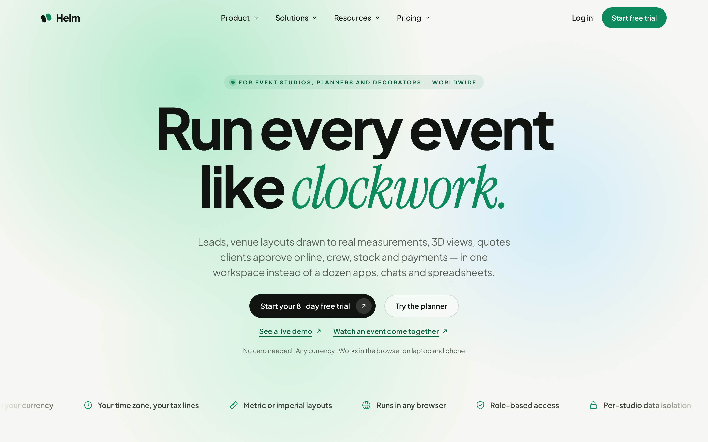
*Figure 1 — The Helm home page. "No card needed · Any currency · Works in the browser on laptop and phone."*

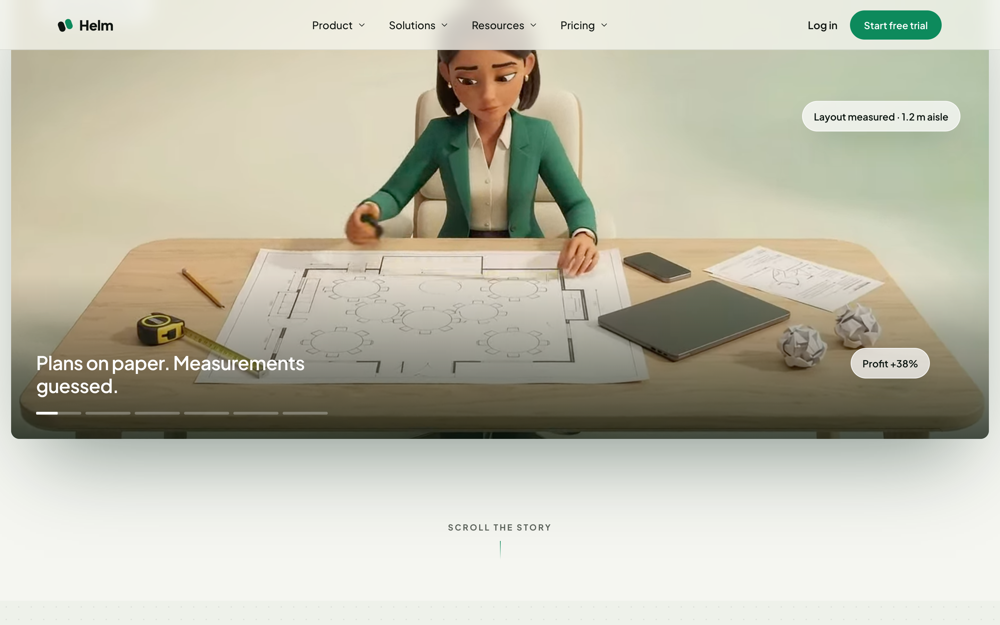
*Figure 2 — Scrolling the home page tells the story: from plans on paper and guessed measurements to a measured, priced layout. The footer links to Terms, Privacy and the other legal pages.*

### 1.2 Create your studio
1. Click **Start your 8-day free trial** (or **Log in → Start free trial**).
2. Fill in:
   - **Studio / business name** — optional. Leave it empty and Helm names it "Demo N"; rename it any time.
   - **Your name** — optional.
   - **Email** — required; you will confirm it.
   - **Password** — at least 12 characters with a lowercase letter, an uppercase letter, a number and a symbol. The checklist under the field ticks each rule as you type.
   - **Confirm password**.
3. Click **Start free trial →**.
4. Open the confirmation email and click the link. Then sign in.

Prefer Google? Use **Continue with Google** on the sign-in tab.

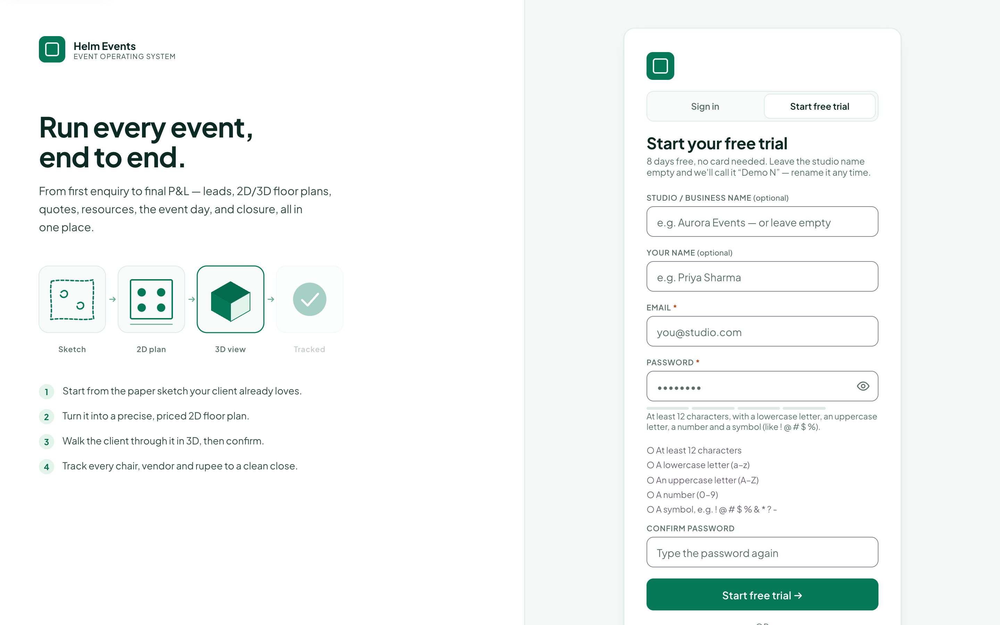
*Figure 3 — "Start your free trial": 8 days free, no card needed.*

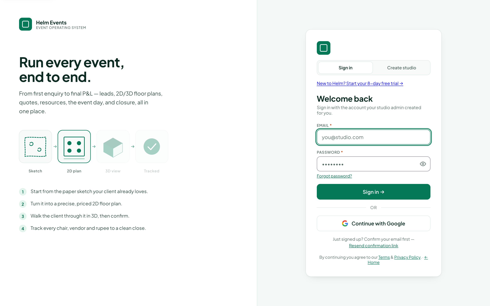
*Figure 4 — Sign in. "Forgot password?" sends a reset link. "Resend confirmation link" helps if the first email went to spam.*

### 1.3 Demo data versus your own data
Your trial studio opens **pre-filled with sample records marked *Demo*** (a few leads, quotes and an event) so every screen has something to explore. When you are ready:

- Keep exploring with demo data, **or**
- Choose **Start my own studio** (from the dashboard banner). Helm shows how many demo records of each kind will be cleared from *your trial studio only* and asks you to confirm. Your own records are never touched.

> **Tip.** Explore the demo quote in the builder first — it shows how a finished plan, quote and event look.

### 1.4 Look around before signing up
- **Live demo** — a read-only studio called *Marigold Events*. Every button only shows a "read-only" message.
- **Try the planner** — see [chapter 6](#6-the-2d--3d-builder).

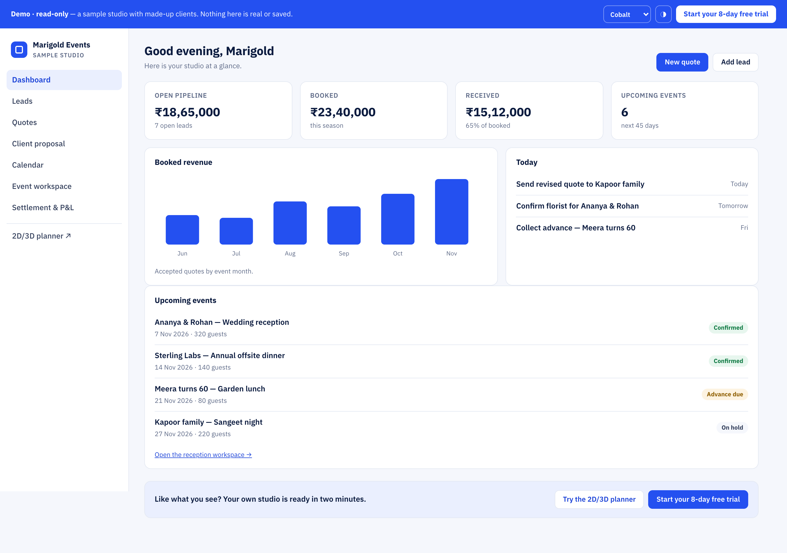
*Figure 5 — The live demo: open pipeline, booked, received, upcoming events, booked revenue chart and today's to-dos.*

---

## 2. Studio setup and onboarding

The **onboarding wizard** opens on your first sign-in. You can re-open any step later from **Control Center → Studio**. A **Getting started** checklist on the dashboard tracks your progress.

| Step | What you set | Why it matters |
|---|---|---|
| **1. Studio profile** | Studio name, contact phone and email, address, city. | Appears on proposals, booklets and invoices. |
| **2. Branding** | Logo upload, accent colour. | Your client-facing pages look like you. |
| **3. Country, currency and tax** | Country (sets the currency, e.g. ₹ INR or AED), tax lines (e.g. GST 18 %, UAE VAT 5 %), whether prices include tax, measurement units (metres or feet), time zone. | Every quote total and tax line is computed from this on the server. |
| **4. Price list** | Item rates (chairs, tables, stages, décor, lighting …) with specs. Use **Smart import** to upload an Excel/CSV price list — Helm maps the columns for you. | The builder prices every item you place. |
| **5. Packages** | Menu / service packages (e.g. *Silver*, *Gold*, *Platinum Wedding — 300 pax*). Six standard packages are provided to edit. | One-click quoting. |
| **6. Venues** | Venue name, address, usable length × width, access / load-in notes, contacts. | The builder draws the hall to scale. |
| **7. Roles and team** | Invite teammates by email and pick each person's role. | Everyone sees only their part. |

### 2.1 Roles you can give your team

| Role | Typical person | Sees by default |
|---|---|---|
| Admin | Studio owner | Everything (always). |
| Event manager | Senior planner | Everything except delete. |
| Planner | Designer / planner | Sales, quotes, builder, planning. |
| Sales | Enquiry handler | Leads and CRM. |
| Event coordinator, Supervisor, Quality engineer, Operations | On-ground leads | Operations areas, **no finances** unless you allow them. |
| Crew / Worker | Decorators, helpers | Only their own tasks. |
| Client | Your customer | Only links you send them. |

You can change exactly what each role sees in **Control Center → User control → Access matrix** (see [chapter 10](#10-administration)).

### 2.2 Directories you set once and reuse
- **Staff** — name, title, department, phone, day rate, skills (e.g. *photography*, *catering*).
- **Inventory** — item, category, total quantity owned, unit.
- **Vendors / partners** — rental companies, freelancers, caterers, florists, with services and contacts.
- **Templates** — reusable checklists (logistics, permits, comms) and task templates.

---

## 3. Dashboard tour

*Figure 6 — The dashboard (shown with demo studio data).*

| Element | What it does |
|---|---|
| **Greeting and today strip** | "Good evening, …" plus everything **due today**: follow-ups, payments due, tasks, events. |
| **Money cards** | **Open pipeline** (value of open leads/quotes), **Booked** (confirmed this season), **Received** (cash in, % of booked), **Upcoming events** (next 45 days). |
| **Booked revenue chart** | Accepted quotes by event month. |
| **Upcoming events** | Next events with status pills (*Confirmed*, *Advance due*, *On hold*). Click one to open its workspace. |
| **New quote / Add lead** | The two most common actions, always top-right. |
| **Customise** | Choose which cards you see and their order. Saved per user. |
| **Search (⌘K / Ctrl K)** | Find any lead, client, quote code, event, vendor or page. |
| **Bell** | Notifications (approvals, payments, task accepted/declined, mentions). Click to jump to the record. Mute noisy types in notification settings. |
| **Chat** | Team chat per studio or per event, with attachments, mentions and reactions. |
| **Privacy eye** | Hides all money figures — useful when sharing your screen with a client. |
| **Themes** | Light / dark (and accent themes). The demo shows a theme picker in the top bar. |
| **Tour** | Re-run the guided tour any time from the **?** menu. |

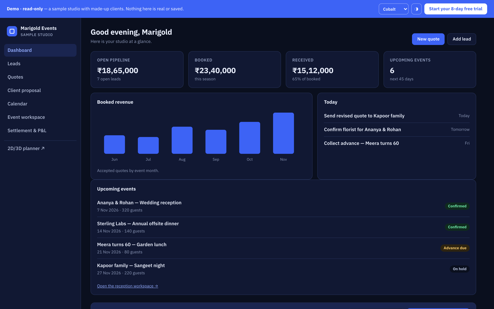
*Figure 7 — The same dashboard in dark mode.*

---

## 4. Leads, CRM and nurture

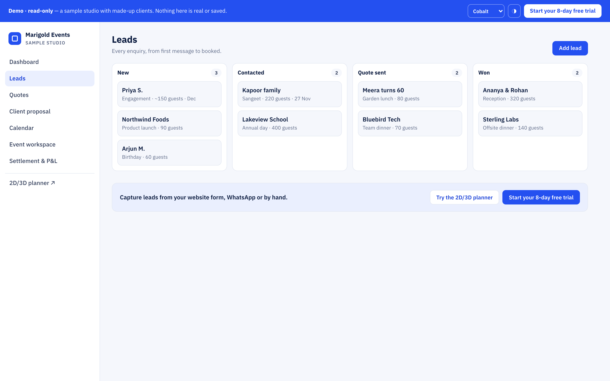
*Figure 8 — The leads pipeline: every enquiry with its stage, event date, guests and budget.*

### 4.1 Capture a lead
**Leads → + New lead.** Fill in contact name, phone, email, source (Instagram, referral, walk-in, website …), event type, event date, guest count, budget and notes. The lead lands in **New**.

### 4.2 Work the pipeline
- Move a lead through **New → Qualified → Discovery → Quoted → Won / Lost** (drag the card or use its menu).
- Set a **next follow-up** date — it appears in the dashboard's today strip.
- **Saved filters** remember views such as "Weddings this quarter".
- Every change is written to the **audit log** (who changed what, when).

### 4.3 Convert to a quote
Click **Convert →** on the lead. Helm creates the quote (= the event), gives it a code like `12152026-01` (event date + sequence) and opens its workspace. Contact details carry over.

### 4.4 CRM and Client 360
**CRM** keeps a history of every client: all their quotes, events, payments and messages on one **timeline**, with lifetime totals. Archived and lost leads are kept here, never deleted.

### 4.5 Nurture
**Nurture** remembers anniversaries, birthdays and repeat occasions. Add name, phone, occasion, occasion date and next follow-up. When it is due, a red **Due** flag appears. Click **Followed up** to push it a year ahead, or **→ Lead** to start a new enquiry.

---

## 5. Quote → proposal → client approval

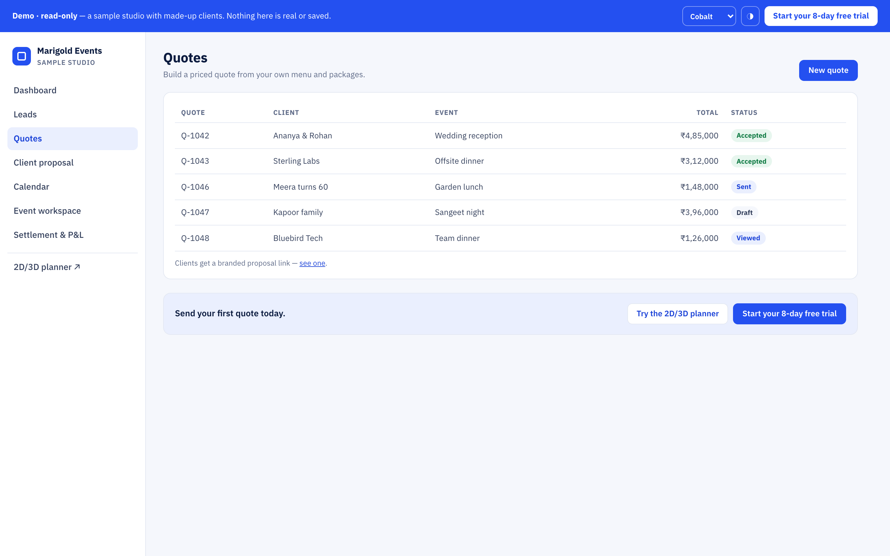
*Figure 9 — Quotes: each quote with its code, client, status and value.*

### 5.1 Build the quote
1. Open the quote from the event workspace (**Quote & pricing → Open this quote**) or **Quotes**.
2. Pick a **package** or add lines from your price list. Items placed in the builder are added and priced automatically.
3. Apply **discount** (fixed or %), **coupon** or a **cap** if needed.
4. Tax lines (e.g. GST 18 %) are calculated **after discount**, from your studio settings.
5. **Save version.** Every save is a new version; you can compare and restore.

> **Money is checked by the server.** Whatever the screen shows, the database recomputes the total from the lines, so a quote can never be saved with a wrong total.

### 5.2 Discovery and requirements
**Discovery & requirements → Open discovery**: meeting date and mode, who attended, budget range, notes, and a list of requirements (service, priority *Must-have / Nice-to-have*, quantity).

### 5.3 Proposal
**Proposal & mood board → Open proposal**: concept summary, theme, colour palette, reference images, scope ("what's included"), feasibility risks with mitigations. **Publish** creates a share link — the client needs no login.

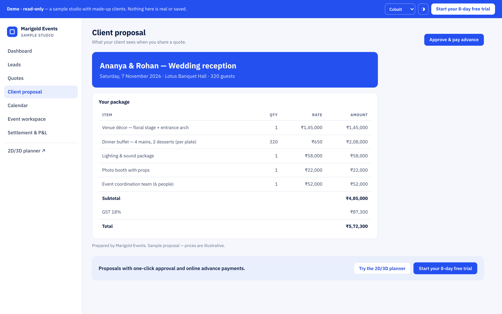
*Figure 10 — The client proposal: concept, palette, scope and price summary.*

### 5.4 Client approval
1. **Confirm** the quote version you want the client to approve.
2. **Send the approval link** (copy the link or share it by email; WhatsApp sharing switches on when the integration goes live).
3. The client opens the link, reads the scope and price, enters the **one-time code** sent to them, ticks consent, and approves.
4. The quote becomes **Confirmed** and that version is **locked**. If you later change the scope, Helm asks the client to **re-approve**.
5. Staff can also record an approval received offline from **Quotes → Manage**.

---

## 6. The 2D / 3D builder

The builder draws your venue to real measurements, prices every item you place, and lets the client walk through it in 3D.

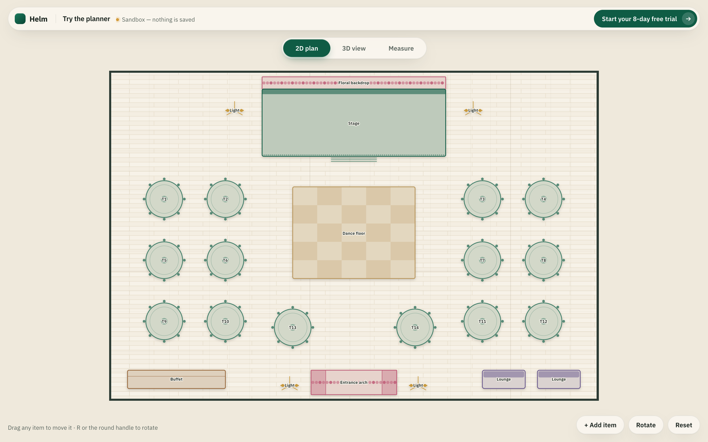
*Figure 11 — 2D plan: a wedding banquet with stage, round tables, dance floor, buffet, entrance arch and lounges.*

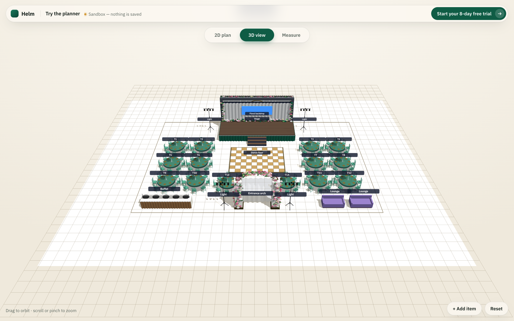
*Figure 12 — 3D view: drag to orbit, scroll or pinch to zoom.*

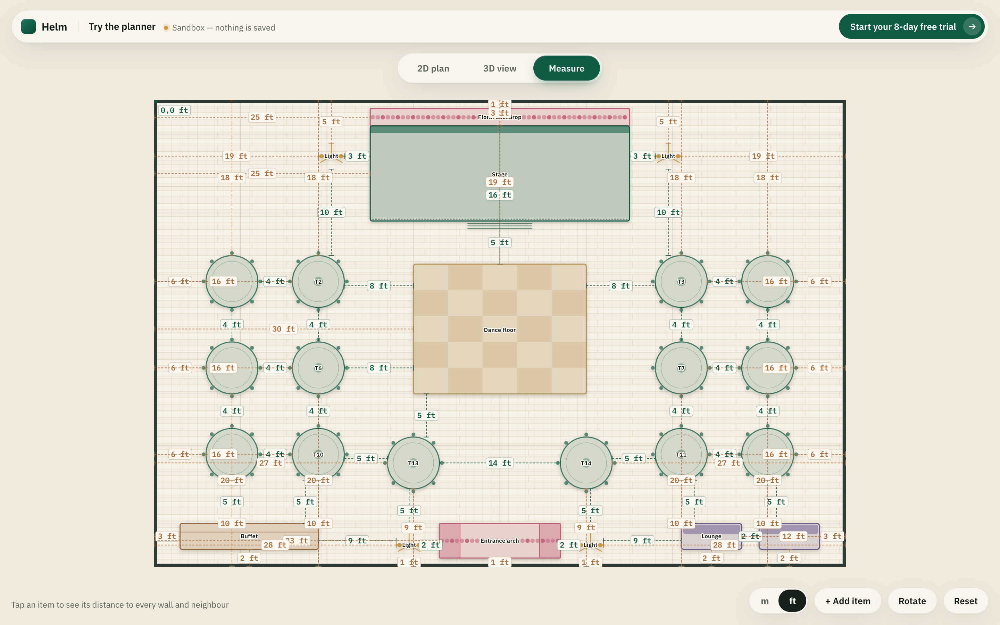
*Figure 13 — Measure mode (feet): tap any item to see its distance to every wall and to its neighbours.*

| Tool | How to use it |
|---|---|
| **Products / + Add item** | Open the catalogue: stages, seating, round and banquet tables, dance floors, buffets, bars, lounges, entrances and arches, backdrops, floral, lighting, sound, screens. |
| **Search** | Type "arch", "chiavari", "LED" to find an item fast. |
| **Move, rotate, resize** | Drag to move; rotate handle or **Rotate**; keyboard arrows nudge. |
| **Snap** | Items snap to the grid and align with neighbours. |
| **Measure (m / ft)** | Switch units with the **m / ft** toggle. Distances to walls and neighbours are shown. |
| **2D / 3D** | Toggle at the top. 3D shows true heights and colours. |
| **Full screen** | Distraction-free view for client meetings. |
| **Templates / layout wizard** | Start from a studio layout template or generate seating for a guest count. |
| **Versions** | Each save is a layout version linked to the quote version. |
| **Live pricing** | The running total updates as you place or remove items. |
| **Photo render** | Creates a realistic photo of the design. **Each render uses paid credits — only the studio owner should run renders.** |

> **Try it without an account:** the **Try the planner** sandbox (home page) opens a pre-made wedding banquet with 2D, 3D and Measure. Nothing is saved.

---

## 7. The event workspace

Every confirmed quote has a workspace: the lifecycle bar at the top and one card per job below it.

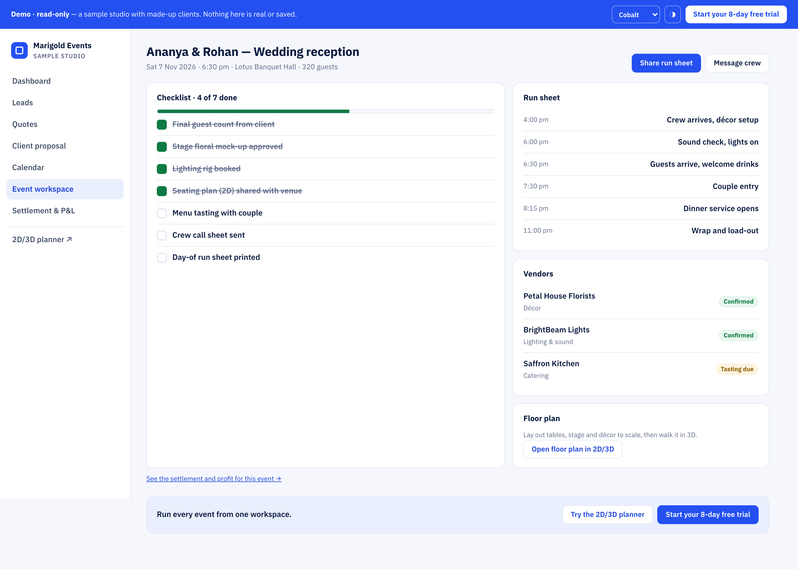
*Figure 14 — Event workspace (demo view): checklist, run sheet, vendors and floor plan for "Ananya & Rohan — Wedding reception".*

### 7.1 Plan and flow
- **Venue & menu** — venue name, contact, address, access and load-in notes; package and menu details, then **Lock**.
- **Plan** — the event plan (timings, zones, headcounts).
- **Flow** — the guided step-by-step flow of the event with the dish editor for menus.
- **Design studio** — décor concept and design stages.

### 7.2 Ops tasks and crew
**Tasks & crew → Open operations.**
1. Add tasks (or apply a **task template**), assign an owner, a due time, and dependencies ("Stage build" before "Lighting focus").
2. Set **alarms** for time-critical tasks.
3. Crew receive the task on their phone (**Work** page or task link). They tap **Accept** or **Decline** (with a reason). Declines notify the planner.
4. Crew mark tasks **Done** with photo **evidence**; a supervisor **verifies** or sends it back for rework.

### 7.3 Resource plan, inventory and reservations
- **Resource plan** — list needs (staff skill, inventory item, other). Helm checks in-house first and flags **gaps** (e.g. 40 tables needed, 30 owned).
- **Reserve stock** — item + quantity + note. Reservations are atomic, so two events cannot over-book the same chairs. Over-reserving shows a warning.
- **Checkout / return** — issue stock on the day; record returns, damaged or lost quantities (they come off your stock).

### 7.4 Vendors and bookings
For each gap: **+ Book a partner** → partner, which need it covers, cost, advance, status, contract. Booking marks the need *outsourced*. The **Calendar** shows staff, stock and vendors per date and highlights conflicts.

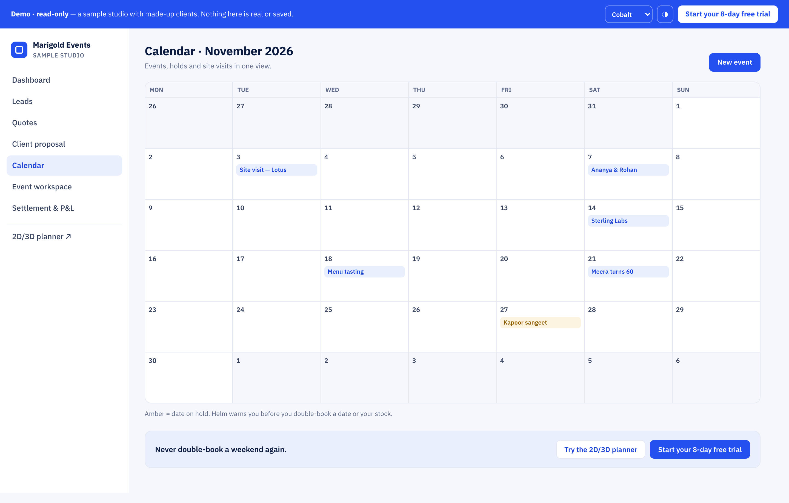
*Figure 15 — Calendar: events by date with status.*

### 7.5 Logistics
Tabs: **Guests** (groups and headcounts), **Logistics** checklist (apply a template), **Permits**, **Comms**, **Payments** (milestones — see chapter 8).

### 7.6 Run sheet
Start time, minutes, activity, owner, location for each segment (load-in, ceremony, dinner, wrap). Share it with crew and vendors.

### 7.7 Readiness gate
A checklist of critical checks (vendors confirmed, stock reserved, dry run, team briefed). When everything is green, click **Mark event ready →**.

### 7.8 Event-day command and issues
- **Arrivals & attendance** — **Pull team & vendors**, then tap *Arrived / Left / No-show*.
- **Setup & technical checks** — stage, sound check, lighting → *Done* or *Issue*.
- **Guest reception** — pull guest groups, count guests in.
- **Live stock requests** — "3 extension cords" → *Issued / Replaced*.
- **Issues & incidents** — log issue, severity, owner → **Resolve**. Safety incidents go in the *Incidents* tab.

### 7.9 Teardown and media
Return reserved stock, mark vendors exited, venue handover checklist. **Media & gallery**: add photos and videos; tick which ones the client sees.

---

## 8. Money

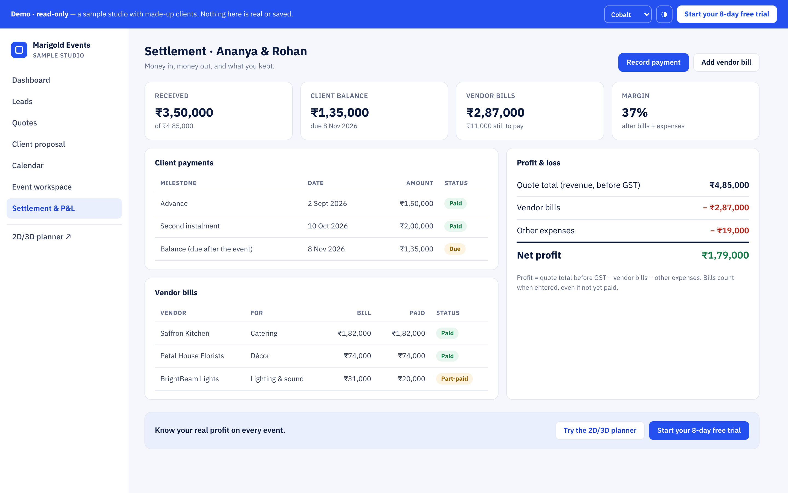
*Figure 16 — Settlement & P&L: received, client balance, vendor bills, margin, and the profit-and-loss card.*

### 8.1 Payment milestones and payments
Add milestones (e.g. *Advance 40 %*, *Second instalment*, *Balance*) with due dates and amounts. **Record payment** when money arrives (mode, reference, date). Helm refuses any payment that would take the total received above the confirmed amount plus approved changes.

### 8.2 Change orders
**Budget → + New change**: title, detail, amount charged to the client, extra cost. **Approve** — revenue and cost both update and the client's balance grows.

### 8.3 Settlement
- **Client invoice** — balance and payments received.
- **Vendor settlement** — settle each booked partner.
- **Staff expense claims** — who, for what, amount → *Approve* → *Mark paid*.
- **Refunds & recovery** — refund to client, recover from client (e.g. broken chairs), or deduct from deposit.

### 8.4 Vendor bills and payouts
**Add vendor bill**: vendor, what it is for, bill amount, bill date, reference. **Record payout** against it (part or full). Helm refuses payouts above the bill. A wrong bill is **voided with a reason** — never deleted — so your records stay complete.

### 8.5 Closure and P&L
**Closure & P&L**: revenue (before tax) − vendor bills − other expenses = **net profit** and margin %. Add client rating, feedback, a quotable testimonial (with marketing consent), lessons learned, and rate vendors and staff. Click **Mark event closed & archived**.

### 8.6 Business page, reports and insights
- **Business** — studio-wide P&L, vendor payables (what you still owe), cash received by month.
- **Reports** — exportable lists (events, payments, leads).
- **Insights** — conversion rate, average event value, profit by event type (figures shown ex-tax).

---

## 9. Client portal, booklet and invitation sites

| Client page | What the client sees |
|---|---|
| **Proposal view** | The concept, palette, scope and price. |
| **Approval page** | Scope, total, one-time code, consent, approve. |
| **Client booklet / portal** | The confirmed plan, images (including 2D/3D captures), change lines, payments made and due. Share with a link; links can expire automatically. |
| **Invitation site** (`/i/<your-event>`) | A public invitation website for confirmed events — 5 templates, event details, RSVP. |

All client links are token-scoped: a client sees only their own event, without an account.

---

## 10. Administration

### 10.1 Control Center
- **Studio** — profile, branding, currency/tax, units, venues, packages.
- **User control** — team list: invite, change role, remove.
- **Access matrix** — rows are roles, columns are areas (leads, quotes, finance, inventory …). A green tick = can view; ✎ = can edit. Admin always has full access.
- **Codes** — quote numbering.
- **Link windows** — how long client links stay valid.

### 10.2 Audit log
Who created, edited or deleted what and when — for leads, quotes, payments, tasks and settings. Filter by person, record or date.

### 10.3 Data export and deletion
Export your studio's data at any time. Data-deletion requests follow the published **Data deletion** policy.

---

## 11. Trial lifecycle and plans

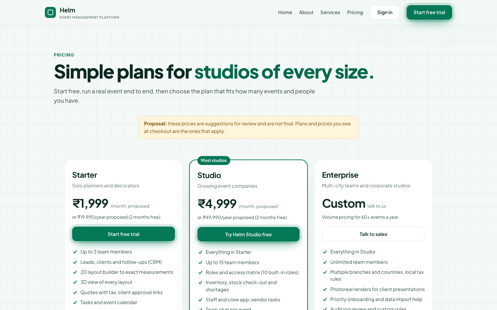
*Figure 17 — Plans (prices shown are proposed and may change before launch).*

| Day | What happens |
|---|---|
| Day 0 | Trial studio created with demo data; welcome email. |
| Days 1–8 | Full product. Switch to **Start my own studio** whenever you are ready. |
| Day 5 / 7 / 8 | Reminder emails and a dashboard banner showing days left. |
| After day 8 | Choose a plan to keep working. Your events, layouts and records stay with your studio when you move between plans. |

Plans: **Solo** (solo planners and decorators), **Studio** (most studios), **Enterprise** (multi-city and corporate teams).

---

## 12. FAQ and troubleshooting

| Question / problem | Answer |
|---|---|
| I did not get the confirmation email. | Check spam; use **Resend confirmation link** on the sign-in page. |
| My password is refused. | It needs 12+ characters, an uppercase and a lowercase letter, a number and a symbol. Repeated wrong attempts lock the account briefly. |
| A teammate cannot see a page. | Their role does not have that area. Admin → Control Center → Access matrix. |
| Operations staff can see prices. | Remove *finance* from their role in the access matrix. |
| The quote total differs from my calculator. | Tax is applied **after** discount; rounding is to whole currency units. The server total is the correct one. |
| "Payment exceeds amount due". | Payments cannot go above the confirmed total plus approved changes. Add a change order first. |
| Stock shows a shortage. | Another event on the same date has reserved it. See Calendar conflicts; book a vendor for the gap. |
| A client link has expired. | Re-issue it from the event (link windows in Control Center). |
| I entered a wrong vendor bill. | Void it with a reason and add the correct one. |
| I want to remove demo data. | Dashboard banner → **Start my own studio** (clears demo records in your trial studio only). |
| Screen sharing with a client shows my margins. | Click the **privacy eye** to hide money. |
| The 3D view is slow. | Close other tabs; use 2D for editing and 3D for presenting. |
| Photo render is unavailable. | It is an owner-controlled feature that uses paid credits. |

---

## 13. Worked example — "QA-E2E Sharma Wedding", lead to closure

A complete run you can repeat in a **test studio**. All names carry the `QA-E2E` prefix so test records are easy to find later. Currency ₹ (INR), GST 18 %.

### Step 1 — Lead
**Leads → + New lead**
| Field | Value |
|---|---|
| Contact name | `QA-E2E Priya Sharma` |
| Phone / Email | `+91 98765 43210` / `qa-e2e.sharma@example.test` |
| Source | Referral |
| Event type | Wedding |
| Event date | 15 Dec 2026 |
| Guests | 300 |
| Budget | ₹8,00,000 |
| Notes | Blush & gold, outdoor mandap |

Move it **New → Qualified**, then **Convert →**. Quote `12152026-01` is created.

### Step 2 — Discovery
Meeting 1 Oct 2026, in person; budget range ₹7,00,000–₹9,00,000. Requirements: Full décor & mandap (Must-have, 1) · Catering veg (Must-have, 300) · Photo booth (Nice-to-have, 1).

### Step 3 — Layout in the builder
Venue `QA-E2E Garden Lawns`, 120 ft × 80 ft. Place: stage 24 × 16 ft, mandap, 30 round tables × 10 seats, dance floor 20 × 20 ft, buffet line, entrance arch, 2 lounges, lighting. Check in **Measure (ft)** that every aisle is at least 5 ft. Save the layout.

### Step 4 — Quote
| Line | Amount |
|---|---|
| Décor, mandap & entrance (from builder) | ₹3,20,000 |
| Catering — veg, 300 pax (*Platinum Wedding* package) | ₹3,00,000 |
| Furniture, linen & lighting | ₹1,30,000 |
| **Subtotal** | **₹7,50,000** |
| Discount 4 % | − ₹30,000 |
| **Taxable value** | **₹7,20,000** |
| GST 18 % | ₹1,29,600 |
| **Quote total** | **₹8,49,600** |

Save the version.

### Step 5 — Proposal and approval
Concept "Timeless blush & gold garden wedding", palette `#F7D7D0 #E8C07D #FFFFFF`, scope list, risk "Outdoor rain risk — high — tent backup". **Publish**. **Confirm** the version and send the approval link. The client enters the one-time code (in a test studio, use the code from the test email), consents and approves → **Confirmed**.

### Step 6 — Milestones
| Milestone | Due | Amount |
|---|---|---|
| Advance 40 % | 5 Oct 2026 | ₹3,39,840 |
| Second instalment 30 % | 15 Nov 2026 | ₹2,54,880 |
| Balance 30 % | 10 Dec 2026 | ₹2,54,880 |
| **Total** | | **₹8,49,600** |

Record the advance ₹3,39,840 (bank transfer).

### Step 7 — Resources, stock and vendors
Reserve `QA-E2E Chiavari Chairs` × 300 and `QA-E2E Round Tables` × 30. Gap: tents and sound. Book partners:

| Vendor | Covers | Cost |
|---|---|---|
| `QA-E2E Shamiana Tents` | Tent backup | ₹1,20,000 |
| `QA-E2E Sound & Light Co` | DJ, sound | ₹45,000 |
| `QA-E2E Annapurna Caterers` | Catering | ₹2,10,000 |
| `QA-E2E Petal House Florists` | Fresh flowers | ₹90,000 |

### Step 8 — Tasks, run sheet, readiness
Tasks: *Tent erection* (Ops, 14 Dec), *Stage build* → *Lighting focus* (dependency), *Floral install* (15 Dec, 10:00). Crew accept on their phones. Run sheet: 16:00 load-in · 19:00 ceremony · 21:00 dinner & DJ · 23:30 wrap. Readiness: all green → **Mark event ready**.

### Step 9 — Change order
Client adds a photo booth: **+ New change** "Photo booth", charge ₹40,000 (+ GST ₹7,200), extra cost ₹15,000 → **Approve**. New client total: ₹8,49,600 + ₹47,200 = **₹8,96,800**.

### Step 10 — Event day
Pull team & vendors; mark arrivals. Setup checks done. Guests counted: 296. Live stock: 3 extension cords issued. Issue logged: "Late floral delivery — Medium" → resolved 17:10.

### Step 11 — Money in
Second instalment ₹2,54,880 (15 Nov) and balance ₹3,02,080 (₹2,54,880 + ₹47,200 change) received. **Received ₹8,96,800 · Balance ₹0.**

### Step 12 — Vendor bills, expenses and P&L
| Vendor bill | Bill | Paid |
|---|---|---|
| QA-E2E Shamiana Tents | ₹1,20,000 | ₹1,20,000 |
| QA-E2E Sound & Light Co | ₹45,000 | ₹45,000 |
| QA-E2E Annapurna Caterers | ₹2,10,000 | ₹2,10,000 |
| QA-E2E Petal House Florists | ₹90,000 | ₹90,000 |
| **Total vendor bills** | **₹4,65,000** | |

Other expenses: in-house wages ₹82,000 · transport & fuel ₹28,000 · staff claim (fuel + toll) ₹5,000 = **₹1,15,000**. (The photo booth's ₹15,000 cost is included in wages and transport above in this example.)

| Profit & loss | |
|---|---|
| Revenue before GST (₹7,20,000 + ₹40,000 change) | ₹7,60,000 |
| − Vendor bills | − ₹4,65,000 |
| − Other expenses | − ₹1,15,000 |
| **Net profit** | **₹1,80,000** |
| **Margin** | **23.7 %** |

GST collected (₹1,36,800) is shown separately and is not profit.

### Step 13 — Close
Recovery: 2 broken chairs, recover ₹2,000 from client → Approve → Done. Return stock (2 chairs written off). Feedback 5★, testimonial with consent, lessons learned "Order flowers a day early". Rate vendors. **Mark event closed & archived.** Nurture: `QA-E2E Priya Sharma`, 1st anniversary 15 Dec 2027, follow up 15 Nov 2027.

**Done.** The lifecycle bar is green from Lead to Closed, and the event's P&L feeds the Business page and Insights.

---

*Helm — run every event like clockwork.*
