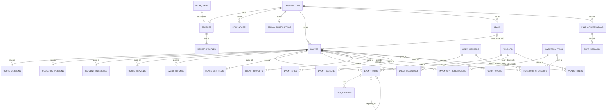

# Helm — Database

This document describes the Helm database **as it exists in the code today**. Everything here was checked against the repo. File paths are relative to the repo root.

- Base schema: `supabase/canonical-base/base-v1-2026-09-25.sql` (taken from prod on 2026-09-25, about 3,800 lines, 59 base tables)
- Forward migrations: `supabase/migrations/0001_…` to `0162_…`, applied in the order listed in `supabase/migrations/MANIFEST`. If an object is defined more than once, **the latest migration's definition is the one that counts.**
- Runner: `scripts/db-migrate.sh`
- DB tests: `supabase/tests/*.sql`, `supabase/test-harness/`, `scripts/db-test/`

---

## 1. Technology

| Item | What is used |
|---|---|
| Engine | PostgreSQL, hosted on **Supabase** (DB tests target PG17, see the header of `0003_money_integrity.sql`) |
| Auth | Supabase Auth (`auth.users`). App users are mirrored 1:1 in `public.profiles`. |
| Access control | Postgres **Row Level Security (RLS)** on every public table, plus `SECURITY DEFINER` RPC functions for anything sensitive |
| Files | Supabase Storage buckets. Only metadata rows live in Postgres. |
| Server logic | PL/pgSQL functions and triggers (pricing authority, money guards, tenant guards). Supabase Edge Functions are in `supabase/functions/`. |
| Extensions | `pgcrypto`, called as `extensions.crypt` / `gen_salt('bf')` / `gen_random_bytes` (see `0026_business_logic_crypto.sql`) |
| Environments | Prod (serves helm.events) and staging (serves helm-v01.vercel.app). These are separate Supabase projects. |

The browser calls Supabase directly using the **anon/public key** plus the user's JWT, so RLS is the main security boundary. Service-role keys are used only in edge functions and server code. This doc does not list key values; see the env var names in `docs/CANONICAL-DEPLOYMENT.md`.

---

## 2. Core concept: the studio and the event

- **Studio = `organizations` row.** Every business table has an `org_id uuid not null default current_org_id()` column with an FK to `organizations(id)`.
- **The quote IS the event.** One `quotes` row runs through the whole lifecycle: lead → discovery → proposal → quote → confirmed → planning → day-of → settlement → closure. Nearly every operational table hangs off `quote_id → quotes(id) on delete cascade`.
- **Users** come from `auth.users`, with a matching `profiles` row that holds `org_id` and `role`.

---

## 3. Main tables

Column types come from the base schema, plus columns added by later migrations where noted. "jsonb" columns hold structured documents that the app reads and writes as a whole.

### 3.1 Tenancy and identity

**`organizations`** (studio)
| Column | Type | Notes |
|---|---|---|
| id | uuid PK | `gen_random_uuid()` |
| name | text not null | |
| slug | text | used for pretty URLs (`0067_pretty_urls`, `org_slug_history`) |
| business_email | text | Reply-To for studio emails |
| currency | text not null | default `'INR'` |
| timezone | text not null | default `'Asia/Kolkata'` |
| gst_number | text | |
| brand | jsonb | logo and colours |
| plan | text | default `'free'` |
| location | text | |
| created_by | uuid FK → auth.users | |
| trial_mode | text | added in the trial migrations (0097/0116+) |

**`profiles`** (one row per login)
| Column | Type | Notes |
|---|---|---|
| id | uuid PK, FK → auth.users **on delete cascade** | |
| email, full_name | text | |
| role | text not null | default `'client'`. CHECK `profiles_role_check` allows: admin, manager, planner, sales, coordinator, supervisor, quality, operations, designer, crew, client |
| org_id | uuid FK → organizations | the source of `current_org_id()` |
| must_change_password | boolean | forced reset after a temporary password |

Related tables:
- `member_profiles`: PK user_id → profiles, cascade. Holds phone/WhatsApp, which have CHECK constraints for the `+91` format, plus emergency contact and avatar.
- `invitations`: team invites with a role CHECK.
- `platform_admins`: Helm HQ operators, keyed by lowercase email (`0029`).
- `studio_subscriptions`: PK org_id. Status is one of trial / active / past_due / suspended / cancelled (`0045`).
- `helm_plans` and `helm_plan_prices`.
- `role_access`: the RBAC matrix. One row per `(org_id, role, area)` with `can_view` and `can_edit`.

### 3.2 Sales: leads → quotes

**`leads`**: id uuid PK; name text not null; phone, email, source, event_type text; event_date date; budget numeric; guest_count integer (range check in `0149`); notes; status text (new / qualified / discovery / quoted / won / lost …); `quote_id` FK → quotes **on delete set null**; owner uuid default `auth.uid()`; created_at/updated_at; org_id. Later migrations added `birthday` and `anniversary` (`0105`). `lead_archive` keeps restorable copies (`0139`).

**`quotes`** (the event)
| Column | Type | Notes |
|---|---|---|
| id | uuid PK | |
| code | text not null | human-readable quote code, unique per studio (phase28/0090 numbering) |
| title | text | default `'Untitled event'` |
| event_type | text | |
| status | text | CHECK: quote / confirmed / cancelled |
| lifecycle_stage | text | CHECK `quotes_lifecycle_chk` (lead, discovery, proposal, quote, confirmed, …) |
| client | jsonb | client name, contact, venue |
| pricing | jsonb | pricing inputs. **The server recomputes the totals** (D8 pricing authority, `0001`, phase99). |
| current_version | integer | points to `quote_versions.version_no` |
| approval_token | uuid | client approval link token |
| approval_token_expires_at / _revoked_at | timestamptz | link windows (`0022`) |
| approval_status | text | CHECK: none / sent / approved / paid / cancelled … |
| confirmed_at, confirmed_by | timestamptz, uuid | |
| manager_id | uuid | assigned manager |
| event_date | date | |
| event_time | text | |
| currency, tax_snapshot | text, jsonb | added in `0089`–`0094`, filled in by `0091` |
| deleted_at | timestamptz | soft-delete "shelf" (`0042`). Hard delete is only allowed once the row is shelved. |
| is_demo | boolean | marks trial/demo sample rows (`0097`) |

Other tables on the quote:
- `quote_versions`: floor-plan builder data, `data jsonb {"items": []}`, plus version_no and object_count.
- `quotation_versions`: snapshots of the quotation document.
- `change_requests`.
- `event_discovery`, `event_requirements`, `event_proposal`, `proposal_risks`.
- `package_selections`, `menu_templates`, `event_menu_items`.

### 3.3 Money

| Table | Purpose | Key columns |
|---|---|---|
| `payment_milestones` | payment schedule (advance, balance …) | quote_id (not null), label, due_date, amount numeric, status (due / invoiced / paid / waived …), paid_at, seq |
| `quote_payments` | **the cash ledger**: what was actually received | quote_id, provider (default `'razorpay'`), amount numeric (>0, `quote_payments_amount_pos`), currency, status (created / paid …), method, receipt_no, provider_ref, `simulated` boolean, `idempotency_key` |
| `event_refunds` | refunds and credits | kind, amount, status (pending / approved / processed / rejected) |
| `event_costs`, `expense_claims` | costs and staff claims | |
| `vendor_bills` | bills from vendors (`0124`) | amount (CHECK > 0), status open/void (a void needs a reason), FK to vendors / event_resources / event_files |
| `vendor_payouts`, `payment_reconciliation`, `subscription_payments` | payouts, recon, Helm subscription billing | |

Money rules enforced in the database:
- **Ledger only.** "Total paid" means paid `quote_payments` rows only (`helm_total_paid`, `0003`).
- **No overpayment.** The `enforce_no_overpayment` trigger runs on `quote_payments` and `payment_milestones`. It takes a per-quote advisory lock plus `FOR UPDATE` on the quote, so concurrent payments are serialized and the second one fails with error 23514. Change lines count toward the cap (`0110`).
- **Frozen after confirmation.** Money can't be edited once frozen (`0046_d6_money_freeze`).
- **Server pricing authority.** The client cannot set totals (`0001`, phase98/99 revoke anon `set_pricing`).
- **Settlement and closure gates.** These read from the ledger (`0010`, `0148`).

### 3.4 Planning and operations

| Table | Purpose |
|---|---|
| `event_tasks` | crew tasks: status CHECK (unassigned / assigned / accepted / rejected / …); verification fields (verify_status, verified_by/at); planned_start/end; `depends_on` → event_tasks; `crew_id` → crew_members; `vendor_id` → vendors; reminders |
| `task_evidence`, `task_evidence_grants` | photo/voice proof from workers (path and duration checks) |
| `run_sheet_items`, `event_plan`, `event_checklist`, `event_day`, `event_issues`, `event_reminders` | run sheet, plan, day-of operations |
| `crew_members` | studio crew: name and phone are not null; skills jsonb; day_rate |
| `work_tokens` | per-crew magic-link tokens (token uuid PK, quote_id, phone) |
| `vendors`, `event_resources` | vendor directory and bookings (status: enquiry / booked / confirmed / delivered …) |
| `inventory_items`, `inventory_reservations`, `inventory_checkouts`, `event_stock_requests`, `inv_shortage_alerts` | stock: reservations are atomic (`0071`); over-issuing is blocked (`0015`); item names are unique (`0073`) |
| `event_resource_needs` | needs per event; `item_id` → inventory_items set null |
| `layouts`, `layout_rules`, `studio_layout_templates`, `chair_types`, `plate_types`, `dish_catalog`, `venues`, `item_rate_cards` | builder and catalog data |
| `design_stages` | designer workflow (`0008`) |
| `event_guests`, `event_attendees`, `event_media`, `event_files` | guests and media |

### 3.5 Client-facing

- `client_booklets`: the shareable booklet. Has its own `token` uuid, `expires_at` (default now+30 days), `revoked_at`, and length checks.
- `client_booklet_images`: mime and size checks, max 1.5 MB, 2d/3d.
- `quote_otps` and `quote_consents`: client approval by OTP. **OTP codes are stored only as bcrypt hashes** (`code_hash`, `0026`).
- `event_sites`: public invitation sites. Has slug and status draft/published.
- `client_link_issued` / `client_link_opens`, `org_link_autoexpire`, `org_link_expiry_shelf`: link lifecycle (`0039`, `0040`).
- `event_closure`: rating, feedback, testimonial, media consent.
- `event_ratings`.

### 3.6 Communication, notifications, audit

- **Chat:** `chat_conversations` (dm / group / broadcast, `dm_key` dedupe), `chat_messages` (kind text / image / voice / system, soft `deleted`), `chat_members`, `chat_reactions`, `chat_prefs` (`0016`–`0018`).
- **Notifications:** `notifications`, `notification_seen`, `notification_prefs`, `notification_mutes`.
- **Outbox tables:** `comms_outbox`, `invite_email_outbox`, `welcome_email_outbox`, `assign_notify_outbox`, `security_alert_outbox`, `pkg_outbox`. Edge functions drain these.
- **WhatsApp:** `org_whatsapp_accounts`, `member_wa_optin`, `whatsapp_opt_outs`, `wa_proposal_optins` / `_audit`, `messaging_rate`.
- **Audit and security:** `audit_log` (actor, action, entity, entity_id, quote_id, `changed` jsonb, at), `security_alert_events`, `auth_rate_hits`, `auth_password_attempts`, `auth_mfa_attempts`, `privacy_pin` (bcrypt `pin_hash`, `0157`), `upload_scans`, `storage_upload_log`.
- **Config:** `app_config`, `comms_settings`, `helm_env_settings`, `helm_hq_settings`, `helm_billing_settings`, `tax_rules`, `custom_field_defs`, `import_mappings`, `saved_views`, `user_dashboard_prefs`.
- **Migration ledger:** `helm_schema_migrations`. RLS is on and all access is revoked from anon and authenticated (`0014`).

---

## 4. Relationships (ER diagram)

The diagram shows the core tables only. Almost every table also has `org_id → organizations`, which is omitted here so the diagram stays readable.



Delete behaviour, in plain words:
- Deleting a quote cascades to its child rows. In practice quotes are **soft-deleted** first (`deleted_at`), and RLS only allows a hard delete of a shelved quote, by a user who passes `can_delete()`.
- Deleting a vendor or inventory item sets the references on bookings and needs to null, so event history is kept.
- `studio_subscriptions → organizations` is `on delete restrict`, so a studio with a subscription can't be dropped by accident.

Base FK count is 147. Later migrations add more.

---

## 5. Constraints and validation

The database does not trust the browser. Validation runs in three layers:

1. **CHECK constraints.** The base and migrations together define many: status enums for every workflow table, role lists, phone regex (`^\+91[6-9][0-9]{9}$`), text length caps, JSON shape (`jsonb_typeof(...)='object'` plus `pg_column_size` limits), money ranges (`amount > 0 and < 1e12`), URL patterns (`venues_map_url_ck` requires `https://`), mime/size limits on images. Wave 16 (`0142`, `0149`) added currency, tax and length checks. Some constraints were added `not valid` so they apply to new writes without failing on legacy rows.
2. **Triggers.**
   - `zz_quote_org_match` (`0004`, catch-up in `0136`) rejects any row whose `org_id` differs from its parent quote's org_id. This blocks cross-tenant "planting".
   - The overpayment guard and money freeze (§3.3).
   - Inventory over-issue guard (`0015`).
   - `set_updated_at` touch triggers. See `docs/FILL-ONLY-MIGRATIONS.md` for the rule on backfills.
3. **RPC guards.** `SECURITY DEFINER` functions check role, area and org before writing (`0007`, `0011`, `0024_injection_guards`, `0025_write_path_lockdown`).

Uniqueness: quote codes are unique per studio, and many other uniques were re-scoped to `(org_id, …)` in the phase59 multitenant fix. Inventory names are unique (`0073`). Slugs are unique, with `org_slug_history` keeping old ones.

---

## 6. Indexes

- The base defines **116 indexes**, and migrations add more with `create index if not exists`.
- Pattern: every tenant table has `<table>_org_idx (org_id)` because RLS filters on it. FK and lookup columns are indexed, e.g. `(quote_id, created_at)`. Audit tables have time-ordered indexes such as `audit_at_idx (at desc)` and `audit_quote_idx (quote_id, at desc) where quote_id is not null`.
- Partial indexes are used where a column is mostly null. `0080_notif_catalog_speed` and `0061_studio_search` add indexes for performance.

Assumption: no index review has been done against prod query plans since `0080`. A `pg_stat_statements` check after launch is recommended.

---

## 7. Ownership and authorization

| Concept | How it works | Where |
|---|---|---|
| Tenant | `current_org_id()` returns `profiles.org_id` for `auth.uid()`. It is a `SECURITY DEFINER` function with a pinned `search_path`. | base §1. Latest redefinition is in `0126_trial_staff_and_expiry.sql`. |
| Role | `user_role()` returns `profiles.role` | base |
| Area permission | `has_area(area, 'view'\|'edit')`: admin always gets true. Every other role reads `role_access` for its own org. | base, latest version in `0154_final_fixes.sql` |
| Coarse helpers | `can_edit()`, `can_view_finance()`, `can_create()`, `can_delete()`, `mfa_ok()` | base, `0042`, `0043` |
| Platform (HQ) | `platform_admins` plus an operator check (`0029`, `0037`). HQ MFA is optional (`0047`). | |
| Row owner | `created_by` / `owner` default to `auth.uid()` for traceability. Access is still decided by org plus area, not by owner. | |

Roles can't escalate their own privileges: `0021_profiles_privilege_lockdown` stops users changing their own `role` or `org_id`.

---

## 8. RLS approach

- RLS is **enabled on every public table**: 59 in the base, and every new table in later migrations enables it in the same file.
- The standard policy shape (from the base) is:
  ```sql
  using  (has_area('<area>','view') and org_id = (select current_org_id()))
  with check (has_area('<area>','edit') and org_id = (select current_org_id()))
  ```
  Wrapping the call in `(select current_org_id())` means it is evaluated once per query, not once per row.
- **Restrictive policies** are layered on top for extra gates. For example, `0042` adds "quotes insert can_create" and "quotes delete from shelf" as `as restrictive`.
- **Public (anon) access never reads tables directly.** Client portal, booklet, approval/OTP, invitation site and crew work-link all go through definer RPCs (e.g. `public_get_portal`, `public_get_proposal`) that check the token, its expiry and revocation, and the matching org (`0004`, `0012`, `0022`).
- **Least privilege.** `0005` and `0014` revoke default grants. Internal tables such as `helm_schema_migrations` grant nothing to anon or authenticated. EXECUTE on sensitive functions is revoked from `anon` (e.g. phase98).
- **Storage.** Buckets include `chat-media`, `invite-media`, `member-avatars`, `booklet-snapshots`, `helm-manual` and `upload-quarantine`, plus event-file and evidence buckets. They are private by default, with org-scoped object policies (`0013`, `0031`). Uploads go through quarantine and scanning first (`0048`, `0051`). `invite-media` is readable only for published sites (`0019`).
- **Tests.** `supabase/tests/40-ledger-rls.sql` and `60-tenant-rbac.sql` prove cross-tenant isolation. `docs/DB-TEST-SUITE.md` and `docs/OPERATOR-VERIFY-DEFINER-FUNCTIONS.md` describe the checks.

Decision needed: the restrictive `mfa_gate` policy on every table is designed but deliberately not applied. A comment in the migrations says it needs a table-by-table staging rollout. The owner should decide whether to do that rollout.

---

## 9. Sensitive-data handling

| Data | Handling |
|---|---|
| Passwords | Supabase Auth only, never in public tables. Temporary passwords force `must_change_password`. Lockout and rate tables are `auth_password_attempts` and `auth_rate_hits` (`0050`, `0053`). |
| OTP codes | Stored as bcrypt `code_hash` with a 10-minute expiry. Per-phone and per-quote advisory locks plus lockout guard against brute force (`0012`, `0026`). |
| Privacy PIN | `privacy_pin.pin_hash` (bcrypt). NULL means the default PIN. |
| Tokens (approval, booklet, work link) | Random uuids with expiry and revoke columns. Read only through definer RPCs. |
| Client PII (name, phone, email, venue) | Lives in `leads` and `quotes.client` jsonb, inside the org boundary. Org data export and GDPR export are available (phase85). Data protection is covered in `docs/DATA-PROTECTION-REVIEW.md`. |
| Staff PII | `member_profiles` (phone, emergency contact): own row plus admin. |
| Payment data | No card data is ever stored. Only amounts, method, receipt numbers, and the provider reference. Razorpay is switched off, and `quote_payments.simulated` defaults to true. |
| Integration secrets | Never in tables. Kept as Supabase or Vercel secrets, listed by name only in `docs/INTEGRATIONS-WHATSAPP-RAZORPAY.md`. |
| Audit | `audit_log` records who changed what (`changed` jsonb). Coverage widened in `0135`. |

Assumption: there is no column-level encryption of client PII at rest beyond Supabase's disk encryption.

Decision needed: a retention period for leads, audit_log and outbox rows. No purge job exists today.

---

## 10. Migration strategy

**Rules** (from `MANIFEST`, `scripts/db-migrate.sh` and the zero-data-loss guardrail):
- **Forward-only and numbered.** `NNNN_name.sql` in `supabase/migrations/`. An applied file is never edited. If a recorded file's sha256 changes, the runner reports drift, and the fix is a new migration.
- **Additive and idempotent.** Use `create … if not exists`, `add column if not exists`, `create or replace function`, `drop policy if exists` followed by `create policy`, and constraints wrapped in `if not exists … end if`. Every file must be safe to re-run.
- **No destructive data changes.** Fill-only backfills must not bump `updated_at` (`docs/FILL-ONLY-MIGRATIONS.md`). Never use `disable trigger all` or `session_replication_role`.
- **The base snapshot is applied only on a fresh DB.** `scripts/check-base-immutable.mjs` keeps it unchanged, and `scripts/check-migration-canon.mjs` checks that the manifest and migration files match.
- **Ledger.** `public.helm_schema_migrations(filename, sha256, applied_at)`.

**Two ways to apply:**
1. `scripts/db-migrate.sh --plan`, then `--apply`, then `--verify`. It connects using the `HELM_DB_URL` or `PG*` env vars.
2. **Paste into the Supabase SQL editor** using the `supabase/APPLY-NNNN.sql` and `APPLY-NNNN-MMMM.sql` bundles, or `APPLY-PENDING.sql` / `APPLY-ALL-PENDING.sql`, each with a matching `VERIFY-NNNN.sql`. Pastes must not use temp tables or session state, and each statement should be validated.

**Order:** **staging first, then prod**, in manifest order. Run `PRODUCTION-PRECHECK.sql` before prod bundles. Confirm with the VERIFY file on both environments. `0162_launch_bypass_off` is the latest migration.

Legacy files are kept for history only and must **not** be run: `supabase/phase*.sql`, `full-schema/complete-setup.sql` (deprecated), `setup-all.sql`, and the `wave*/` folders. Running them could overwrite newer function bodies.

Decision needed: which migrations are applied on prod versus staging right now. Check this by running `--verify` or the VERIFY files on each project. This doc does not record live state.

---

## 11. Seed strategy

- **There is no bulk seed in migrations for real studios.** Per-studio defaults are created on onboarding (phase58, `0056_onboarding_checkout`). Role matrix defaults come from phase29 and `0143`. `0044` reverted a matrix seed that overwrote studio edits. Fill-only seeds are used for things like nurture templates (`0105`, `0107`) and item rate cards (`0086`).
- **Demo and trial data** comes from RPCs `seed_demo_data` / `reset_demo_data` / `_demo_seed_for(country)`, with IN and UAE variants (`0097`, `0100`, `0102`, `0116`–`0128`). These touch **only the caller's own `is_demo` rows**. Demo contacts are never messaged or charged.
- **Test fixtures** are in `supabase/tests/00-fixtures.sql`, `supabase/test-harness/10-fixtures.sql` and `supabase/seed-users.sql`. These are for local and staging use only. Assumption: `seed-users.sql` and `otp-dev-pin.sql` must never run on prod.

---

## 12. Backup and recovery

Full detail is in `docs/DISASTER-RECOVERY-RUNBOOK.md`. Summary:
- **Targets** (recommended, to be confirmed by the owner): Postgres RPO ≤ 5 min via **PITR**, RTO ≤ 2 h. The money ledger is why PITR is needed rather than daily snapshots alone.
- **There are five separate recovery domains.** The Postgres backup does **not** contain Storage file bytes (only their metadata rows), edge function secrets, or Vercel config. Each needs its own backup.
- **Restore procedure:** always restore into a **new** project and validate there first (table count, a known fixture row, RLS policies present). Only then repoint the app via `config.js` / Vercel env. **Never restore over live prod.**
- A **restore drill** against a throwaway project is described in §5 of the runbook. Staging (`helm-staging`) was built from a read-only prod schema extraction plus `HELM-STAGING-SCHEMA.sql` / `HELM-STAGING-VERIFY.sql`.

Decision needed: confirm PITR is enabled on the prod Supabase plan and choose its retention window. Choose an independent backup for Storage objects. Schedule the first restore drill.

---

## 13. Quick reference: where to look

| Question | File |
|---|---|
| Latest definition of a function or policy | `grep -l "function public.<name>" supabase/migrations/*` and take the highest number |
| Apply order | `supabase/migrations/MANIFEST` |
| Money guards | `0003`, `0026`, `0046`, `0110` |
| Tenant guards | `0004`, `0136`, phase56–60, phase70–74 |
| RBAC | phase29, `0006`, `0011`, `0143`, `0144`, `0152`, `0154` |
| DB tests | `supabase/tests/run-db-tests.sh`, `docs/DB-TEST-SUITE.md` |
